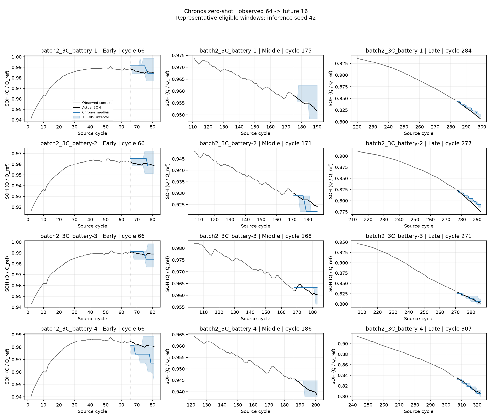
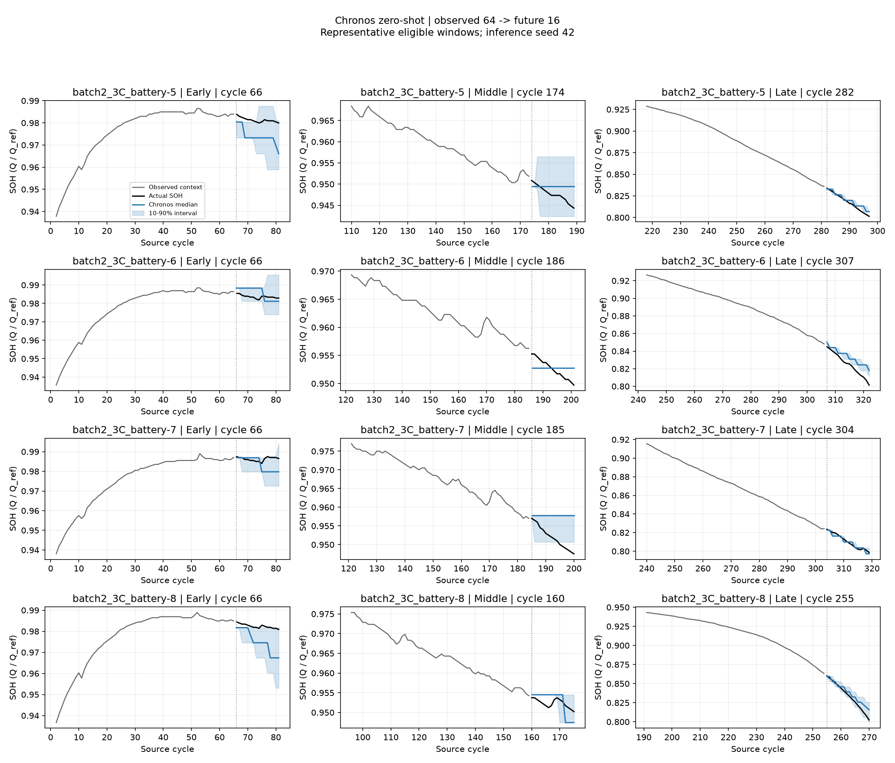
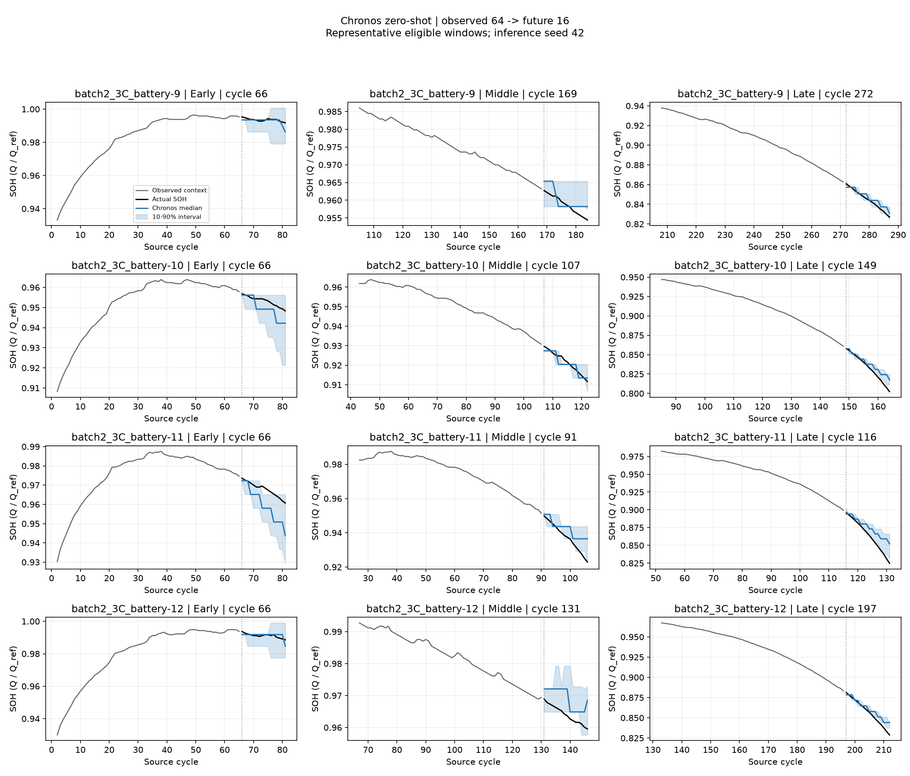
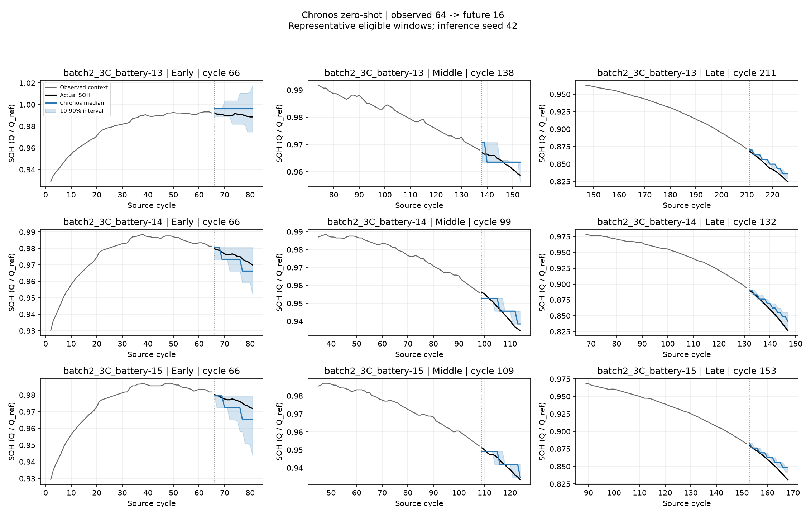

# 공통 SOH 데이터의 Chronos zero-shot

실행: `20261006T030722Z_batteryzeroshot_fecc95`. 평가 범위: **smoke**.

배터리 기록 15개, 평가 window 45개. 평가 가능한 전체 window는 2,542개이며 window가 없는 기록 0개는 제외했다.

실제 과거 64 cycle로 다음 16 cycle을 예측한다. 모델 `amazon/chronos-t5-base`의 revision을 고정했고 100 samples, 추론 seed [42, 43, 44]를 사용한다. 가중치를 학습하거나 정규화 기준을 다시 계산하지 않는다.

**일부 window만 실행한 결과다. 전체 수명 성능으로 해석하거나 full 평가와 점수를 직접 비교하지 않는다.** window 제한은 예측값이나 target 오차 대신 window 위치로 결정한다.

| 모델 | 집계 | RMSE ↓ | MAE ↓ | R² ↑ | CRPS ↓ | 80% 포함률 | 구간 폭 |
|---|---|---:|---:|---:|---:|---:|---:|
| Chronos | mean | 0.006138 | 0.004020 | 0.983713 | 0.002948 | 0.529167 | 0.008803 |
| Chronos | median | 0.005409 | 0.004187 | 0.989986 | 0.002948 | 0.529167 | 0.008803 |
| LastValue | point | 0.016377 | 0.010747 | 0.908846 | — | — | — |
| Linear | point | 0.018261 | 0.015057 | 0.878490 | — | — | — |

R²는 배터리·seed별 전체 window/horizon을 펼쳐 `1 - SSE/SST`로 계산한다. 음수도 유지하고 상수 target은 NaN으로 둔다. seed 점수를 평균하고 배터리 기록마다 같은 가중치를 준다. MIT의 연속 측정 기록은 별도 기록이며 이 요약을 독립 물리 배터리 개수로 해석하지 않는다.

LastValue는 마지막 관측을 유지하고 Linear는 context의 최소제곱 직선을 연장한다. 단순 기준 모델도 Chronos와 같은 target과 window에서 평가한다. 점예측 기준 모델의 확률 구간·CRPS는 계산하지 않는다.

원시 samples를 보존하며 clipping하지 않는다. 중앙값·평균 예측을 함께 평가한다. 초기 시험·이상치·부분 방전·수집 문제는 공통 로더 규칙대로 제외하고 cycle 간격이나 segment 경계를 건너 연결하지 않는다.

[배터리별 결과](battery_summary.csv) · [단순 기준과 비교](paired_comparison.csv) · [평가·제외 기록](coverage.csv) · [horizon별](horizon_metrics.csv) · [window별](window_metrics.csv)

그림은 첫 번째 추론 seed의 첫·중간·마지막 평가 window다. 겹치는 window는 독립 표본이 아니고 seed별 표준편차는 데이터 표본의 신뢰구간이 아니다. 원시 예측 NPZ는 로컬에 저장하고 Git에서는 제외한다.

