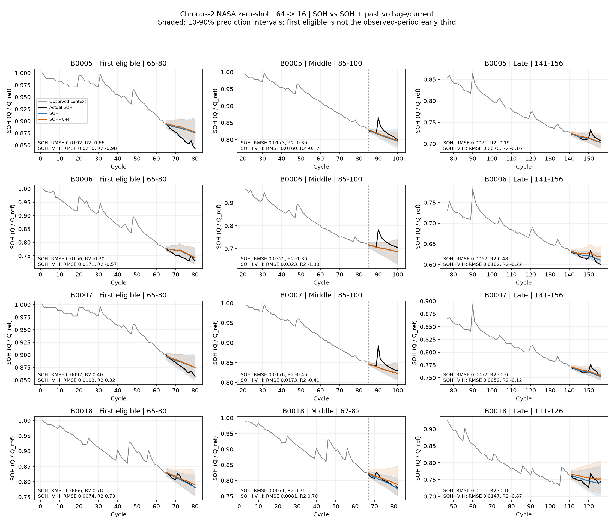

# NASA: Chronos-2에 과거 전압·전류 추가

NASA 네 배터리의 동일한 320개 rolling window에서 비교했다. 과거 64 cycle로 다음 16 cycle의 SOH를 예측하며 stride는 1이다. 모델 추가 학습은 하지 않았다.

전압·전류는 각 방전 시작 후 0~600초의 시간 가중 평균이다. 600초 경계의 값을 선형 보간해 적분하며, 방전 전체 길이·전류 적분 capacity는 특징에 사용하지 않았다. 과거 cycle의 측정값만 past_covariates로 입력하고 미래 센서값은 입력하지 않았다.

단위는 전압 V, 전류 A다. 원래 부호를 유지하고 외부 정규화·클리핑·평활화는 하지 않았다. C2의 내부 정규화와 group attention을 사용하며 서로 다른 예측창 사이의 cross_learning은 껐다.

| 입력 | RMSE ↓ | 평균 window R² ↑ | WQL ↓ | PICP@80 | RMSE 변화 |
|---|---:|---:|---:|---:|---:|
| SOH | 0.015708 | -0.6031 | 0.012139 | 80.1% | +0.00% |
| SOH+V | 0.015877 | -0.6485 | 0.012299 | 80.3% | +1.08% |
| SOH+I | 0.015120 | -0.5326 | 0.011662 | 81.0% | -3.74% |
| SOH+V+I | 0.015108 | -0.5420 | 0.011740 | 81.4% | -3.82% |

## 배터리별 SOH 대비 전압·전류 추가

| 배터리 | SOH RMSE | SOH+V+I RMSE | 변화 | SOH R² | SOH+V+I R² |
|---|---:|---:|---:|---:|---:|
| B0005 | 0.013797 | 0.013508 | -2.10% | -0.5970 | -0.5578 |
| B0006 | 0.017010 | 0.017184 | +1.02% | -0.2728 | -0.3552 |
| B0007 | 0.011293 | 0.011375 | +0.72% | -0.4097 | -0.4889 |
| B0018 | 0.020731 | 0.018365 | -11.41% | -1.1327 | -0.7660 |

## 특징 범위

| 배터리 | 평균 전압 범위 (V) | 평균 전류 범위 (A) |
|---|---:|---:|
| B0005 | 3.761032~3.873841 | -1.965280~-1.923861 |
| B0006 | 3.650500~3.876761 | -1.963397~-1.921611 |
| B0007 | 3.794904~3.881678 | -1.942678~-1.902207 |
| B0018 | 3.771089~3.856549 | -1.960640~-1.951810 |

전압·전류 동시 추가의 전체 RMSE 변화는 -3.82%다. 이는 이 두 특징과 현재 문맥 길이에 대한 결과이며, 모든 다변량 입력의 효과나 배터리 물리 관계를 학습했다는 증거로 일반화하지 않는다.

R²는 각 16-cycle 예측창에서 표준 1−SSE/SST로 계산한 뒤 배터리 안에서 단순 평균하고 네 배터리를 동일 가중 평균한다. 다른 지표도 배터리별 계산 후 동일 가중 평균한다. 중·후반은 기존 관측 cycle 범위의 1/3 구분을 유지한다. NASA 초반 1/3에는 64개 과거 관측을 확보한 창이 없으므로 점수는 없다. 그림의 첫 유효 창은 cycle 65~80이다.

변수 선택은 결과를 보기 전에 고정했다. 겹치는 rolling window를 독립 표본으로 취급하는 유의성 검정은 하지 않았다. SOH-only 재실행 결과는 기존 저장된 네 배터리의 지표와 교차 확인했다.

전체/구간별 점수: [c2-battery_nasa_vi_summary.csv](c2-battery_nasa_vi_summary.csv). 배터리별 점수: [c2-battery_nasa_vi_battery_metrics.csv](c2-battery_nasa_vi_battery_metrics.csv).
