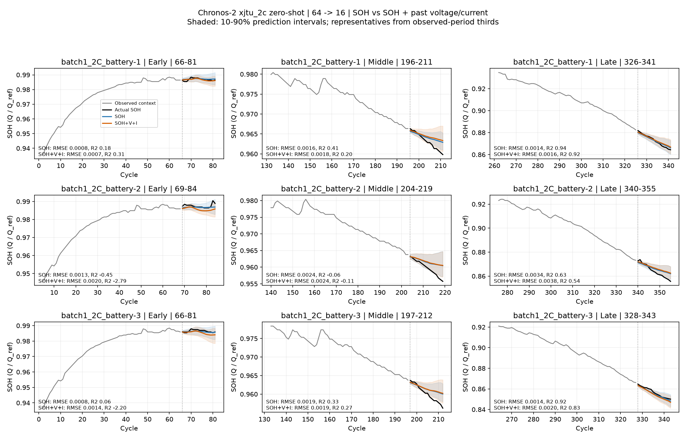

# Chronos-2 xjtu_2c: 과거 전압·전류 추가

각 충전율에서 파일 번호 1~3번 배터리를 예측 결과와 무관하게 미리 선택했다. 선택한 배터리의 유효 rolling window를 전부 평가했으며, XJTU 전체 배터리 결과는 아니다.

과거 64 cycle → 미래 16 cycle SOH, stride 1. SOH-only / +전압 / +전류 / +전압·전류를 같은 창에서 비교한다. 기존 SOH 정규화·마스크·구간 구분을 유지하며 추가 학습은 하지 않았다.

원본 cycle에서 current_A < −0.1 A인 단일 연속 방전 구간을 분리하고 relative_time_min을 초로 변환했다. 각 방전의 시작 후 0~600초에서 시간 가중 평균 전압(V)·전류(A)를 추출한다. 600초 경계는 선형 보간한다. 충전·휴지 구간이나 방전 전체 길이·capacity 적분은 특징에 사용하지 않는다.

동일 방전 내 중복 시각 15개는 해당 시각의 마지막 센서 표본을 유지했다. 시간 역전이나 방전 구간의 모호성은 자동 연결하지 않고 오류로 처리한다.

SOH와 센서 특징은 같은 과거 cycle에 맞춰 past_covariates로 입력한다. 미래 센서값은 입력하지 않는다. C2 cross_learning=False로 서로 다른 예측창은 독립된 그룹이다. 외부 스케일링·클리핑·평활화 없이 C2 내부 정규화를 사용한다.

| 입력 | RMSE ↓ | 평균 window R² ↑ | WQL ↓ | PICP@80 | RMSE 변화 |
|---|---:|---:|---:|---:|---:|
| SOH | 0.002789 | -0.2449 | 0.001568 | 65.2% | +0.00% |
| SOH+V | 0.002818 | -0.2633 | 0.001582 | 67.0% | +1.05% |
| SOH+I | 0.003041 | -0.5056 | 0.001651 | 68.8% | +9.05% |
| SOH+V+I | 0.003019 | -0.4685 | 0.001662 | 68.2% | +8.25% |

## 배터리별 비교

| 배터리 | 창 수 | SOH RMSE | SOH+V+I RMSE | 변화 | SOH R² | SOH+V+I R² |
|---|---:|---:|---:|---:|---:|---:|
| batch1_2C_battery-1 | 310 | 0.002751 | 0.002939 | +6.86% | -0.3772 | -0.6176 |
| batch1_2C_battery-2 | 327 | 0.003198 | 0.003543 | +10.80% | -0.2255 | -0.4370 |
| batch1_2C_battery-3 | 313 | 0.002417 | 0.002574 | +6.47% | -0.1319 | -0.3509 |

## 정상 프로토콜에서 특징 범위

초기 기준 capacity 측정 cycle 1은 정상 방전과 전류 조건이 다르므로 아래 범위에서 제외한다. 실제 예측창은 기존 유효 관측 마스크를 사용해 초기 기준 측정을 제외한다.

| 배터리 | 평균 전압 범위 (V) | 평균 전류 범위 (A) | 전류 표준편차 (A) |
|---|---:|---:|---:|
| batch1_2C_battery-1 | 3.894540~3.988030 | -2.000093~-2.000022 | 0.00001230 |
| batch1_2C_battery-2 | 3.886641~3.988581 | -1.999862~-1.999777 | 0.00001876 |
| batch1_2C_battery-3 | 3.881034~3.987196 | -2.000085~-2.000000 | 0.00002131 |

R²는 각 16-cycle 창에서 표준 1−SSE/SST로 계산 후 배터리 내 유효 창 단순 평균, 선택한 세 배터리 동일 가중 평균이다. pooled R²는 사용하지 않는다. 다른 지표도 배터리별 계산 후 동일 가중 평균한다. 초·중·후반은 기존 관측 cycle 범위의 1/3을 예측 시작 cycle로 나눈다.

과거 SOH-only 점수와 모든 조건의 window R² 평균을 교차 확인했다. 다른 센서 특징이나 fine-tuning의 가능성으로 일반화하지 않는다. 거의 일정한 전류의 미세한 변동이 입력에서 영향을 줄 수 있으며 개선 자체가 물리 관계 학습의 증거는 아니다. 겹치는 창에 독립 표본 가정의 유의성 검정은 하지 않았다.

[구간별 점수](c2-battery_xjtu_2c_vi_summary.csv) · [배터리별 점수](c2-battery_xjtu_2c_vi_battery_metrics.csv)
