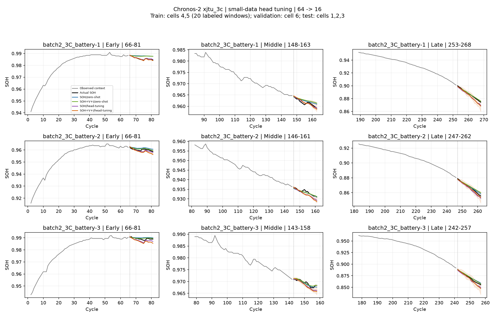

# Chronos-2 xjtu_3c: output head few-shot tuning

출력 head만 3,653,280개 파라미터(3.06%) 학습했다. C2는 별도 Transformer decoder가 없는 encoder 구조다. 입력 embedding, encoder, 변수 간 group attention은 고정하고 output_patch_embedding의 residual MLP 전체만 갱신했다. 따라서 기존 표현을 SOH 출력에 맞게 조정하는 실험이며, attention의 변수 관계를 직접 재학습하는 실험은 아니다.

- 학습: 배터리 4·5번에서 각 10개, 총 20개 창. 검증: 6번의 10개 창. 평가: 1·2·3번의 각 30개, 총 90개 창.
- 1개 창 = 과거 64 cycle → 미래 SOH 16 cycle. 학습 loss 라벨 320개 + 별도 검증 라벨 160개. 과거 입력까지 포함한 고유 SOH 관측은 학습 608개, 검증 320개다.
- source 배터리의 전체 수명에서 창을 골랐다. 다른 배터리의 완료된 이력을 이용하는 소량 데이터 적응이며, 평가 배터리 초반만으로 적응하는 프로토콜은 아니다.
- 학습·검증·평가 배터리를 분리하고, 미래 전압·전류는 NaN으로 제외했다. SOH와 V/I 조건은 같은 창을 사용한다.
- learning rate 0.0001, 100 optimizer steps, step당 4개 창, seed 42. 20 step마다 검증하고 가장 낮은 검증 quantile loss의 가중치를 선택했다. 테스트 점수로 step을 고르지 않는다.
- frozen backbone은 eval mode, head는 train mode로 학습했다. SOH loss의 sensor-row 희석 보정은 기존 full tuning과 같다.
- full tuning과 데이터·step 예산은 같지만 full tuning의 learning rate는 1e-6이다. 이 비교만으로 튜닝 방식의 일반적 우열이나 각 방식의 최적 성능을 단정할 수 없다.
- R²는 각각의 16-cycle 예측창에서 정석으로 계산한 뒤 배터리 내 산술평균 → 배터리 간 동일 가중 평균이다. 초·중·후반도 해당 창의 R²를 평균한다. 실제값을 이어 붙인 pooled R²는 사용하지 않는다.

분위수는 정렬·보정하지 않고 원본을 평가했다. q10 > q90인 지점이 하나라도 있으면 그 배터리/구간의 PICP·구간폭을 미정의(N/A) 처리하고, 배터리 평균에도 N/A를 전파한다. RMSE·R²·WQL은 원래 예측에서 계산할 수 있다. 그래프에서 뒤집힌 구간은 음영을 생략했다.

| 입력·학습 | RMSE ↓ | 평균 window R² ↑ | WQL ↓ | PICP@80 |
|---|---:|---:|---:|---:|
| SOH/zero-shot | 0.003008 | -0.0316 | 0.001768 | 63.8% |
| SOH+V+I/zero-shot | 0.002957 | -0.0559 | 0.001757 | 69.2% |
| SOH/head-tuning | 0.002469 | 0.1546 | 0.001447 | N/A (구간 역전) |
| SOH+V+I/head-tuning | 0.002329 | 0.0774 | 0.001344 | N/A (구간 역전) |
| SOH/full-tuning | 0.002325 | 0.2590 | 0.001303 | 72.9% |
| SOH+V+I/full-tuning | 0.002284 | 0.2875 | 0.001291 | 74.3% |

| 조건 | q10/q90 구간 역전 비율 | 9개 분위수 중 순서 역전 비율 |
|---|---:|---:|
| SOH/zero-shot | 0.00% | 0.28% |
| SOH+V+I/zero-shot | 0.00% | 0.21% |
| SOH/head-tuning | 2.78% | 58.54% |
| SOH+V+I/head-tuning | 1.81% | 51.74% |

| 입력 | head / zero-shot RMSE 변화 | head / full tuning RMSE 변화 |
|---|---:|---:|
| SOH | -17.90% | +6.19% |
| SOH+V+I | -21.24% | +1.99% |

head 튜닝끼리 비교한 V/I 추가의 RMSE 변화: -5.68%. V/I 모델이 자기 zero-shot보다 좋아졌다는 사실만으로 변수 추가의 효과를 주장하지 않는다.

| 조건 | 선택 step | 검증 loss | 변경된 head tensor | 고정 tensor 변경 |
|---|---:|---:|---:|---:|
| SOH/head-tuning | 100 | 1.315134 | 6 | 0 |
| SOH+V+I/head-tuning | 100 | 1.327787 | 6 | 0 |

검증: 저장 예측에서 지표 재계산, full 실험과 학습창·평가창 일치, encoder 원본 가중치 불변, 최종 가중치와 best validation checkpoint 일치. 단일 seed 파일럿 결과다.
