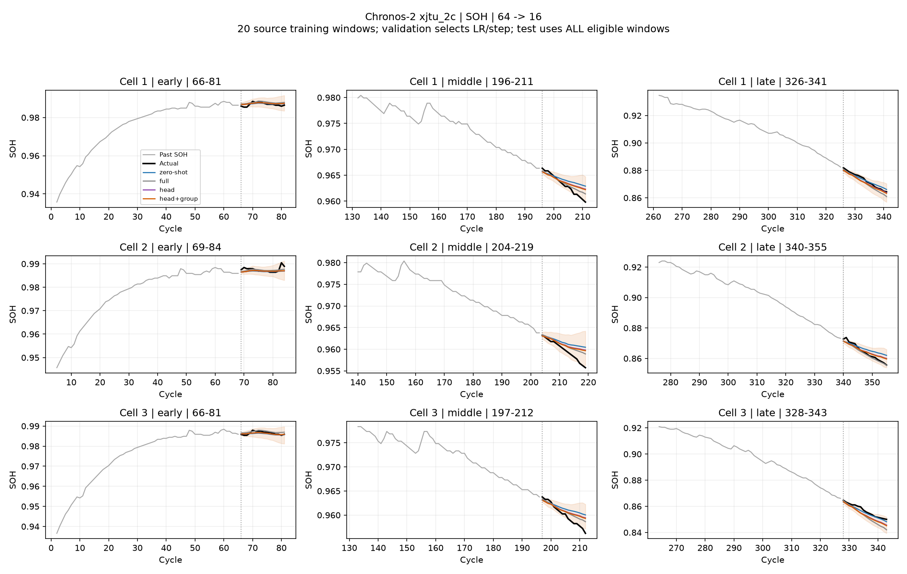
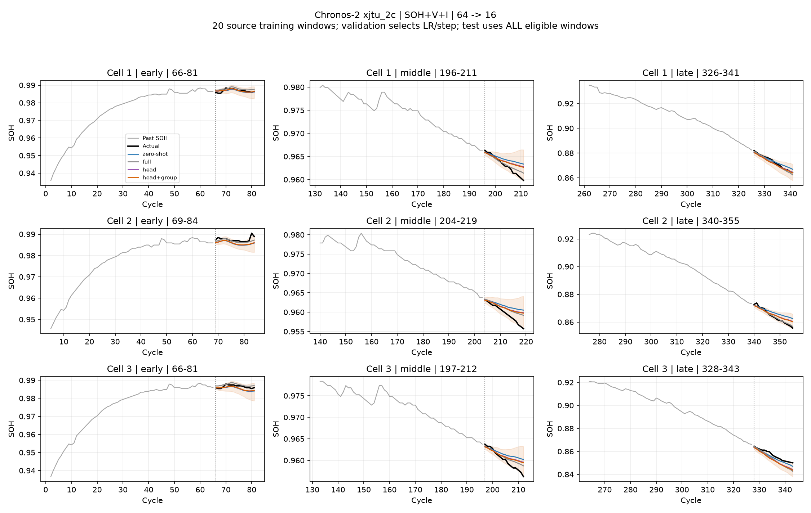
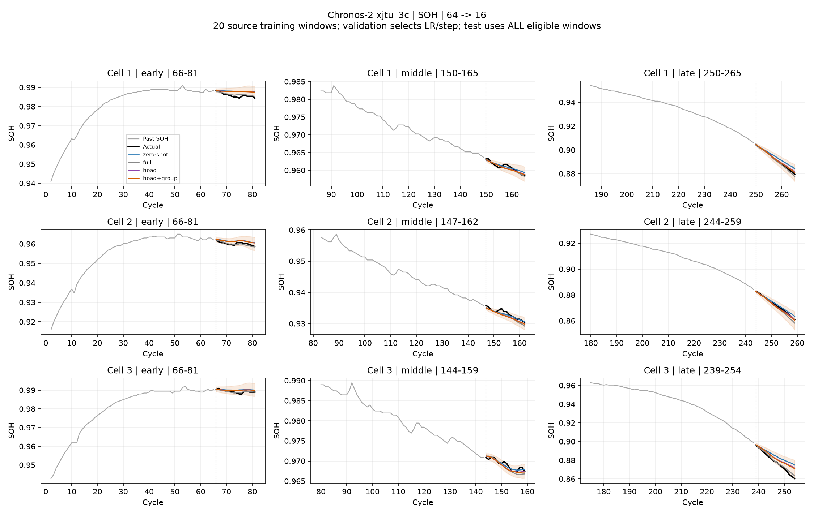
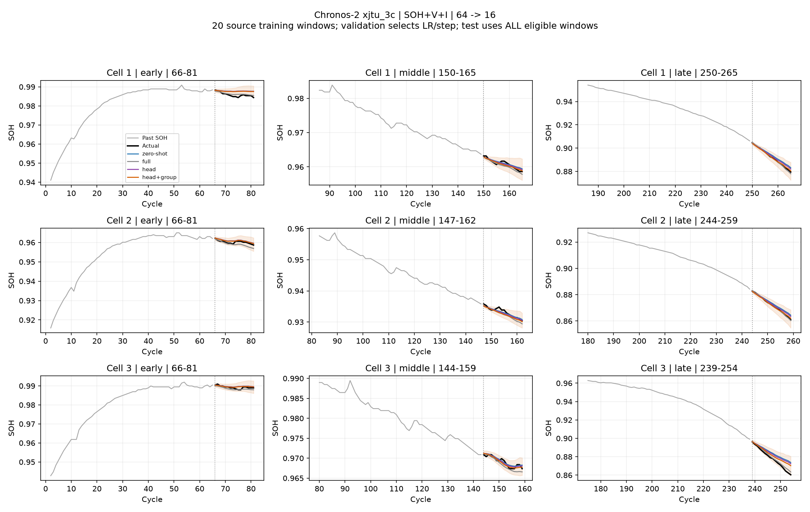

# Chronos-2: 소량 데이터로 head / 마지막 group attention 튜닝

전체 모델을 다시 학습하지 않고 적은 파라미터만 바꿔 zero-shot에서 개선되는지 확인했다. 비교용 full tuning과 이전 head 모델은 저장된 가중치로 추론만 다시 했다.

## 핵심 결과

| 데이터 | SOH head RMSE 변화 | SOH head+group RMSE 변화 | head R² 평균 / 중앙값 |
|---|---:|---:|---:|
| xjtu_2c | -5.2% | -5.5% | -0.187 / 0.416 |
| xjtu_3c | -12.4% | -13.4% | -0.012 / 0.571 |

이번 결과에서는 head만 3.06% 학습해도 zero-shot보다 개선됐고, head+마지막 group attention 5.03% 학습의 추가 이득은 작았다. 전압·전류를 더한 신규 모델은 같은 방식의 SOH 단독 모델보다 두 데이터셋 모두 RMSE가 높았다. 따라서 이번 범위에서는 변수 추가의 이득이 확인되지 않았다.

신규 모델의 q10>q90 역전은 테스트 전체에서 없었다. 다만 일부 내부 분위수 순서 역전은 남아 있으며, PICP@80도 목표 80%에는 못 미쳤다. 낮춘 학습률과 검증 필터를 함께 적용했으므로 각각의 효과를 따로 입증한 실험은 아니다. 평균 window R²는 여전히 음수인 조건들이 있다. 오차가 줄었다는 결과와 모든 창에서 예측이 충분히 정확하다는 주장은 구분해야 한다.

## 실험 조건

- XJTU 2C·3C 각각: 학습 배터리 4·5번, 검증 6번, 테스트 1·2·3번. 기존 실험과 동일한 학습창이다.
- 학습 20개 창(미래 SOH 정답 320개), 검증 10개 창(160개). 1개 창은 과거 64 + 미래 16 cycle이며, 20개 측정값만 쓰는 실험이 아니다.
- 완료된 다른 배터리의 수명 전체에서 창을 고른 offline adaptation이다. 테스트 배터리의 초기 일부에 적응하는 방식과 구분한다.
- SOH만 입력 / SOH+과거 전압·전류를 입력하는 조건을 모두 비교했다. 미래 V/I는 NaN, 서로 다른 예측창은 독립된 group이다.
- head: output_patch_embedding 전체. head_group: head + 마지막 encoder block의 group attention만 학습한다. 나머지 가중치는 고정한다.
- 후보 학습률 1e-6·1e-5, 후보당 100 optimizer steps, step당 4개 창, seed 42, AdamW·선형 학습률 감소. 20 step마다 검증한다.
- 각 방식·입력별로 검증 decile 분위수 역전율과 q10>q90 비율이 초기 모델보다 늘지 않는 후보 중 검증 SOH quantile loss가 가장 낮은 LR·step을 선택했다. Step 0도 포함했다.
- 모든 신규 모델 선택을 잠근 다음 테스트 전체 창을 평가했다. 재정렬·clipping·평활화는 없다. 검증의 분위수 검사가 테스트에서도 역전이 없음을 보장하지는 않는다.
- R²는 각 16-cycle 예측창에서 정석으로 계산한다. 배터리 내 창 평균 → 배터리 간 동등 가중 평균. 중앙값과 음수 비율도 같은 배터리 가중치를 쓰며, pooled R²는 사용하지 않는다.
- RMSE·WQL·PICP는 배터리별 계산 후 동등 가중 평균. q10>q90이 한 점이라도 있으면 해당 그룹 PICP는 N/A로 표시하고 평균에도 전파한다.
- 초·중·후반은 관측 cycle 범위를 3등분해 예측 시작 cycle로 배정한다. 세부 점수는 summary.csv에 있다.

단일 seed와 기존에 검토한 테스트 배터리를 사용하는 탐색 실험이다. 여러 데이터셋에서 재현되는 일반적 우위나 foundation 사전학습 데이터 중복 부재까지 입증한 것은 아니다.

## xjtu_2c: 조건당 전체 950개 테스트 창

과거 입력을 포함한 고유 SOH 관측값: 학습 784개, 검증 400개.

| 입력 / 방법 | RMSE ↓ | R² 평균 | R² 중앙값 | 음수 창 비율 ↓ | WQL ↓ | PICP@80 | 분위수 역전율 ↓ |
|---|---:|---:|---:|---:|---:|---:|---:|
| SOH/zero-shot | 0.002789 | -0.245 | 0.269 | 36.1% | 0.001568 | 65.2% | 0.96% |
| SOH/full | 0.002377 | -0.006 | 0.526 | 27.0% | 0.001376 | 58.8% | 0.10% |
| SOH/old_head_lr1e-4 | 0.002469 | -0.153 | 0.504 | 31.8% | 0.001486 | N/A | 64.42% |
| SOH/head | 0.002643 | -0.187 | 0.416 | 33.3% | 0.001482 | 69.7% | 0.59% |
| SOH/head_group | 0.002636 | -0.184 | 0.426 | 33.2% | 0.001479 | 69.7% | 0.41% |
| SOH+V+I/zero-shot | 0.003019 | -0.468 | 0.220 | 38.2% | 0.001662 | 68.2% | 0.80% |
| SOH+V+I/full | 0.002412 | 0.008 | 0.507 | 27.5% | 0.001338 | 63.7% | 0.13% |
| SOH+V+I/old_head_lr1e-4 | 0.002558 | -0.197 | 0.480 | 34.0% | 0.001468 | N/A | 56.16% |
| SOH+V+I/head | 0.002848 | -0.378 | 0.352 | 34.3% | 0.001573 | 69.8% | 0.00% |
| SOH+V+I/head_group | 0.002838 | -0.366 | 0.360 | 34.5% | 0.001569 | 70.0% | 0.01% |

| 검증으로 선택한 조건 | LR | step | 학습 파라미터 | 두 후보 학습+검증 합계 |
|---|---:|---:|---:|---:|
| SOH/head | 1e-06 | 100 | 3,653,280 (3.06%) | 23.1초 |
| SOH/head_group | 1e-06 | 100 | 6,013,344 (5.03%) | 21.7초 |
| SOH+V+I/head | 1e-06 | 100 | 3,653,280 (3.06%) | 20.4초 |
| SOH+V+I/head_group | 1e-06 | 100 | 6,013,344 (5.03%) | 21.9초 |

시간은 이 노트북 XPU에서 측정한 신규 후보의 학습·검증 합계이며 모델 로딩·전처리·테스트 추론은 제외한다. 파라미터 감소가 같은 비율의 실행시간 감소를 뜻하지는 않는다. 이전 full tuning은 LR 1e-6, 이전 head는 LR 1e-4였고, 이번에는 후보 탐색과 검증 분위수 필터를 추가했으므로 방식별 최적 성능을 동일 탐색 예산으로 비교한 결과는 아니다.

## xjtu_3c: 조건당 전체 637개 테스트 창

과거 입력을 포함한 고유 SOH 관측값: 학습 608개, 검증 320개.

| 입력 / 방법 | RMSE ↓ | R² 평균 | R² 중앙값 | 음수 창 비율 ↓ | WQL ↓ | PICP@80 | 분위수 역전율 ↓ |
|---|---:|---:|---:|---:|---:|---:|---:|
| SOH/zero-shot | 0.002977 | -0.110 | 0.435 | 31.3% | 0.001757 | 64.8% | 0.26% |
| SOH/full | 0.002453 | 0.210 | 0.743 | 20.6% | 0.001353 | 73.7% | 0.09% |
| SOH/old_head_lr1e-4 | 0.002592 | 0.129 | 0.665 | 23.6% | 0.001475 | N/A | 55.92% |
| SOH/head | 0.002607 | -0.012 | 0.571 | 27.7% | 0.001530 | 72.5% | 0.23% |
| SOH/head_group | 0.002578 | -0.000 | 0.609 | 27.4% | 0.001509 | 73.6% | 0.21% |
| SOH+V+I/zero-shot | 0.002944 | -0.141 | 0.304 | 36.0% | 0.001761 | 68.5% | 0.23% |
| SOH+V+I/full | 0.002384 | 0.217 | 0.688 | 19.8% | 0.001347 | 73.7% | 0.11% |
| SOH+V+I/old_head_lr1e-4 | 0.002434 | 0.087 | 0.676 | 23.3% | 0.001382 | N/A | 49.09% |
| SOH+V+I/head | 0.002756 | -0.076 | 0.391 | 33.7% | 0.001646 | 71.9% | 0.25% |
| SOH+V+I/head_group | 0.002606 | -0.002 | 0.487 | 31.4% | 0.001548 | 75.6% | 0.35% |

| 검증으로 선택한 조건 | LR | step | 학습 파라미터 | 두 후보 학습+검증 합계 |
|---|---:|---:|---:|---:|
| SOH/head | 1e-06 | 100 | 3,653,280 (3.06%) | 20.3초 |
| SOH/head_group | 1e-06 | 100 | 6,013,344 (5.03%) | 21.8초 |
| SOH+V+I/head | 1e-06 | 20 | 3,653,280 (3.06%) | 20.6초 |
| SOH+V+I/head_group | 1e-06 | 60 | 6,013,344 (5.03%) | 22.2초 |

시간은 이 노트북 XPU에서 측정한 신규 후보의 학습·검증 합계이며 모델 로딩·전처리·테스트 추론은 제외한다. 파라미터 감소가 같은 비율의 실행시간 감소를 뜻하지는 않는다. 이전 full tuning은 LR 1e-6, 이전 head는 LR 1e-4였고, 이번에는 후보 탐색과 검증 분위수 필터를 추가했으므로 방식별 최적 성능을 동일 탐색 예산으로 비교한 결과는 아니다.

## 저장 파일

- summary.csv: 전체/초·중·후반 점수와 R² 분포 통계.
- 각 그룹의 run.json: 선택한 LR·step, 가중치 위치, 파라미터 범위, 실행 정보.
- *_validation.csv: 테스트를 보지 않고 선택한 후보의 검증 기록.
- window_metrics.csv.gz / predictions.npz: 창별 R²와 재계산 가능한 예측값.
- forecast_*.png: 테스트 배터리별 초·중·후반 대표창. 그래프는 전체 평가창을 대표하는 예시이지 전체 성능 그 자체가 아니다.
