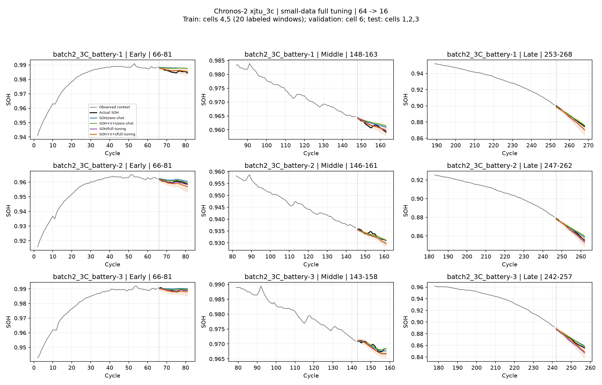

# Chronos-2 xjtu_3c: 소량 데이터 full fine-tuning

학습 4·5번, 검증 6번, 평가 1·2·3번으로 배터리를 분리했다. 학습 배터리의 측정 완료 이력을 사전에 확보한 offline cross-battery adaptation 실험이다. 평가 배터리 자신의 초반 라벨로 적응하는 target-cell few-shot과는 구분한다. Foundation 모델의 사전학습 데이터 중복까지 검증했다는 뜻은 아니다.

1-shot 단위는 과거 64 cycle + SOH 정답 16 cycle인 하나의 감독 학습창이다. 학습은 셀당 10개, 총 20개 창 / 미래 SOH loss 라벨 320개다. 검증은 별도 셀의 10개 창 / 라벨 160개를 추가로 쓴다. 과거 SOH 입력도 필요하므로 'SOH 측정값이 총 20개만 필요'하다는 주장이 아니다. 학습/검증 target 구간은 각각 서로 겹치지 않도록 선정하지만 과거 context는 겹칠 수 있다. 창 시작 순서에서 균등 선택하며 정답 값이나 성능으로 고르지 않는다.

학습창에서 실제 필요한 고유 SOH 관측은 608개, 검증창에서는 320개다. 창을 전체 source 수명에서 고르기 때문에 source 데이터 취득을 초반에 끝낼 수 있다는 뜻은 아니다.

두 입력 조건 모두 같은 학습창, seed 42, 초기 learning rate 1e-6(선형 감소), 최대 100 optimizer step, 한 step에 4개 task를 사용한다(SOH batch_size=4, V/I batch_size=12). 80길이 시퀀스, min_past=64로 학습 split을 64에 고정했다. 센서는 과거 64개만 제공하고 미래 16개는 NaN이다. 센서 라벨 loss는 없고, 공식 C2 loss의 masked covariate 행 평균 희석을 SOH 행 수 기준으로 보정했다.

검증은 20 step마다 수행하며 가장 낮은 검증 quantile loss의 체크포인트를 사용한다. 검증 라벨은 gradient update에 사용하지 않으며 full-data refit은 하지 않는다. 각 조건은 원래 foundation 가중치에서 시작한다. 조건/step 선택에 테스트 점수를 사용하지 않는다. 이번은 seed 하나의 pilot이며 일반적인 성능 개선을 단정하지 않는다.

평가는 이전 cross-learning 비교와 동일한 각 셀 30개, 총 90개 창이다. zero-shot 캐시와 target/시작 cycle을 대조했다. 64→16, 과거 센서만 제공, cross_learning=False, 정답 clipping/평활화 없음. R²는 각 16-cycle 창에서 표준식으로 계산한 후 셀 내 창 산술평균, 셀 간 동일 가중 평균이다. 초중후반은 원래 관측 cycle 범위의 1/3에 예측 시작 cycle을 배정한다. RMSE/WQL/PICP는 셀 안에서 계산하고 셀 간 동일 가중 평균이다.

| 입력·학습 | RMSE ↓ | 평균 window R² ↑ | WQL ↓ | PICP@80 | 같은 입력 zero-shot 대비 RMSE |
|---|---:|---:|---:|---:|---:|
| SOH/zero-shot | 0.003008 | -0.0316 | 0.001768 | 63.8% | +0.00% |
| SOH+V+I/zero-shot | 0.002957 | -0.0559 | 0.001757 | 69.2% | +0.00% |
| SOH/full-tuning | 0.002325 | 0.2590 | 0.001303 | 72.9% | -22.69% |
| SOH+V+I/full-tuning | 0.002284 | 0.2875 | 0.001291 | 74.3% | -22.77% |

같은 입력 zero-shot 대비 RMSE 변화는 SOH -22.69%, V/I -22.77%다. 두 튜닝 모델끼리 비교한 센서 추가 효과는 RMSE -1.79%다. V/I 모델이 자신의 zero-shot보다 좋아졌다는 사실만으로 센서 관계 학습이 효과적이라고 결론내릴 수 없다. SOH-only 모델도 학습했을 때의 성능과 비교해야 한다. PICP@80의 목표는 80%이며 정확도 개선과 불확실성 보정을 함께 확인해야 한다.

## 검증으로 선택한 step

| 조건 | best step | 검증 loss | 학습 device |
|---|---:|---:|---|
| SOH/full-tuning | 100 | 1.075601 | xpu:0 |
| SOH+V+I/full-tuning | 60 | 1.176109 | xpu:0 |

## 배터리별 결과

| 배터리 | SOH 0-shot RMSE | VI 0-shot RMSE | SOH FT RMSE | VI FT RMSE |
|---|---:|---:|---:|---:|
| batch2_3C_battery-1 | 0.002560 | 0.002634 | 0.001981 | 0.001820 |
| batch2_3C_battery-2 | 0.002533 | 0.002568 | 0.001476 | 0.001515 |
| batch2_3C_battery-3 | 0.003930 | 0.003669 | 0.003519 | 0.003515 |

## 배터리 few-shot 문헌과 적용 범위

- [Few-shot multidomain SOH estimation (IEEE TTE)](https://ieeexplore.ieee.org/document/10699429/): 이완 전압으로 현재 SOH를 추정한다. Meta-learning 후 새 배터리의 라벨 있는 6개 cycle로 적응한다. 우리 미래 SOH 예측과는 목표가 다르다.
- [Cross-dataset battery life forecasting (Energy and AI)](https://doi.org/10.1016/j.egyai.2026.100771): TimesFM으로 capacity 궤적·RUL을 예측한다. Source 학습과 target 초반 이력 적응을 구분하고 30%·20%·10% prefix를 비교한다. 우리와 가까운 미래 열화 예측 설정이다.
- [Prognostics by generalists (Scientific Reports)](https://www.nature.com/articles/s41598-026-43545-1): LLaMA 가중치를 고정하고 운전 조건과 과거 SOH 3개를 프롬프트에 넣어 미래 SOH를 예측한다. 논문의 few-shot 단위는 우리 감독 학습창 단위와 다르다.
- [Fine-tuning enables SOH estimation (Energy)](https://doi.org/10.1016/j.energy.2024.134177): TimeGPT 튜닝은 143개 배터리와 방전 capacity 외생변수를 사용한다. 100 step이라는 작은 step 수만으로 few-shot 데이터 실험이라고 볼 수 없고, V/I만 사용하는 우리 미래 예측과 구분해야 한다.

문헌의 현재 SOH 추정 정확도를 우리 미래 16-cycle 예측 정확도와 직접 비교하지 않는다. few-shot은 LoRA와 동의어가 아니며, shot 단위·라벨 예산·시간 분할·배터리 분할을 먼저 명시해야 한다.
