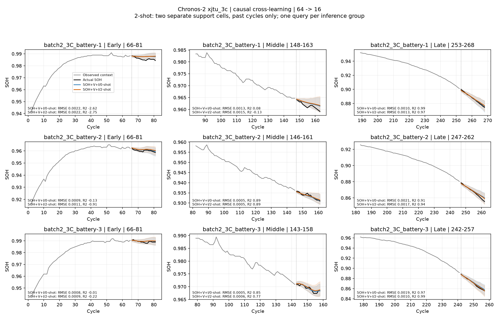

# Chronos-2 xjtu_3c: 누수를 차단한 cross-learning few-shot

가중치 고정 in-context few-shot이며 fine-tuning이나 LoRA가 아니다. 1-shot은 참고 배터리 하나의 과거 창, 2-shot은 참고 배터리 두 개의 과거 창을 뜻한다.

평가 배터리는 파일 1~3번, 참고 배터리는 같은 충전율의 파일 4·5번이다. 참고 배터리 순서는 고정한다. 참고 창은 cycle 번호 기준으로 평가 창의 예측 시작 이전에 끝나는 최신 유효 64-cycle 구간이다. 이 cutoff는 보수적인 cycle 기준 규칙이며 서로 다른 셀의 실제 취득 달력 시각 동기화를 뜻하지 않는다.

배터리당 최대 30개 창을 유효 창 순서에서 균등 간격으로 선택했다. 공통 평가 창은 90개다. zero-shot과 1/2-shot은 모두 이 동일한 창에서 평가하며, 이전 전체 창 점수와 직접 비교하지 않는다. 참고 배터리 두 개의 과거 문맥이 모두 확보되지 않는 창은 모든 조건에서 제외했다.

SOH-only와 SOH+전압·전류를 각각 비교한다. 센서 특징은 이전 실험과 같은 방전 첫 600초 시간 가중 평균이다. 과거 SOH/센서만 입력하며 future_covariates는 사용하지 않는다.

## 데이터 누수 차단

- 각 cross-learning 호출에는 평가 창 하나와 그 창의 참고 입력만 넣는다. 다른 시점의 평가 창을 섞지 않는다.
- 평가 배터리는 참고 배터리 집합에 들어가지 않는다. 모든 입력 cycle은 평가 시작 cycle 미만이다.
- batch_size는 그룹의 target·covariate 개수와 정확히 같아 한 그룹이 분할되지 않는다.
- 참고 창 선택은 예측 시작 cycle과 관측 유효성만 사용한다. 미래 SOH나 예측 오차로 선택하지 않는다.
- 테스트에서 참고 미래 SOH/센서를 바꿔도 실제 입력이 동일함을 확인했다. 실행 중 같은 입력 변형 검증을 한 번 더 수행했다.
- 선택한 zero-shot 캐시와 target/시작 cycle을 대조하고, cross_learning=False의 실제 추론도 대조했다.

## 동일한 창의 결과

| 입력 | RMSE ↓ | 평균 window R² ↑ | WQL ↓ | PICP@80 | 동일 입력 0-shot 대비 RMSE |
|---|---:|---:|---:|---:|---:|
| SOH/0-shot | 0.003008 | -0.0316 | 0.001768 | 63.8% | +0.00% |
| SOH+V+I/0-shot | 0.002957 | -0.0559 | 0.001757 | 69.2% | +0.00% |
| SOH/1-shot | 0.003029 | 0.0101 | 0.001768 | 64.6% | +0.72% |
| SOH+V+I/1-shot | 0.003077 | -0.0881 | 0.001810 | 68.1% | +4.06% |
| SOH/2-shot | 0.002999 | 0.0258 | 0.001744 | 65.8% | -0.28% |
| SOH+V+I/2-shot | 0.003173 | -0.1807 | 0.001876 | 64.8% | +7.31% |

## 전압·전류 입력의 배터리별 결과

| 배터리 | 창 수 | 0-shot RMSE | 1-shot RMSE | 2-shot RMSE | 2-shot 변화 |
|---|---:|---:|---:|---:|---:|
| batch2_3C_battery-1 | 30 | 0.002634 | 0.002725 | 0.002713 | +3.01% |
| batch2_3C_battery-2 | 30 | 0.002568 | 0.002771 | 0.002883 | +12.28% |
| batch2_3C_battery-3 | 30 | 0.003669 | 0.003734 | 0.003923 | +6.91% |

R²는 각 16-cycle 예측창에서 계산 후 배터리 내 유효 창 단순 평균, 평가 배터리 동일 가중 평균이다. 구간은 관측 cycle 범위의 1/3, 예측 시작 cycle로 구분한다. 모든 점수는 샘플 창 기준이며 전체 배터리·전체 창 결과가 아니다. 참고 입력의 예측값은 평가하지 않는다. 미래 target은 점수 계산에만 사용한다. shot 수에 따른 개선과 센서의 효과는 구분하며, 최선의 결과를 고른 뒤 전체 성능으로 보고하지 않는다.

[구간별 점수](c2-battery_xjtu_3c_fewshot_summary.csv) · [참고 입력 cycle 기록](c2-battery_xjtu_3c_fewshot_support_selection.csv)
