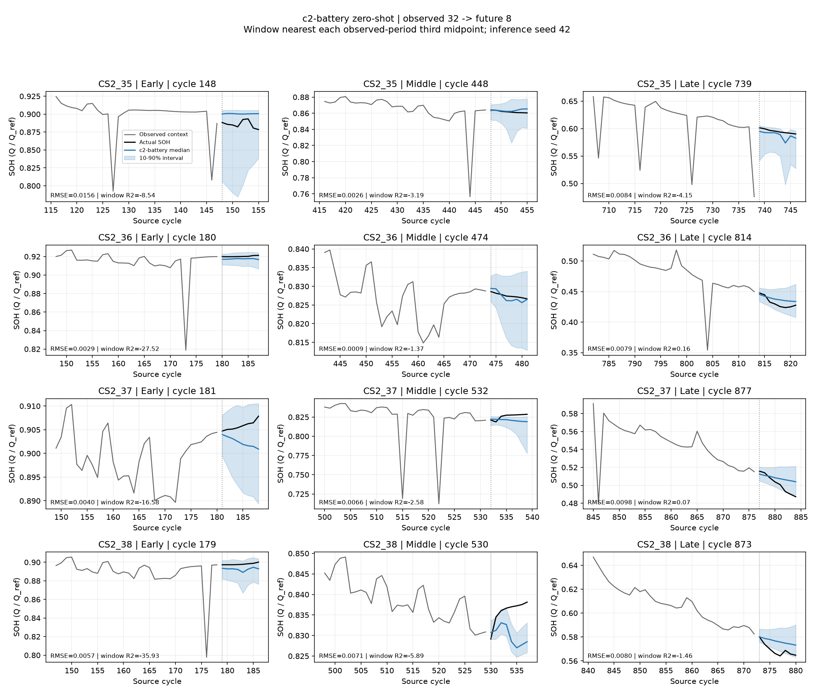

# c2-battery: calce_cs2_1c zero-shot

모델 `amazon/chronos-2`, 관측 32 → 예측 8, stride 1.

각 배터리 측정 기록의 관측 cycle 범위를 3등분한다. 예측 시작 cycle로 초·중·후반을 배정하고 해당 window의 전체 horizon을 평가한다. 경계를 넘는 horizon도 시작 구간에 포함한다. 실제 전체 수명 3등분을 뜻하지 않는다.

Mean window R²: 한 예측창의 미래 target 평균을 기준으로 R² = 1 − SSE/SST를 계산한 뒤 각 배터리·구간 또는 전체에서 유효한 창별 R²를 단순평균한다. 이후 배터리 점수를 동일 가중 평균한다. 음수는 유지하고 상수 target 창은 NaN으로 제외한다. r2_n_windows는 유효 창 수, r2_undefined_windows는 제외 창 수다. 전체 점수는 전체 창의 평균이며 초·중·후반 평균을 단순평균하지 않는다. 실제값이 거의 일정하면 R²가 크게 음수여도 계산 오류가 아니므로 RMSE·곡선을 함께 본다.

| 모델 | 구간 | RMSE ↓ | R² ↑ | WQL ↓ | PICP@80 | 80% 구간 폭 |
|---|---|---:|---:|---:|---:|---:|
| LastValue | all | 0.025784 | -3556.948362 | — | — | — |
| Linear | all | 0.022250 | -389.164230 | — | — | — |
| c2-battery | all | 0.020311 | -65.033761 | 0.012114 | 70.2% | 0.029817 |
| LastValue | early | 0.022371 | -10822.415588 | — | — | — |
| Linear | early | 0.017547 | -315.808208 | — | — | — |
| c2-battery | early | 0.017140 | -57.793499 | 0.008491 | 69.4% | 0.022043 |
| LastValue | middle | 0.023431 | -558.581865 | — | — | — |
| Linear | middle | 0.020767 | -423.724631 | — | — | — |
| c2-battery | middle | 0.016993 | -83.100643 | 0.009451 | 69.4% | 0.030361 |
| LastValue | late | 0.029999 | -88.460336 | — | — | — |
| Linear | late | 0.026661 | -439.887798 | — | — | — |
| c2-battery | late | 0.024547 | -55.174219 | 0.022788 | 71.8% | 0.036650 |

WQL은 q0.1~q0.9의 9개 twice-pinball loss를 평균하고 구간 target 절댓값 합으로 정규화한다. PICP@80은 q0.1~q0.9 포함률이며 명목값은 80%다. RMSE와 구간 폭은 SOH 비율 단위다.

최근 실제 관측으로 매번 예측하는 rolling zero-shot이다. 학습·clipping·평활화 없이 같은 입력과 window를 사용한다. C2는 독립 단변량 입력과 cross_learning=False를 사용한다. T5는 100 samples, seed 42; C2는 직접 분위수 예측으로 sampling 설정을 사용하지 않는다.

대표 곡선은 각 구간 중앙에 가장 가까운 유효 예측창이다. 그래프의 R²는 표시된 window 한 개의 점수이며 구간 전체 점수와 다르다. 겹치는 window는 독립 표본이 아니다. 입력 묶음의 모든 평가 가능한 배터리와 window를 평가했다.

[설정](c2-battery_run.json) · [배터리별 점수](c2-battery_battery_metrics.csv)

평가 4개 기록, 제외 0개 기록, 총 754개 window. [평가 가능 구간](c2-battery_coverage.csv).

일부 기록은 초반 1/3 안에서 context 길이를 확보할 수 없어 초반 점수가 없다. 표에서 해당 구간의 n_batteries가 줄어들며 그림에는 평가 가능한 창이 없다고 표시한다.

