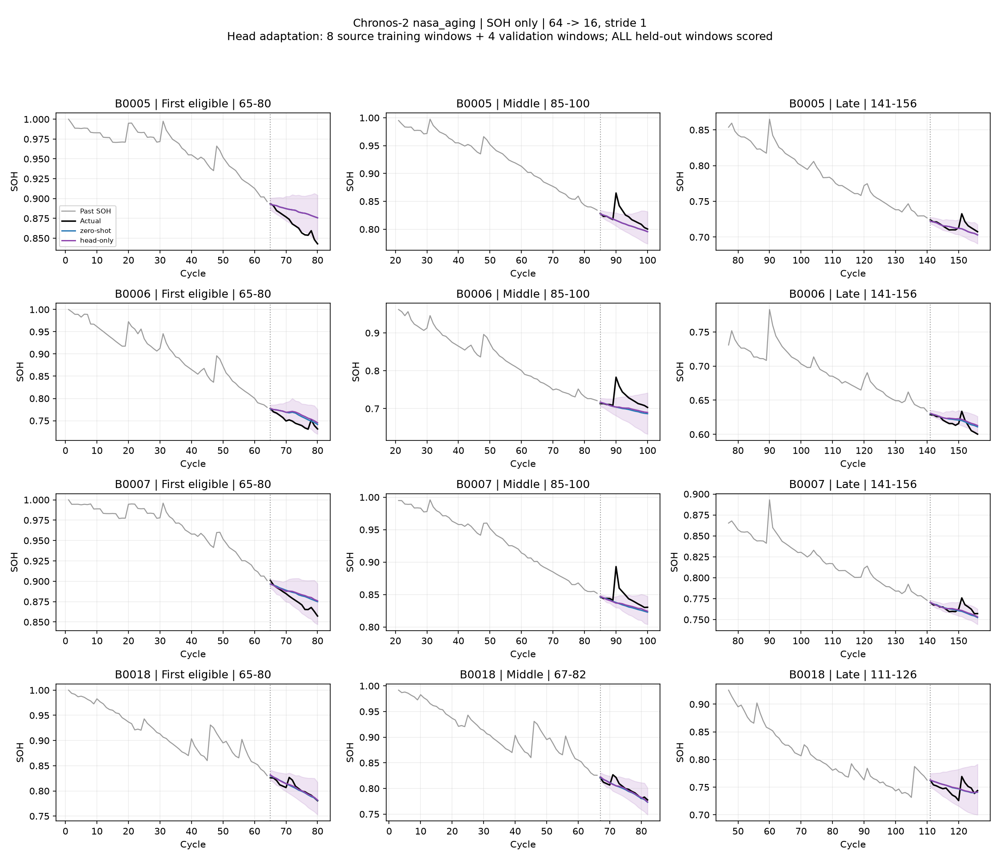
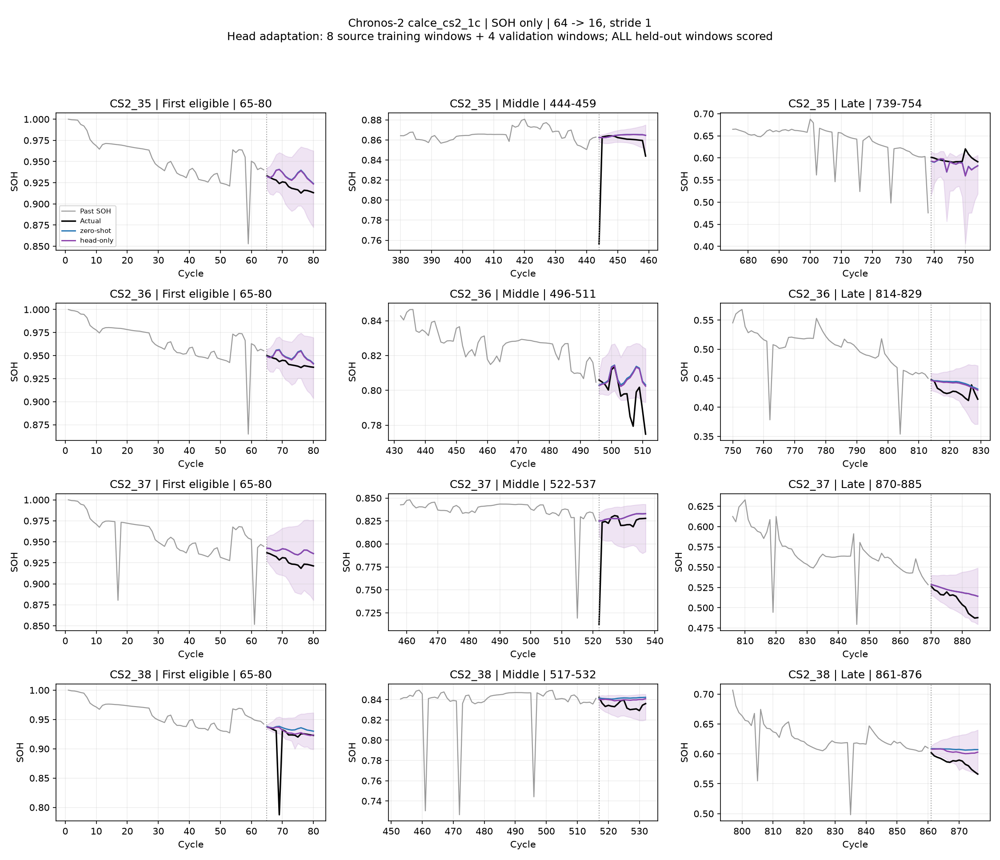
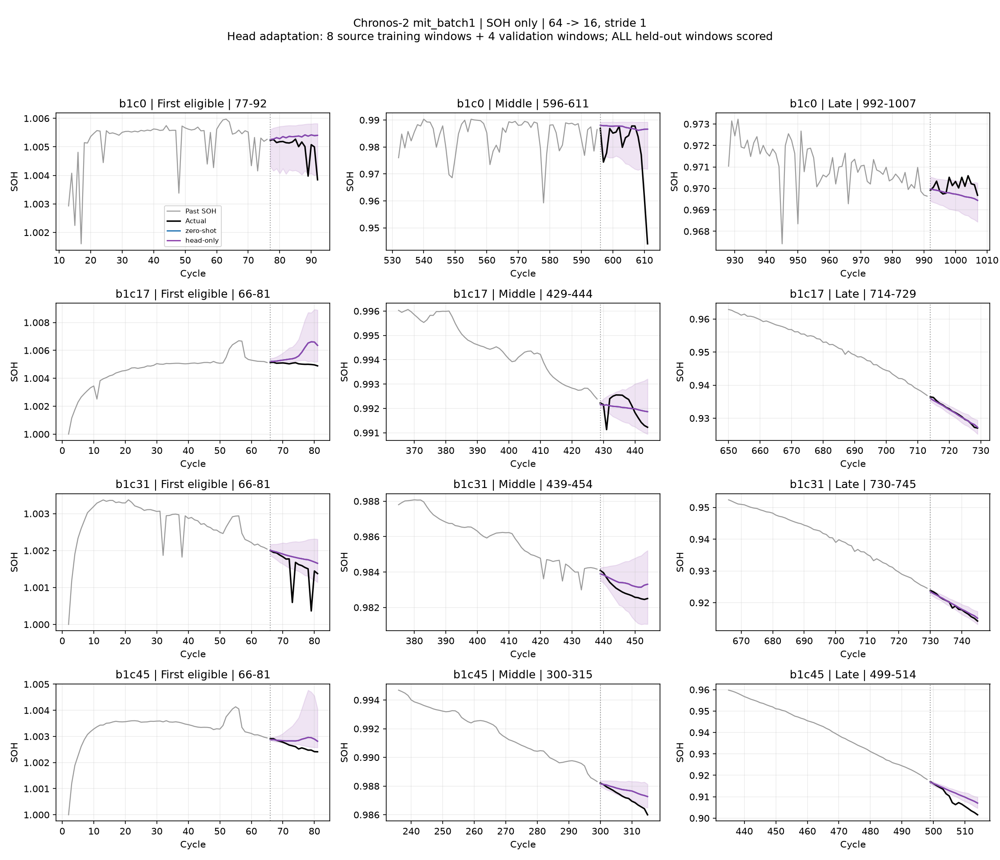
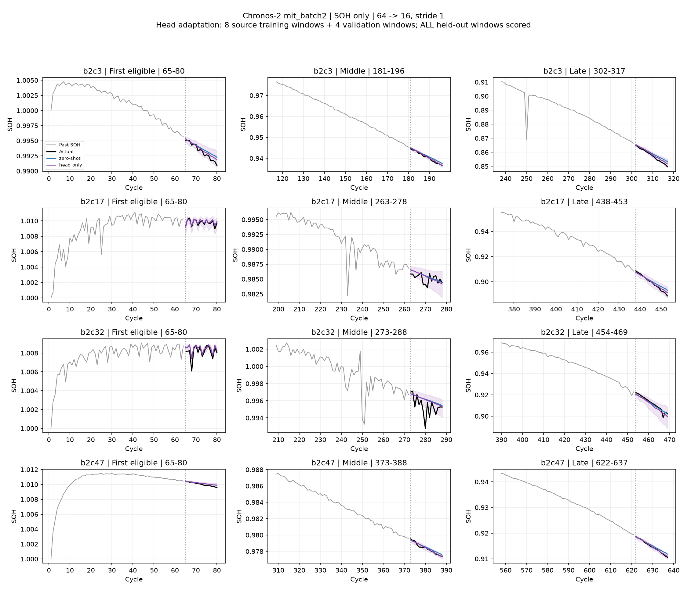
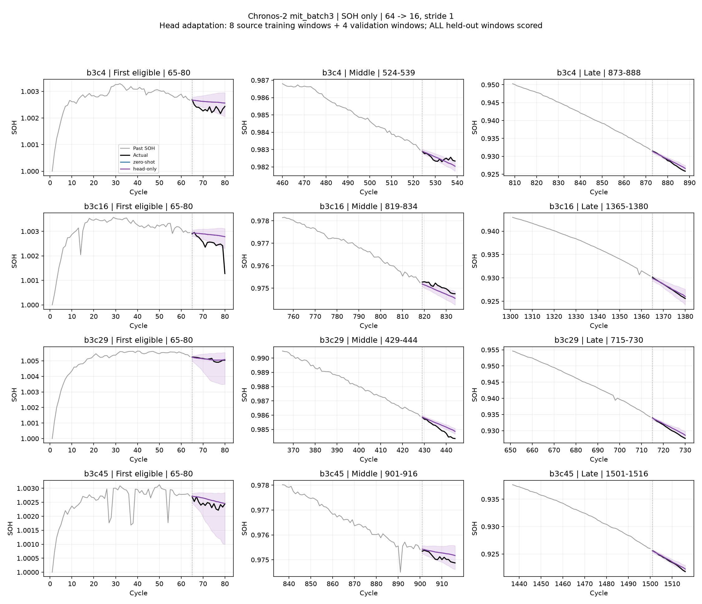
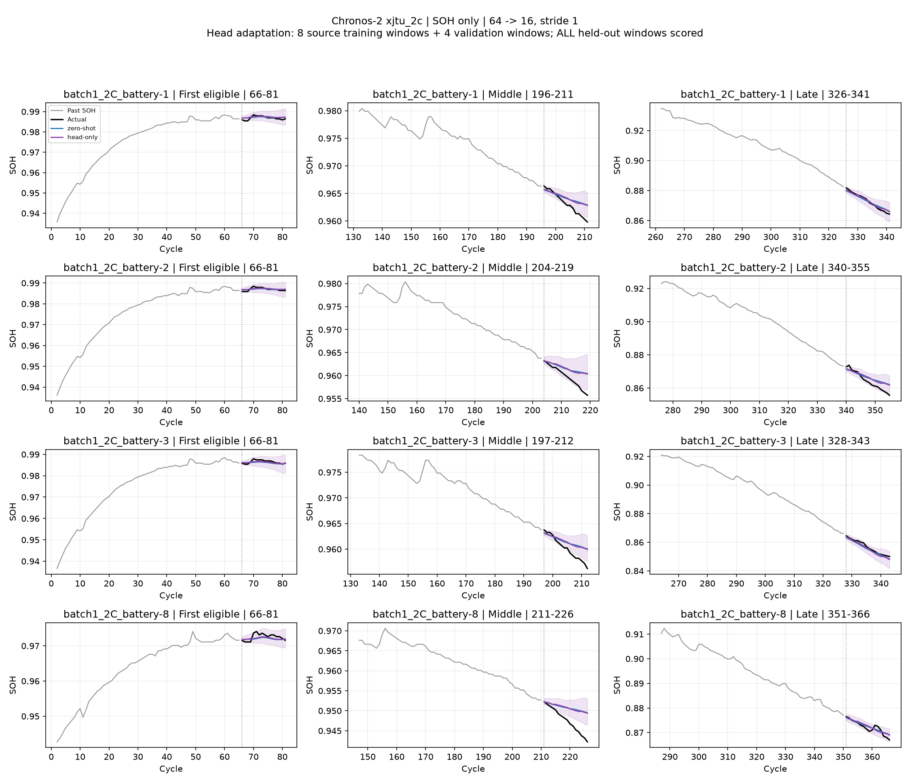
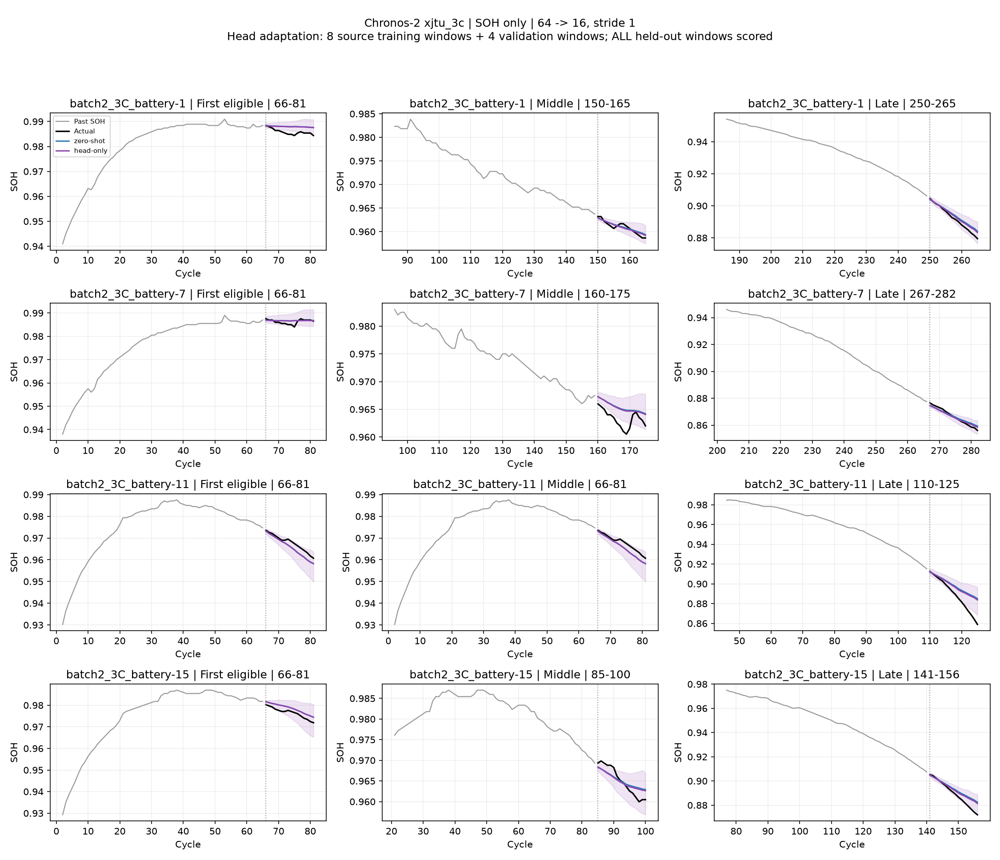

# Chronos-2: 공통 8개 학습창으로 head-only 적응

SOH 단독, context 64 → horizon 16, stride 1. 각 실험에서 원래 C2 가중치로 시작해 head 3.06%만 학습한다. 학습 배터리 2개에서 각 4개 창(총 8개/미래 정답 128개), 검증 배터리 1개에서 4개 창(미래 정답 64개)을 사용한다. 이는 고유 SOH 측정값 8개라는 의미가 아니며, source 전체 이력의 과거 입력도 필요하다.

## 테스트 결과

| 데이터셋 | 모델 | 테스트 기록/창 | RMSE | R² 평균 | R² 중앙값 | 음수 창 비율 | WQL | PICP@80 |
|---|---|---:|---:|---:|---:|---:|---:|---:|
| nasa_aging | zero-shot | 4/320 | 0.015708 | -0.603 | -0.206 | 58.1% | 0.012139 | 80.1% |
| nasa_aging | head-only | 4/320 | 0.015432 | -0.553 | -0.185 | 57.0% | 0.012003 | 79.0% |
| calce_cs2_1c | zero-shot | 4/1,914 | 0.023777 | -3.002 | -0.409 | 83.7% | 0.015539 | 78.2% |
| calce_cs2_1c | head-only | 4/1,914 | 0.023619 | -3.249 | -0.377 | 82.7% | 0.015522 | N/A |
| mit_batch1 | zero-shot | 43/32,744 | 0.000965 | -0.554 | 0.398 | 33.9% | 0.000491 | 71.1% |
| mit_batch1 | head-only | 43/32,744 | 0.000965 | -0.554 | 0.398 | 33.9% | 0.000491 | 71.1% |
| mit_batch2 | zero-shot | 45/20,245 | 0.002063 | -0.764 | 0.824 | 13.5% | 0.000648 | 74.0% |
| mit_batch2 | head-only | 45/20,245 | 0.001931 | -0.720 | 0.905 | 12.2% | 0.000544 | 80.1% |
| mit_batch3 | zero-shot | 37/35,133 | 0.000418 | 0.366 | 0.826 | 14.2% | 0.000206 | 74.7% |
| mit_batch3 | head-only | 37/35,133 | 0.000418 | 0.366 | 0.826 | 14.2% | 0.000206 | 74.7% |
| xjtu_2c | zero-shot | 5/1,612 | 0.002653 | -0.257 | 0.288 | 36.6% | 0.001552 | 65.1% |
| xjtu_2c | head-only | 5/1,612 | 0.002609 | -0.233 | 0.315 | 35.2% | 0.001513 | 68.5% |
| xjtu_3c | zero-shot | 12/1,841 | 0.004115 | 0.195 | 0.489 | 19.1% | 0.002464 | 61.7% |
| xjtu_3c | head-only | 12/1,841 | 0.003813 | 0.252 | 0.553 | 17.7% | 0.002236 | 65.4% |

## 분할과 학습

- NASA·CALCE: 배터리 4개를 test 1개씩 바꾸는 4개 fold. 정렬 ID의 다음 배터리가 검증, 나머지 2개가 학습이다. 각 test 배터리는 해당 fold의 학습·검증에서 제외되고 전체 창을 한 번 평가한다.
- MIT: 자연 ID 순서로, 다른 batch에 이어지는 물리 배터리를 제외한 첫 2개를 학습, 다음 1개를 검증으로 고정한다. 나머지 유효 기록 전체를 테스트한다. 이어지는 동일 물리 배터리의 기록은 모두 test에만 남긴다.
- XJTU: 기존과 동일한 학습 4·5번, 검증 6번, 나머지 전체 test. 기존 20개 학습창 결과를 덮어쓰지 않고 공통 8개 창 결과를 별도로 기록했다.
- 각 source 배터리에서 미래 정답 구간이 겹치지 않는 후보 중 위치에 따라 균등하게 4개를 선택한다. 과거 입력끼리는 겹칠 수 있다. 완료된 다른 배터리 이력을 사용하는 offline adaptation이며 target 초기 prefix 적응이 아니다.
- 두 학습률 1e-6·1e-5, 후보당 100 optimizer steps, step당 4개 창, seed 42, AdamW, 선형 LR 감소, gradient clip 1. 학습에 쓰는 분위수는 기존 C2의 21개이며 context로 계산한 정규화 기준을 사용한다.
- 검증은 20 step마다 수행한다. q0.1~q0.9의 분위수 역전율과 q10>q90 비율이 step 0보다 늘지 않은 후보 중 검증 quantile loss 최소값을 선택한다. Step 0도 포함하며 선택되면 순정을 유지한다. 검증 데이터 refit은 없다.
- 모든 group/fold의 선택을 먼저 고정한 후 테스트한다. 테스트 결과로 LR·step을 바꾸지 않는다. 모델이 서로 다른 fold끼리 가중치를 공유하거나 이어 학습하지 않는다.

## 지표와 해석

R²는 각 16개 정답의 평균으로 1−SSE/SST를 계산한다. 각 배터리 내 창 평균을 낸 뒤 배터리 기록 간 같은 가중치를 주며, 중앙값과 음수 비율도 동일한 가중치다. 상수 창은 미정의로 제외하고 음수 값은 유지한다. RMSE/WQL/PICP 역시 기록별 계산 후 동등 가중 평균한다. 서로 다른 데이터셋 점수를 하나로 합치지 않는다. 학습 loss와 평가 WQL은 분위수 개수와 정규화 방식이 다르다.

매 cycle 실제 SOH 관측이 갱신되는 rolling 예측이다. q50을 점예측, q10~q90을 구간으로 쓰고 WQL은 9개 decile로 평가한다. 예측의 clipping·평활화·분위수 정렬은 없다. 구간 역전 시 해당 그룹 PICP·width는 N/A이며 평균에도 전파한다. 초·중·후반은 관측 cycle 범위의 3등분으로 예측 시작 cycle을 배정한다. 그림 첫 열은 초기 1/3이 아닌 첫 평가 가능 창이며 세부 점수의 early 정의와 구분한다.

단일 seed·고정 분할의 탐색 결과이며, 작은 데이터셋 fold들도 source를 공유해 독립 실험이 아니다. MIT 연속 기록 5쌍을 독립 물리 배터리 10개로 해석하지 않는다. 동일 라벨창 예산이라도 데이터 취득 비용·고유 과거 관측 수·열화 범위는 다르다. 테스트 데이터는 과거 zero-shot 실험에서 이미 검토한 데이터이고 foundation 사전학습 데이터 중복은 검증하지 않았다.

## 선택한 체크포인트

| 데이터셋 | fold | LR | step | 검증 loss: 초기 → 선택 | 두 후보 학습+검증 시간 |
|---|---|---:|---:|---:|---:|
| nasa_aging | test_B0005 | 0 | 0 | 1.4929 → 1.4929 | 21.0초 |
| nasa_aging | test_B0006 | 1e-06 | 40 | 1.4805 → 1.3629 | 19.9초 |
| nasa_aging | test_B0007 | 1e-06 | 100 | 1.8798 → 1.8150 | 16.6초 |
| nasa_aging | test_B0018 | 1e-06 | 40 | 1.6485 → 1.5852 | 19.4초 |
| calce_cs2_1c | test_CS2_35 | 1e-06 | 100 | 5.0111 → 4.9648 | 19.3초 |
| calce_cs2_1c | test_CS2_36 | 1e-06 | 100 | 3.5667 → 3.5345 | 19.0초 |
| calce_cs2_1c | test_CS2_37 | 0 | 0 | 6.1430 → 6.1430 | 18.6초 |
| calce_cs2_1c | test_CS2_38 | 1e-05 | 60 | 4.2948 → 3.2838 | 17.9초 |
| mit_batch1 | fixed | 0 | 0 | 1.4469 → 1.4469 | 19.8초 |
| mit_batch2 | fixed | 1e-06 | 100 | 1.3106 → 1.1550 | 19.8초 |
| mit_batch3 | fixed | 0 | 0 | 1.0707 → 1.0707 | 19.7초 |
| xjtu_2c | fixed | 1e-06 | 100 | 2.8328 → 2.7047 | 19.6초 |
| xjtu_3c | fixed | 1e-06 | 20 | 1.5967 → 1.4760 | 20.1초 |

