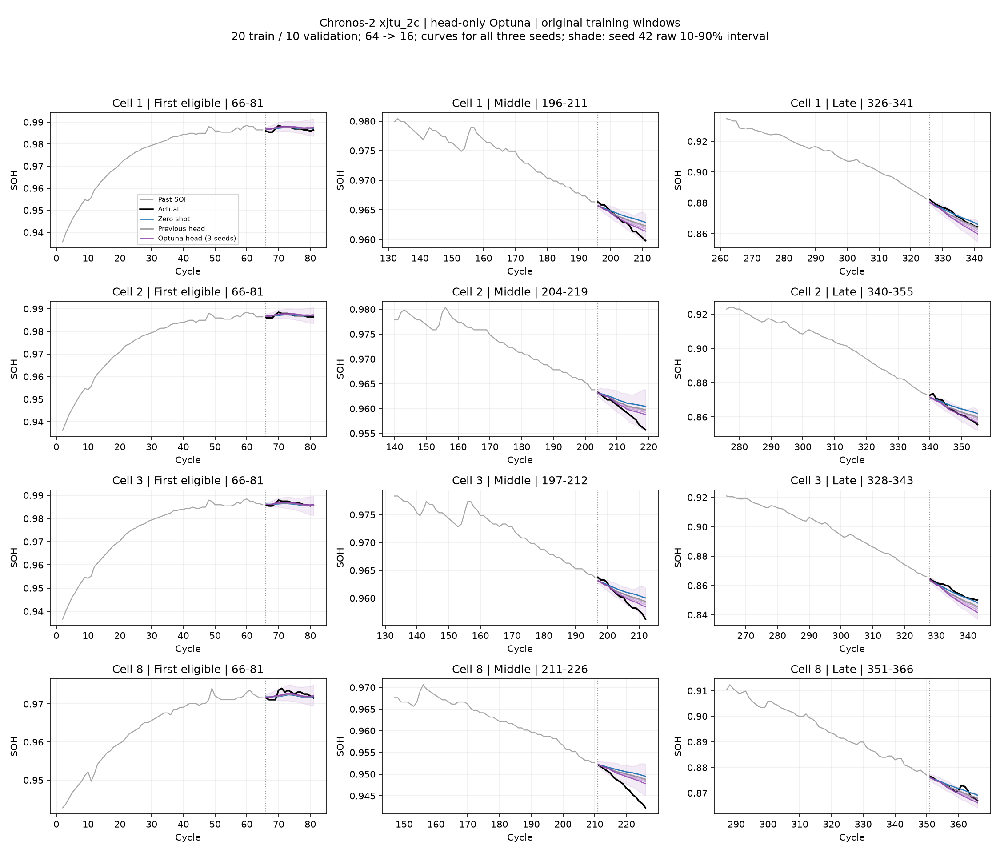
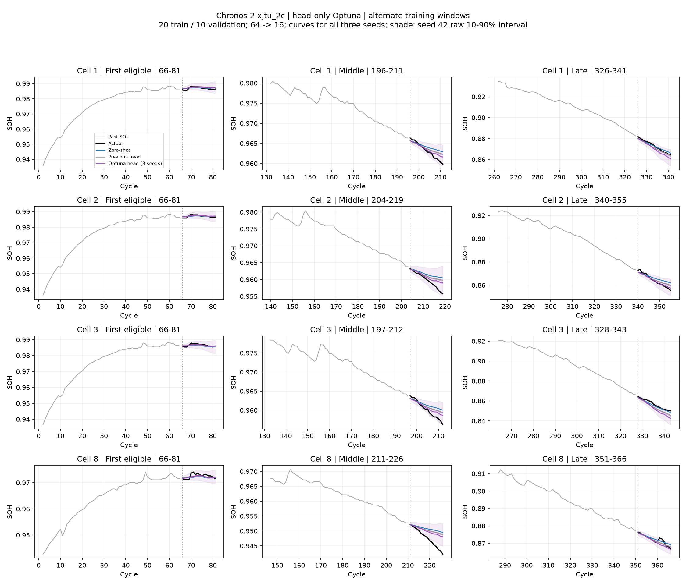
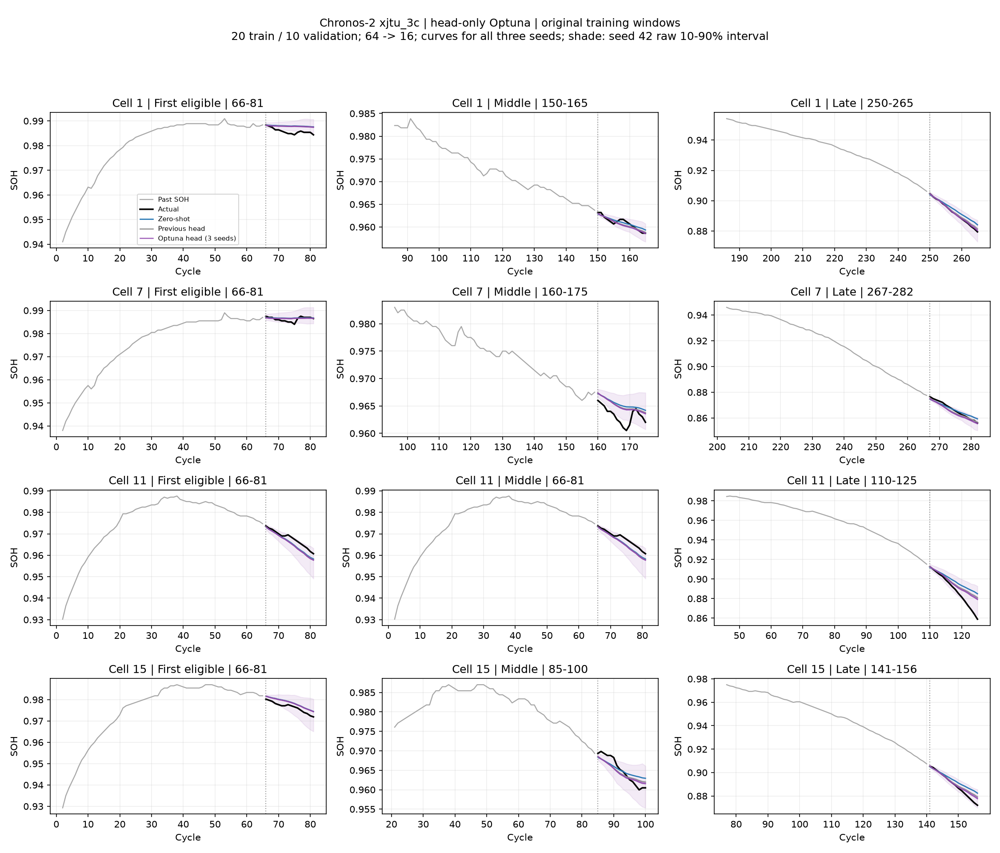
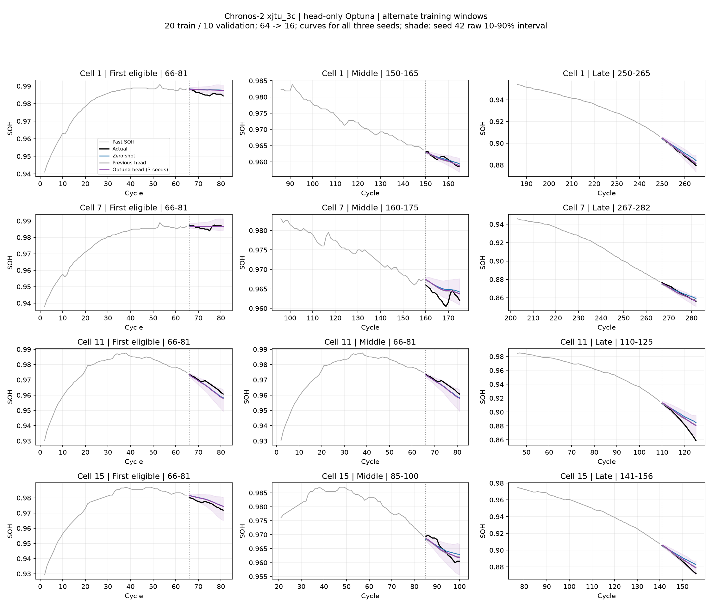

# Chronos-2 head-only: Optuna 20-window search

XJTU 2C·3C에서 기존 학습 20창·검증 10창과 배터리 분할을 고정하고 학습률·최대 학습 길이만 조건별 16회 탐색했다. 테스트를 보기 전에 두 조건의 탐색과 seed/학습창 확인 모델을 모두 고정했다. 기존 결과는 덮어쓰지 않았다.

## 핵심 결과

Optuna를 적용해도 두 조건이 모두 개선되지는 않았다. 아래 변화율은 전체 미학습 배터리의 모든 창 기준이며, 새 모델은 seed 3개 평균, 기존 head는 seed 42 한 번의 결과다. 따라서 동일 seed 분포끼리의 엄밀한 우위 검증은 아니다.

| 데이터 | Optuna: 순정 대비 RMSE 변화 | Optuna: 기존 head 대비 | 학습창을 바꾼 Optuna: 기존 head 대비 |
|---|---:|---:|---:|
| xjtu_2c | -6.5% | +1.3% | -0.2% |
| xjtu_3c | -24.9% | -6.3% | -1.1% |

2C에서는 검증 손실 개선이 테스트 개선으로 이어지지 않았다. 3C에서는 기존 학습창의 세 seed 모두 기존 head보다 RMSE가 낮았지만, 학습창을 바꾸면 추가 이득이 작아졌다. 현재 결과는 head-only의 보편적 개선이나 최적 설정을 입증하지 않는다. 모든 테스트 예측에서 q10>q90이 없는지와 내부 분위수 역전율은 summary.csv에 별도로 보고한다.

## 고정한 실험

- 학습 배터리 4·5번 각 10창, 검증 6번 10창. SOH 단독, 64→16, 배치 4. 본체 고정, 출력 head 3.06%만 학습.
- TPE 16 trials, 학습률 1e-7~3e-5 로그 탐색, 최대 100/200/400 steps. AdamW, weight decay 0, 선형 LR 감소, clip 1. 20 steps마다 검증하며 순정도 후보다. 초기 후보 네 개와 sampler 설정은 protocol.json에 기록했다.
- 검증 내부 분위수 역전율과 q10>q90 비율이 순정보다 늘지 않는 체크포인트 중 검증 분위수 손실 최소를 선택했다. Optuna 목적함수는 이 제약을 만족하는 best checkpoint 손실이다. 테스트 R²·RMSE는 선택에 쓰지 않았다.
- 선택한 LR·최대 steps를 고정하고 seed 42/43/44를 모두 평가했다. seed 42 원래 창 결과는 선택된 trial을 재사용했다. 각 seed의 best step은 같은 검증 규칙으로 고르며 seed를 골라 보고하지 않았다.
- alternate는 학습 배터리의 비중복 label 후보를 수명 구간 10등분 후 위치만으로 하나씩 고른 별도 20창이다. 검증 10창은 동일하고 Optuna 재탐색은 없다. 기존 20창 중 2C는 9창, 3C는 10창이 달라졌다. 같은 배터리에서 창만 바꾸므로 새로운 배터리 분할 검증은 아니다.
- old head는 이전 LR 1e-6/100 steps/seed 42 기준이다. 새 head의 세 seed 평균과 기존 단일 seed를 구분한다.

## 검증으로 선택한 설정

| 데이터 | LR | 최대 steps | seed 42 선택 step | 검증 loss: 이전 head → Optuna | 탐색 학습·검증 시간 |
|---|---:|---:|---:|---:|---:|
| xjtu_2c | 1e-06 | 400 | 180 | 2.3337 → 2.2140 | 203.2초 |
| xjtu_3c | 7.84e-07 | 200 | 200 | 1.9506 → 1.9037 | 273.2초 |

## 전체 미학습 배터리·전체 유효 창

새 Optuna 결과는 seed별 점수 평균이며 RMSE ±는 seed간 표준편차다. 예측을 평균낸 앙상블 점수가 아니다.

| 데이터 | 모델/학습창 | 창/seed | RMSE | R² 평균 | R² 중앙값 | R²<0 | WQL | PICP80 |
|---|---|---:|---:|---:|---:|---:|---:|---:|
| xjtu_2c | zero-shot | 1612 / 1 | 0.002653 | -0.257 | 0.288 | 36.6% | 0.001552 | 65.1% |
| xjtu_2c | previous_head20 | 1612 / 1 | 0.002449 | -0.179 | 0.413 | 31.9% | 0.001438 | 70.1% |
| xjtu_2c | optuna_original | 1612 / 3 | 0.002481 ± 0.000048 | -0.206 | 0.422 | 33.9% | 0.001448 | 70.0% |
| xjtu_2c | optuna_alternate | 1612 / 3 | 0.002444 ± 0.000021 | -0.183 | 0.437 | 33.2% | 0.001424 | 74.4% |
| xjtu_3c | zero-shot | 1841 / 1 | 0.004115 | 0.195 | 0.489 | 19.1% | 0.002464 | 61.7% |
| xjtu_3c | previous_head20 | 1841 / 1 | 0.003300 | 0.333 | 0.663 | 15.8% | 0.001926 | 72.6% |
| xjtu_3c | optuna_original | 1841 / 3 | 0.003092 ± 0.000060 | 0.362 | 0.704 | 15.2% | 0.001808 | 74.7% |
| xjtu_3c | optuna_alternate | 1841 / 3 | 0.003264 ± 0.000039 | 0.341 | 0.670 | 15.5% | 0.001914 | 70.0% |

## 기존 발표와 동일한 90창

새 Optuna 결과는 seed별 점수 평균이며 RMSE ±는 seed간 표준편차다. 예측을 평균낸 앙상블 점수가 아니다.

| 데이터 | 모델/학습창 | 창/seed | RMSE | R² 평균 | R² 중앙값 | R²<0 | WQL | PICP80 |
|---|---|---:|---:|---:|---:|---:|---:|---:|
| xjtu_2c | zero-shot | 90 / 1 | 0.003985 | -0.694 | 0.185 | 40.0% | 0.001867 | 63.5% |
| xjtu_2c | previous_head20 | 90 / 1 | 0.003797 | -0.589 | 0.371 | 38.9% | 0.001734 | 69.4% |
| xjtu_2c | optuna_original | 90 / 3 | 0.003800 ± 0.000030 | -0.591 | 0.291 | 40.7% | 0.001728 | 69.5% |
| xjtu_2c | optuna_alternate | 90 / 3 | 0.003762 ± 0.000007 | -0.563 | 0.330 | 38.1% | 0.001699 | 74.9% |
| xjtu_3c | zero-shot | 90 / 1 | 0.003008 | -0.032 | 0.442 | 31.1% | 0.001768 | 63.8% |
| xjtu_3c | previous_head20 | 90 / 1 | 0.002547 | 0.059 | 0.562 | 31.1% | 0.001516 | 73.0% |
| xjtu_3c | optuna_original | 90 / 3 | 0.002485 ± 0.000015 | 0.069 | 0.585 | 29.6% | 0.001475 | 74.4% |
| xjtu_3c | optuna_alternate | 90 / 3 | 0.002504 ± 0.000014 | 0.077 | 0.567 | 30.7% | 0.001491 | 71.3% |

## 해석 범위

R²는 각 16개 target의 평균으로 1−SSE/SST를 계산한다. 배터리 내 창 평균 후 seed·배터리 동등 가중 평균한다. 중앙값과 음수 비율도 같은 분포 가중치다. 상수창만 미정의, 음수는 유지한다. RMSE/WQL/PICP는 배터리별 계산 후 동일 가중 평균한다. 분위수는 정렬·보정하지 않으며, q10>q90이 발생한 배터리의 PICP는 N/A이고 전체 평균에도 전파한다.

학습창은 완료된 다른 배터리의 전체 이력에서 선택한다. target 초반 몇 라벨로 적응한 실험이 아니다. 테스트에서는 매 cycle 실제 과거 SOH가 갱신되고 stride 1로 예측한다. 전 수명 재귀 예측이 아니며 겹치는 창은 독립 표본이 아니다. 원래 test 배터리들을 이미 여러 번 확인한 탐색 실험이다. 세 seed와 같은 셀의 다른 학습창은 새 검증 배터리나 완전히 새로운 test의 대체가 아니다.

## xjtu_2c 그래프

## xjtu_3c 그래프

세부 seed별 결과: 각 데이터셋의 seed_summary.csv. 모든 창별 R²: window_metrics.csv.gz. 학습창: label_budget.csv. 탐색: trials.csv 및 trial별 validation.csv. 전체 예측 배열은 남기지 않고 대표 창 배열과 그래프를 보관했다.
