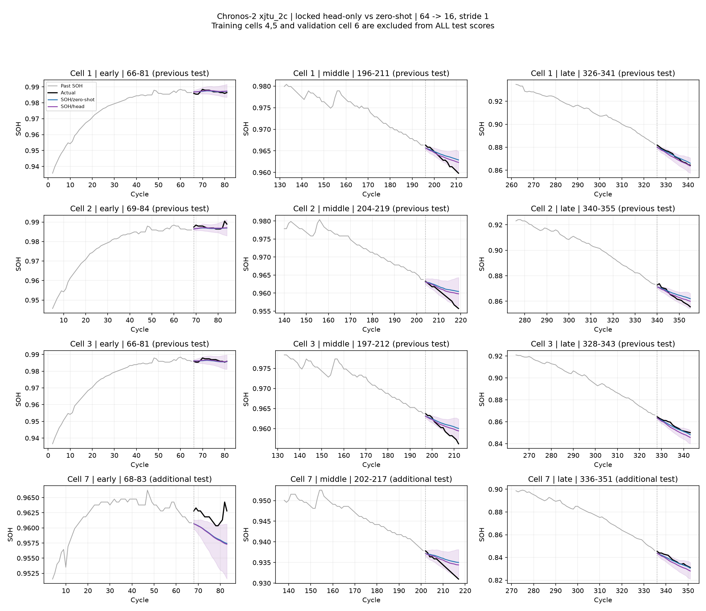
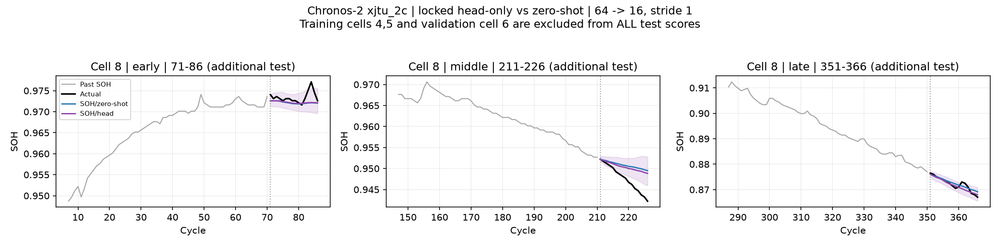
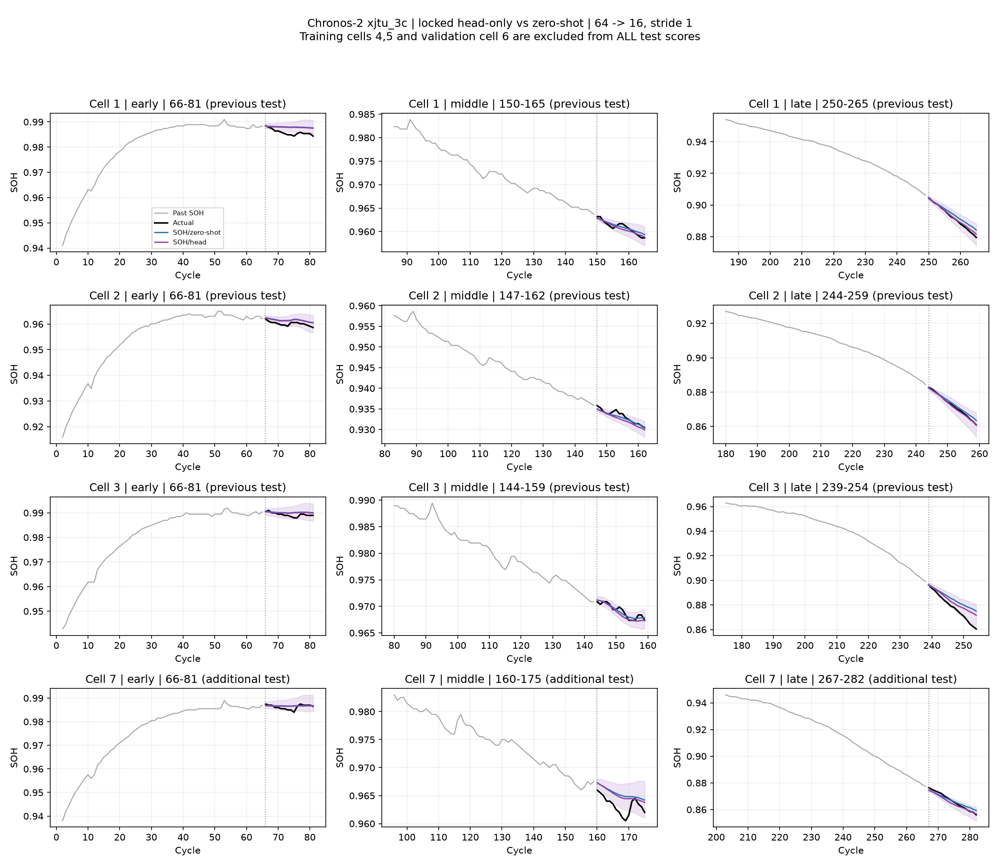
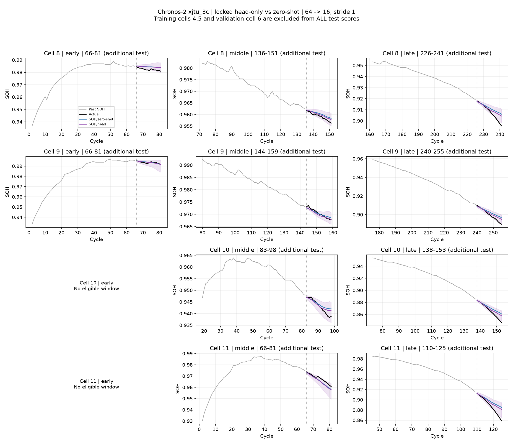
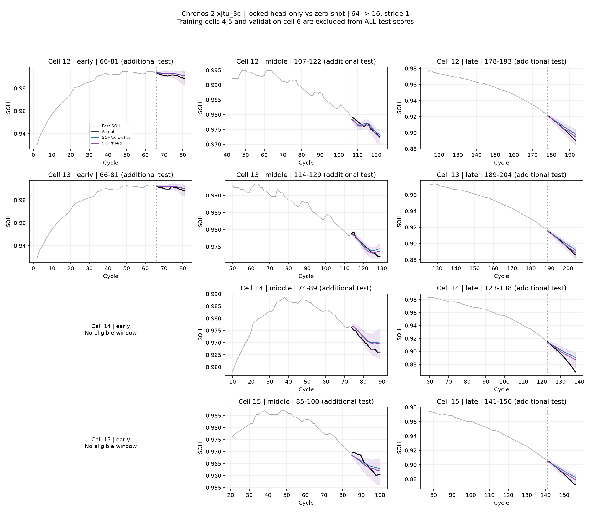

# C2 head-only: XJTU 전체 미학습 배터리 테스트

기존 검증으로 선택한 SOH-only head를 고정해 추가 추론만 수행했다. 학습·검증 배터리 4·5·6번은 모든 테스트 집계에서 제외했다. 각 조건의 head를 같은 조건의 배터리에 적용했으며, 다른 데이터셋으로의 전이 평가는 아니다.

2C: 이전 1·2·3번 + 추가 7·8번. 3C: 이전 1·2·3번 + 추가 7~15번. 모든 유효 64→16 창, stride 1을 평가했다. 이전 세 배터리의 예측은 동일한 정답·시작 cycle을 확인해 재사용했고 원래 점수와 일치함을 확인했다.

R²는 창별 정석 계산 후 배터리 내 평균, 배터리 간 동등 가중 평균이다. 중앙값·음수 비율도 같은 배터리 가중치를 쓴다. 상수 창은 R² 미정의로 제외한다. PICP는 q10>q90 역전이 있으면 N/A이며, 예측을 정렬하거나 보정하지 않는다.

| 데이터 | 테스트 범위 | 모델 | 배터리 / 창 | RMSE | R² 평균 | R² 중앙값 | 음수 창 비율 | WQL | PICP@80 |
|---|---|---|---:|---:|---:|---:|---:|---:|---:|
| xjtu_2c | previous_test | SOH/zero-shot | 3 / 950 | 0.002789 | -0.245 | 0.269 | 36.1% | 0.001568 | 65.2% |
| xjtu_2c | previous_test | SOH/head | 3 / 950 | 0.002643 | -0.187 | 0.416 | 33.3% | 0.001482 | 69.7% |
| xjtu_2c | additional_test | SOH/zero-shot | 2 / 662 | 0.002449 | -0.274 | 0.337 | 37.4% | 0.001529 | 65.0% |
| xjtu_2c | additional_test | SOH/head | 2 / 662 | 0.002159 | -0.167 | 0.409 | 29.9% | 0.001372 | 70.8% |
| xjtu_2c | all_test | SOH/zero-shot | 5 / 1612 | 0.002653 | -0.257 | 0.288 | 36.6% | 0.001552 | 65.1% |
| xjtu_2c | all_test | SOH/head | 5 / 1612 | 0.002449 | -0.179 | 0.413 | 31.9% | 0.001438 | 70.1% |
| xjtu_3c | previous_test | SOH/zero-shot | 3 / 637 | 0.002977 | -0.110 | 0.435 | 31.3% | 0.001757 | 64.8% |
| xjtu_3c | previous_test | SOH/head | 3 / 637 | 0.002607 | -0.012 | 0.571 | 27.7% | 0.001530 | 72.5% |
| xjtu_3c | additional_test | SOH/zero-shot | 9 / 1204 | 0.004495 | 0.297 | 0.501 | 15.1% | 0.002699 | 60.7% |
| xjtu_3c | additional_test | SOH/head | 9 / 1204 | 0.003531 | 0.448 | 0.673 | 11.8% | 0.002058 | 72.6% |
| xjtu_3c | all_test | SOH/zero-shot | 12 / 1841 | 0.004115 | 0.195 | 0.489 | 19.1% | 0.002464 | 61.7% |
| xjtu_3c | all_test | SOH/head | 12 / 1841 | 0.003300 | 0.333 | 0.663 | 15.8% | 0.001926 | 72.6% |

추가 테스트 배터리는 이번 head 학습·검증·체크포인트 선택에 쓰이지 않았다. 다만 이미 순정 zero-shot 결과를 확인한 데이터이며, foundation 사전학습 데이터와의 중복은 검증하지 않았다. 겹치는 창은 독립 표본이 아니며 단일 seed 결과이다. 초·중·후반 점수와 내부 분위수 역전율은 CSV에 보존했다.

