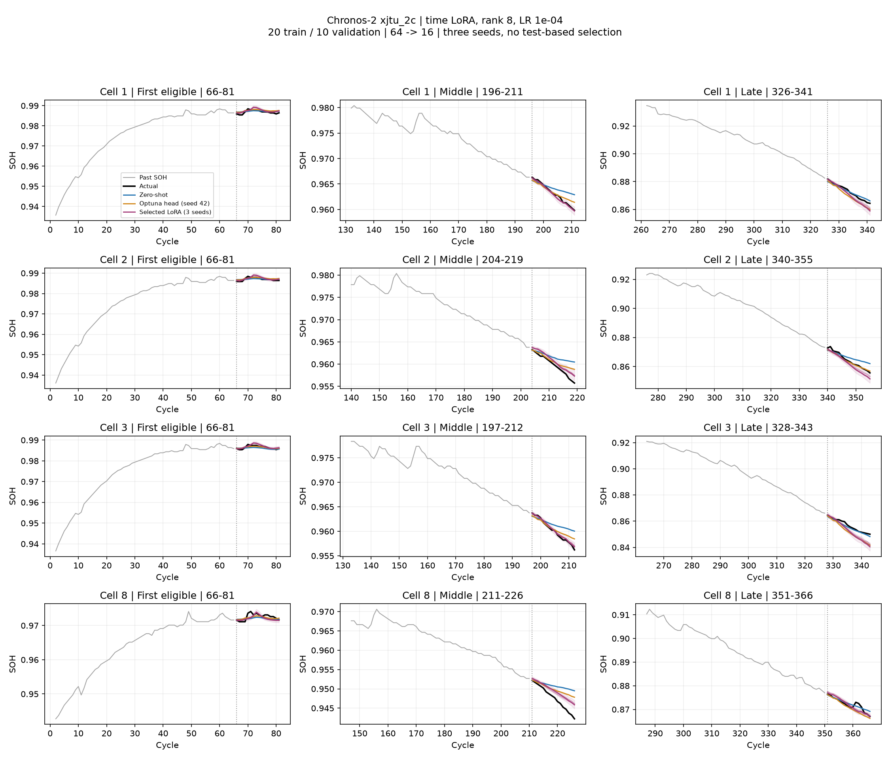
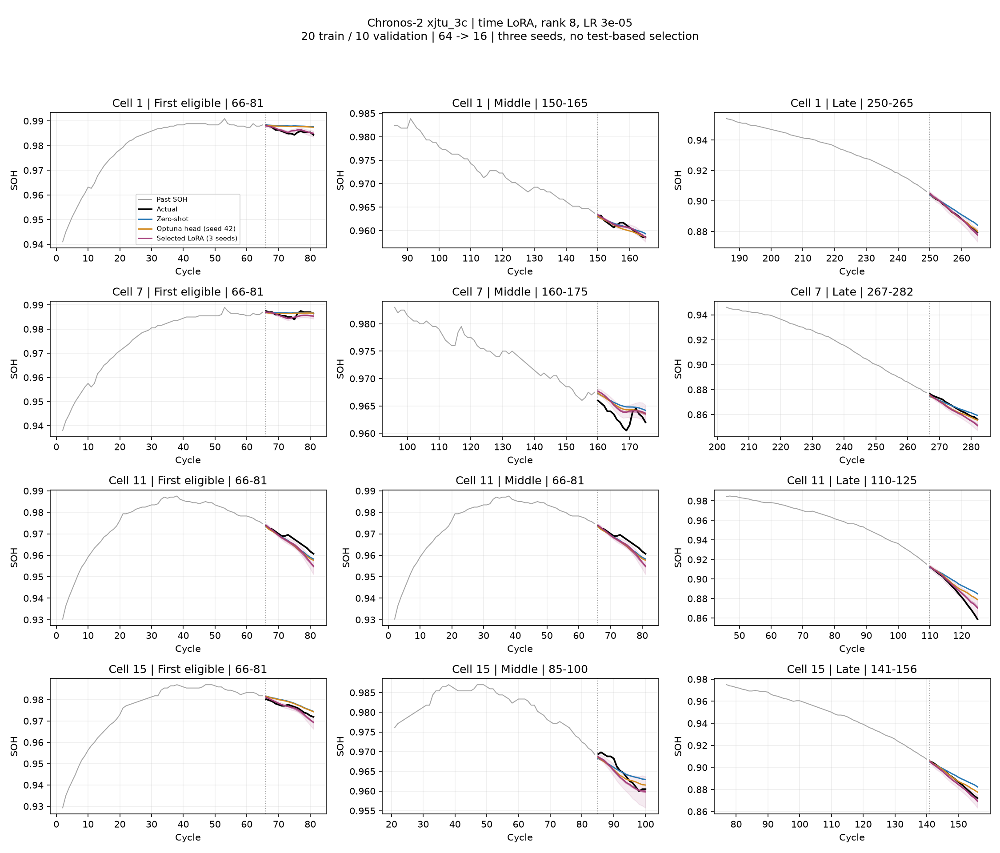

# C2 LoRA 개선 실험: 고정 20창

시간 Attention Q/K/V/O만 조정하는 LoRA와, 출력 head의 세 선형층에도 LoRA를 추가하는 방식을 비교했다. rank 8, alpha 16, LR 1e-5/3e-5/1e-4, 최대 400 step. 배터리별 조건 6개, 검증 분위수 손실로만 선택 후 seed 42/43/44 확인.

학습 4·5번 각 10창, 검증 6번 10창. 본체 원래 가중치는 전부 고정했고 해시로 검증했다. 모든 설정·체크포인트는 테스트 전에 확정했다. 선택 기준은 기존과 같은 정규화 분위수 손실이며 검증 분위수 역전율이 순정보다 늘어나는 체크포인트는 제외, step 0 포함. Raw SOH 검증 RMSE는 진단용으로만 기록.

| 조건 | 선택 구조 | LR | seed별 선택 step | 학습 파라미터 |
|---|---|---:|---|---:|
| xjtu_2c | time | 1e-04 | 100, 100, 120 | 589,824 |
| xjtu_3c | time | 3e-05 | 220, 180, 160 | 589,824 |

## all_test

| 조건 | 모델 | RMSE | R² 평균 | R² 중앙값 | R²<0 | WQL | PICP80 |
|---|---|---:|---:|---:|---:|---:|---:|
| xjtu_2c | zero-shot (1 seeds) | 0.002653 ± 0.000000 | -0.257 | 0.288 | 36.6% | 0.001552 | 65.1% |
| xjtu_2c | previous_head20 (1 seeds) | 0.002449 ± 0.000000 | -0.179 | 0.413 | 31.9% | 0.001438 | 70.1% |
| xjtu_2c | selected_lora (3 seeds) | 0.002295 ± 0.000059 | -0.020 | 0.538 | 25.9% | 0.001478 | 36.7% |
| xjtu_2c | optuna_head (3 seeds) | 0.002481 ± 0.000048 | -0.206 | 0.422 | 33.9% | 0.001448 | 70.0% |
| xjtu_3c | zero-shot (1 seeds) | 0.004115 ± 0.000000 | 0.195 | 0.489 | 19.1% | 0.002464 | 61.7% |
| xjtu_3c | previous_head20 (1 seeds) | 0.003300 ± 0.000000 | 0.333 | 0.663 | 15.8% | 0.001926 | 72.6% |
| xjtu_3c | selected_lora (3 seeds) | 0.002258 ± 0.000009 | 0.515 | 0.849 | 11.8% | 0.001338 | 66.8% |
| xjtu_3c | optuna_head (3 seeds) | 0.003092 ± 0.000060 | 0.362 | 0.704 | 15.2% | 0.001808 | 74.7% |

## slide90

| 조건 | 모델 | RMSE | R² 평균 | R² 중앙값 | R²<0 | WQL | PICP80 |
|---|---|---:|---:|---:|---:|---:|---:|
| xjtu_2c | zero-shot (1 seeds) | 0.003985 ± 0.000000 | -0.694 | 0.185 | 40.0% | 0.001867 | 63.5% |
| xjtu_2c | previous_head20 (1 seeds) | 0.003797 ± 0.000000 | -0.589 | 0.371 | 38.9% | 0.001734 | 69.4% |
| xjtu_2c | selected_lora (3 seeds) | 0.003264 ± 0.000186 | -0.292 | 0.536 | 29.3% | 0.001682 | 37.7% |
| xjtu_2c | optuna_head (3 seeds) | 0.003800 ± 0.000030 | -0.591 | 0.291 | 40.7% | 0.001728 | 69.5% |
| xjtu_3c | zero-shot (1 seeds) | 0.003008 ± 0.000000 | -0.032 | 0.442 | 31.1% | 0.001768 | 63.8% |
| xjtu_3c | previous_head20 (1 seeds) | 0.002547 ± 0.000000 | 0.059 | 0.562 | 31.1% | 0.001516 | 73.0% |
| xjtu_3c | selected_lora (3 seeds) | 0.002368 ± 0.000052 | 0.329 | 0.706 | 17.4% | 0.001336 | 61.8% |
| xjtu_3c | optuna_head (3 seeds) | 0.002485 ± 0.000015 | 0.069 | 0.585 | 29.6% | 0.001475 | 74.4% |

Optuna head와 selected LoRA는 각각 동일 seed 3개의 평균이다. 예측 앙상블이 아니며 seed 선택은 없다. R²는 창별 표준 1−SSE/SST 후 배터리·seed 동등 가중으로 집계하며 중앙값·음수 비율도 같은 분포 가중치다. RMSE/WQL/PICP도 배터리·seed 동등 가중. 음수 R²는 유지하며 q10>q90이면 PICP는 N/A로 전파한다.

이번에도 완료된 다른 배터리 이력에서 라벨 20창을 택했다. 대상 배터리 초반만 사용하는 설정이 아니다. 세 seed는 새로운 배터리 분할 검증을 대신하지 않는다. 기존 테스트 결과를 이미 반복해서 확인한 탐색 연구이므로 새 데이터셋에 대한 확정적 일반화 주장으로 해석할 수 없다. 학습 라벨 수·관측 길이·평가 창·지표 공식은 변경하지 않았다.

