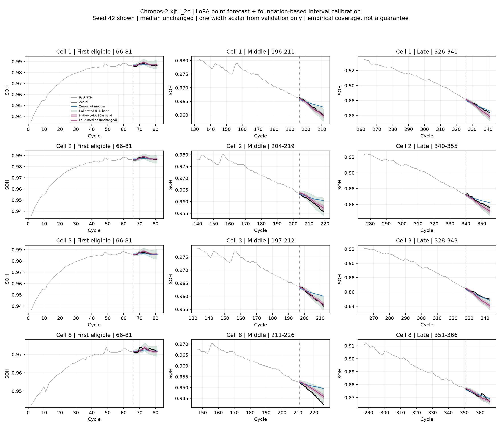
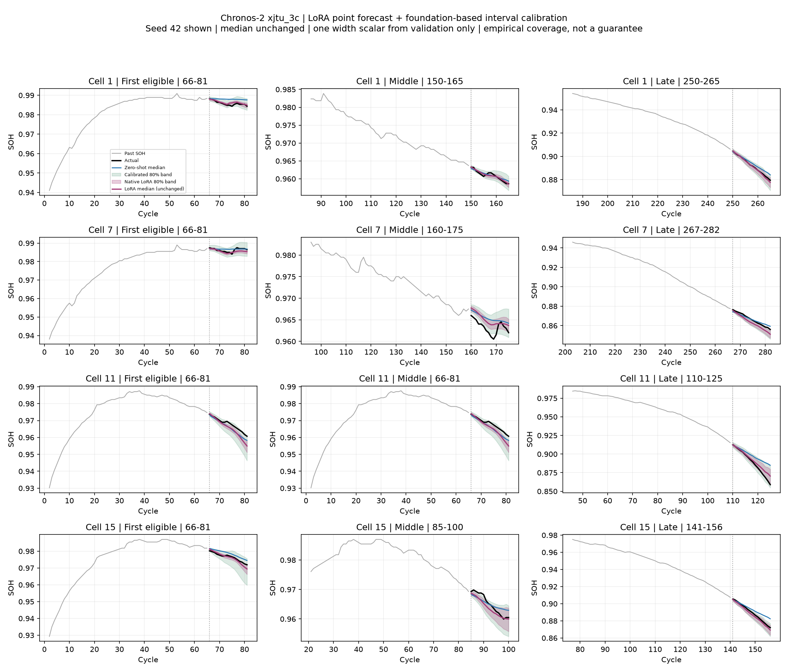

# C2 few-shot 개선 결과: 시간 Attention LoRA

학습 20창·검증 10창을 그대로 유지하면서, 시간 Attention LoRA의 학습률과 학습 길이를 조정해 XJTU 2C·3C 모두 점예측을 개선했다. 출력 head에 LoRA를 추가하는 방식은 검증에서 선택되지 않았다. 순정 파라미터는 전부 고정하고 589,824개(약 0.49%)의 추가 파라미터만 학습했다.

## 전체 테스트 결과

17개 미학습 배터리의 3,453창, 64→16, stride 1. Optuna head와 새 LoRA는 seed 42·43·44의 점수 평균. 예측 앙상블도, 가장 좋은 seed만 고른 결과도 아니다.

| 조건 | 모델 | RMSE | 창 R² 평균 | 창 R² 중앙값 | 음수 창 | WQL | PICP80 |
|---|---|---:|---:|---:|---:|---:|---:|
| xjtu_2c | 순정 | 0.002653 | -0.257 | 0.288 | 36.6% | 0.001552 | 65.1% |
| xjtu_2c | 이전 head (1 seed) | 0.002449 | -0.179 | 0.413 | 31.9% | 0.001438 | 70.1% |
| xjtu_2c | Optuna head (3 seeds) | 0.002481 | -0.206 | 0.422 | 33.9% | 0.001448 | 70.0% |
| xjtu_2c | 시간 LoRA 원본 (3 seeds) | 0.002295 | -0.020 | 0.538 | 25.9% | 0.001478 | 36.7% |
| xjtu_2c | 시간 LoRA + 구간 보정 (3 seeds) | 0.002295 | -0.020 | 0.538 | 25.9% | 0.001354 | 71.6% |
| xjtu_3c | 순정 | 0.004115 | 0.195 | 0.489 | 19.1% | 0.002464 | 61.7% |
| xjtu_3c | 이전 head (1 seed) | 0.003300 | 0.333 | 0.663 | 15.8% | 0.001926 | 72.6% |
| xjtu_3c | Optuna head (3 seeds) | 0.003092 | 0.362 | 0.704 | 15.2% | 0.001808 | 74.7% |
| xjtu_3c | 시간 LoRA 원본 (3 seeds) | 0.002258 | 0.515 | 0.849 | 11.8% | 0.001338 | 66.8% |
| xjtu_3c | 시간 LoRA + 구간 보정 (3 seeds) | 0.002258 | 0.515 | 0.849 | 11.8% | 0.001345 | 85.1% |

## 개선 폭과 선택한 설정

- xjtu_2c: 순정 대비 RMSE 13.5% 감소, Optuna head 대비 7.5% 감소, 이전 head 대비 6.3% 감소. LR 1e-04, seed별 선택 step 100, 100, 120.
- xjtu_3c: 순정 대비 RMSE 45.1% 감소, Optuna head 대비 27.0% 감소, 이전 head 대비 31.6% 감소. LR 3e-05, seed별 선택 step 220, 180, 160.

rank 8 / alpha 16, 시간 Attention Q·K·V·O만 조정. 학습 배터리 4·5번 각 10창, 검증 6번 10창. 학습률 1e-5/3e-5/1e-4와 시간 단독/시간+head 두 구조를 최대 400 step까지 비교했다. 20 step마다 기존 분위수 역전 제한을 만족하는 최소 검증 분위수 손실을 선택했다. 모든 설정과 세 seed의 체크포인트를 확정한 뒤 테스트를 수행했다.

## 예측 구간 문제와 별도 보정

원본 LoRA는 2C의 PICP80이 36.7%로 하락했다. 점예측 개선과 확률예측 품질은 구분해야 한다. 추가 학습 없이 아래 보정을 별도 결과로 평가했다.

`보정 분위수 = LoRA 중앙 예측값 + k × (순정 분위수 − 순정 중앙 예측값)`

LoRA의 중앙 예측값은 그대로 유지한다. k≥1은 기존 검증 10창에서 80%의 점별 포함률을 만족하도록 정하고 두 조건·모든 seed의 k를 고정한 뒤 테스트했다. 테스트 정답은 k를 정하는 데 사용하지 않았다. 2C에서는 k=1, 3C에서는 약 1.04~1.13이다. 보정 후 PICP80은 2C 71.6%, 3C 85.1%. 2C는 여전히 명목 80%보다 낮으며, PICP는 클수록 무조건 좋은 지표가 아니다. 폭과 WQL도 함께 보고했다.

이는 원본 LoRA의 확률 출력이 아니라 순정 C2의 폭을 활용한 별도 보정이다. 실제 사용 시 순정과 LoRA 추론이 모두 필요하다. 이번에는 이미 저장된 순정 테스트 예측을 재사용했다. 검증 창을 모델 선택에도 사용했고 한 창의 cycle들이 상관되어 있으므로, 통계적 80% 보장이나 독립 conformal 검증으로 주장할 수 없다.

## 확인과 해석 범위

- 본체 파라미터 전체 해시가 학습 전후 동일했고 지정한 LoRA만 업데이트됨을 확인했다.
- 각 조건의 seed 3개 모두 같은 seed의 Optuna head보다 RMSE가 낮았다. 배터리별 seed 평균은 2C 5개 중 4개, 3C 12개 중 11개에서 개선됐다.
- 구간 보정 전후 RMSE·창 R² 평균·중앙값·음수 비율이 동일함을 전체/구간별로 확인했다.
- R²는 각 16-cycle 창 안에서 표준 1−SSE/SST로 계산하고 배터리·seed에 동등 가중한다. 식·평가 창·데이터 예산을 변경하지 않았다.
- 20창은 미래 라벨 320개와 입력 context를 뜻한다. 완료된 다른 배터리 이력을 쓰는 적응이며 대상 배터리 초반만 사용하는 설정이 아니다.
- 기존 테스트를 여러 번 확인한 탐색 실험이다. 이번 보정도 원본 LoRA의 테스트 문제를 확인한 뒤 설계했으므로 새로운 독립 데이터에서 재검증해야 한다.
- 현재 권고: XJTU 점예측은 시간 Attention LoRA를 유력 후보로 둔다. 예측 구간을 보고할 때는 원본과 보정 버전을 명확히 구분한다. 전체 데이터셋의 head-only를 즉시 교체하는 근거는 아니다.

탐색과 seed 확인·전체 테스트 실행 약 11분 21초, 구간 보정·평가 약 48초(코드 준비 제외). [원본 LoRA 탐색 보고서](../report.md), [수치 표](summary.csv), [보정 설정](calibration.json).

## xjtu_2c 대표 예측창

## xjtu_3c 대표 예측창

