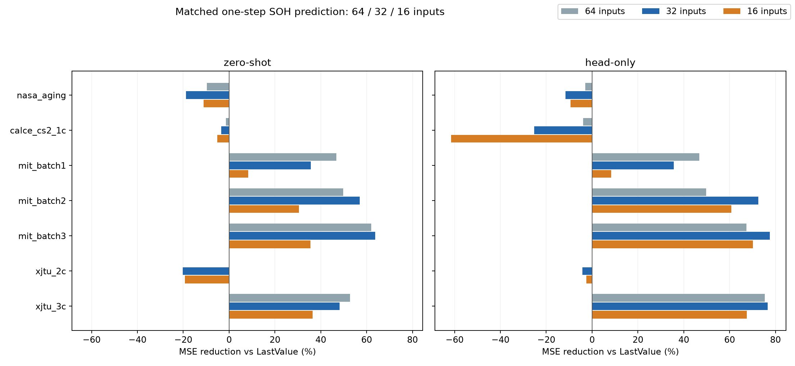
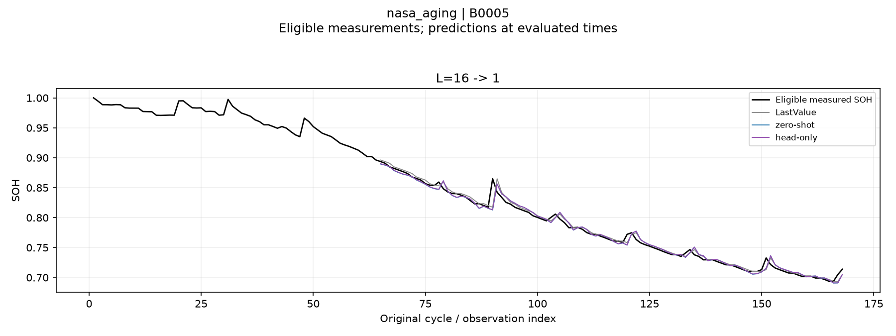
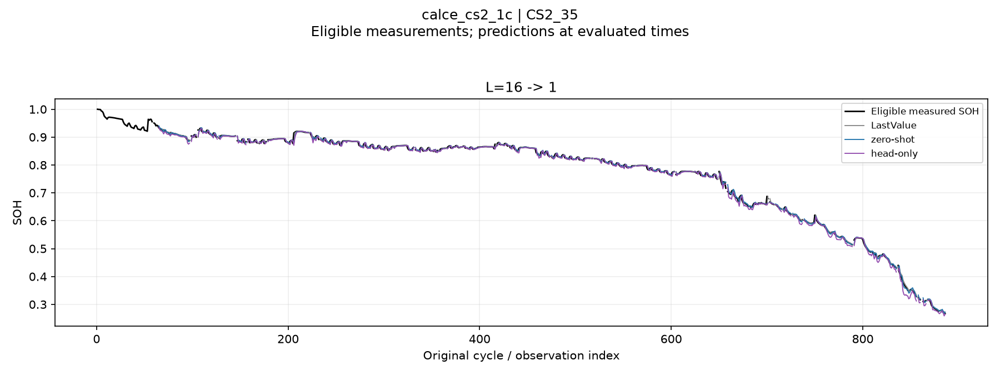
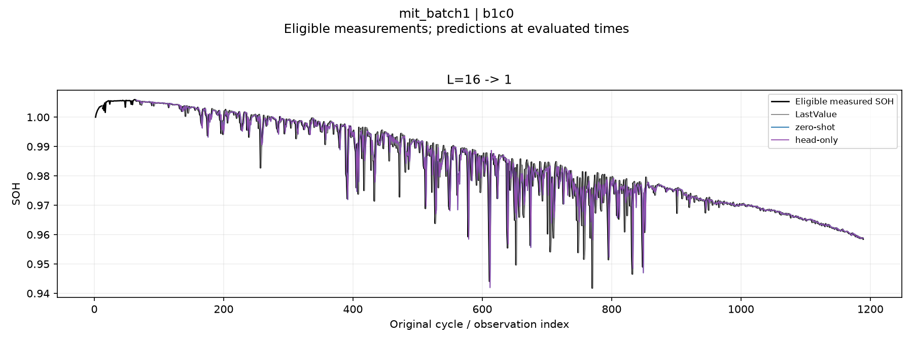
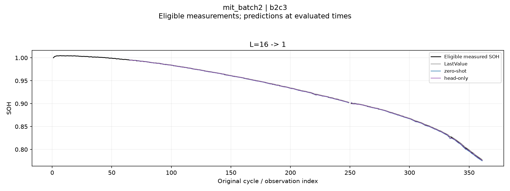
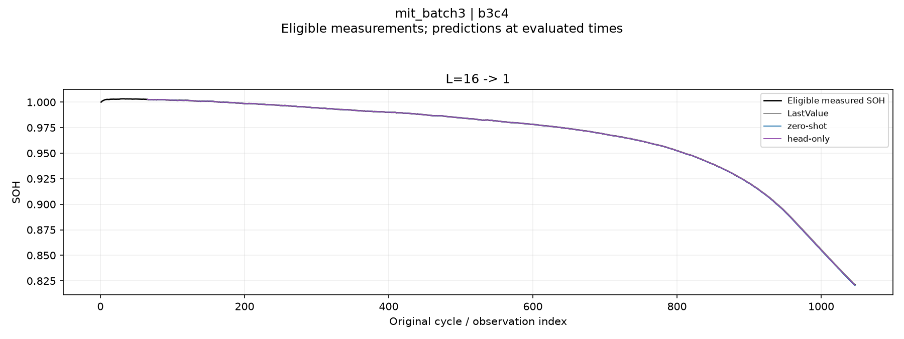
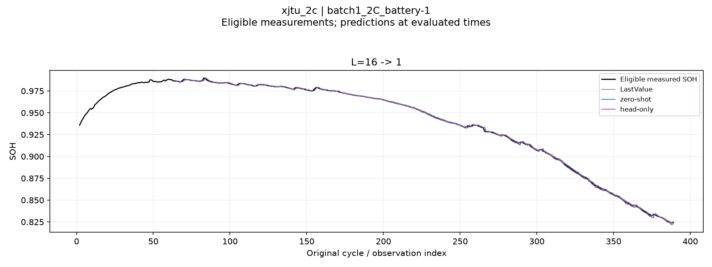
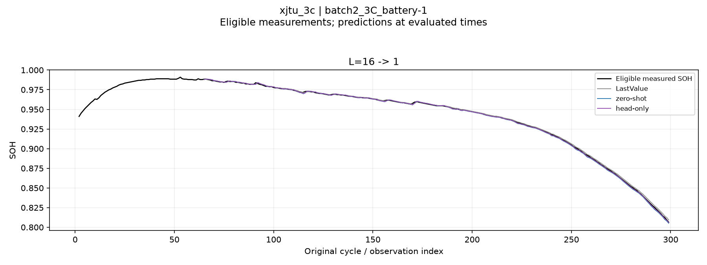

# C2 현재 SOH 예측: 64→1 · 32→1 · 16→1

과거 SOH 16개 기록 위치로 현재 SOH 한 점을 예측한다. 실제 과거 SOH로 입력을 갱신하는 rolling one-step 평가다.

- 기존 reviewed_native_v3 정제·NaN 마스크, 배터리 분할, few-shot 학습/검증 정답과 97,868개 테스트 시점을 유지한다.
- 비교 조건: LastValue, C2 zero-shot, C2 head-only. Linear 제외.
- Head-only: backbone 고정, output_patch_embedding만 학습. Fold당 학습 8개·검증 4개 정답, LR 1e-6/1e-5, 각각 100 steps, seed 42. 검증으로 head 선택 후 테스트한다.
- R²: 같은 배터리 기록의 여러 테스트 시점 한 점 예측을 모아서 계산한 뒤 기록별 동일 가중 평균. 음수 유지, 정의 불가능한 값의 수는 CSV에 표시한다.
- RMSE/MAE는 SOH 비율 단위, 기록별 동일 가중 평균이다. LastValue MSE 감소율도 각 기록의 비율을 먼저 구한 뒤 평균한다.
- 기존 64/32 결과는 XPU, 새 결과는 runtime.json에 기록된 장치에서 계산된다. 하드웨어·패키지 차이에 의한 수치 및 head 선택 차이는 입력 길이 효과와 완전히 분리되지 않는다.
- CALCE의 파일 사이 미확인 물리 cycle, MIT 계측 불일치, 결측 입력 관련 기존 제한을 유지한다.

## 16→1 결과

| 데이터셋 | 조건 | Test R² | RMSE | MAE | LastValue 대비 MSE 감소율 |
|---|---|---:|---:|---:|---:|
| nasa_aging | LastValue | 0.941505 | 0.008843 | 0.005188 | +0.00% |
| nasa_aging | zero-shot | 0.930147 | 0.009362 | 0.005556 | -11.17% |
| nasa_aging | head-only | 0.931121 | 0.009281 | 0.005744 | -9.35% |
| calce_cs2_1c | LastValue | 0.999131 | 0.005686 | 0.003443 | +0.00% |
| calce_cs2_1c | zero-shot | 0.999087 | 0.005831 | 0.003633 | -5.09% |
| calce_cs2_1c | head-only | 0.998556 | 0.007126 | 0.004680 | -61.59% |
| mit_batch1 | LastValue | 0.996393 | 0.000615 | 0.000382 | +0.00% |
| mit_batch1 | zero-shot | 0.996678 | 0.000586 | 0.000347 | +8.39% |
| mit_batch1 | head-only | 0.996678 | 0.000586 | 0.000347 | +8.39% |
| mit_batch2 | LastValue | 0.999555 | 0.000956 | 0.000640 | +0.00% |
| mit_batch2 | zero-shot | 0.999681 | 0.000796 | 0.000513 | +30.48% |
| mit_batch2 | head-only | 0.999752 | 0.000595 | 0.000342 | +60.68% |
| mit_batch3 | LastValue | 0.999910 | 0.000368 | 0.000224 | +0.00% |
| mit_batch3 | zero-shot | 0.999943 | 0.000293 | 0.000174 | +35.46% |
| mit_batch3 | head-only | 0.999974 | 0.000186 | 0.000091 | +70.13% |
| xjtu_2c | LastValue | 0.999582 | 0.001049 | 0.000745 | +0.00% |
| xjtu_2c | zero-shot | 0.999510 | 0.001140 | 0.000770 | -19.30% |
| xjtu_2c | head-only | 0.999571 | 0.001061 | 0.000699 | -2.48% |
| xjtu_3c | LastValue | 0.998497 | 0.001587 | 0.001254 | +0.00% |
| xjtu_3c | zero-shot | 0.999130 | 0.001236 | 0.000999 | +36.37% |
| xjtu_3c | head-only | 0.999606 | 0.000853 | 0.000686 | +67.50% |

## 입력 길이별 head-only 비교

| 데이터셋 | 64 R² | 32 R² | 16 R² | 64 LV 감소율 | 32 LV 감소율 | 16 LV 감소율 |
|---|---:|---:|---:|---:|---:|---:|
| nasa_aging | 0.939368 | 0.934822 | 0.931121 | -2.89% | -11.67% | -9.35% |
| calce_cs2_1c | 0.999092 | 0.998883 | 0.998556 | -3.97% | -25.22% | -61.59% |
| mit_batch1 | 0.997124 | 0.996937 | 0.996678 | +46.85% | +35.66% | +8.39% |
| mit_batch2 | 0.999763 | 0.999813 | 0.999752 | +49.70% | +72.51% | +60.68% |
| mit_batch3 | 0.999968 | 0.999980 | 0.999974 | +67.28% | +77.57% | +70.13% |
| xjtu_2c | 0.999554 | 0.999543 | 0.999571 | -0.02% | -4.15% | -2.48% |
| xjtu_3c | 0.999745 | 0.999749 | 0.999606 | +75.33% | +76.67% | +67.50% |

입력 길이 간 차이는 동일한 LastValue 기준 MSE 감소율의 차이(percentage points)로 표시한다.

분위수 역전은 정렬·보정하지 않는다. 점 예측 지표와 별개로 summary.csv의 quantile_crossing_fraction 및 invalid_interval_fraction을 확인한다.

[전체 지표](context_comparison_scores.csv) · [LastValue 비교](lastvalue_comparison.csv) · [길이별 차이](context16_lastvalue_change.csv) · [검증](verification.json)

시각화는 정제 기준을 통과한 SOH만 표시한다. 제외된 관측점은 점·선 모두 숨기며, 해당 위치는 빈 구간으로 남긴다. 원래 cycle 위치와 평가 전의 유효한 측정 구간은 유지한다.

