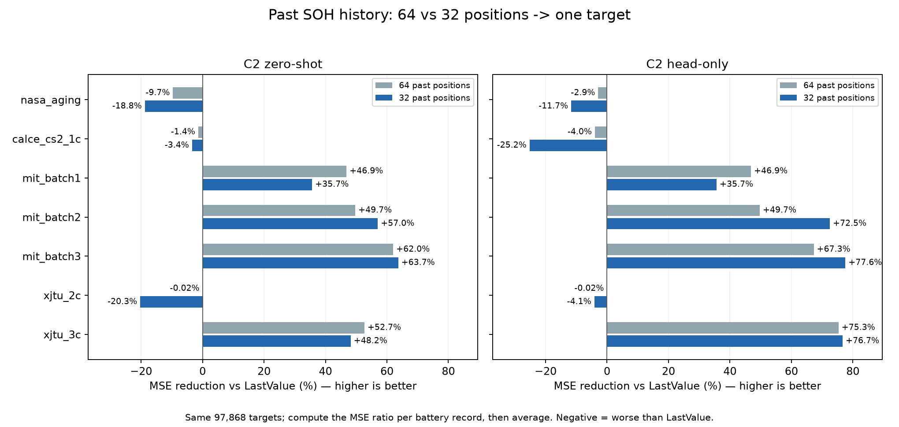
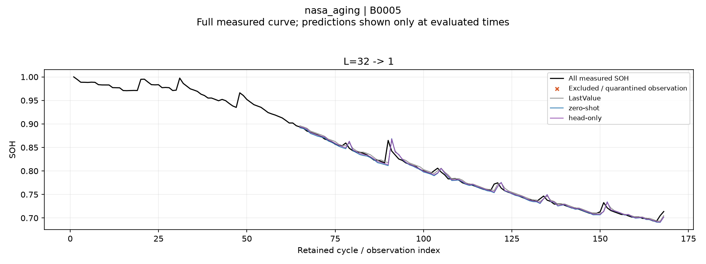
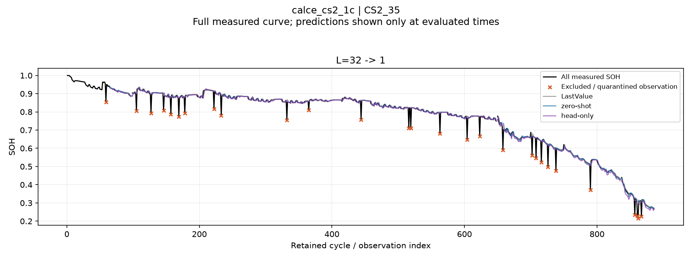
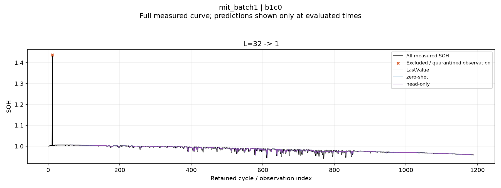
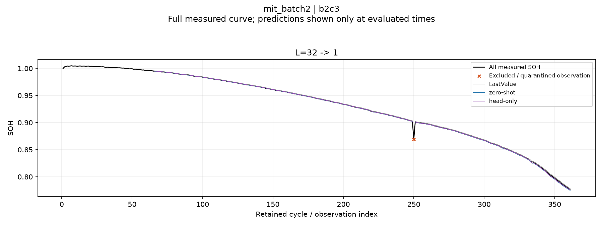
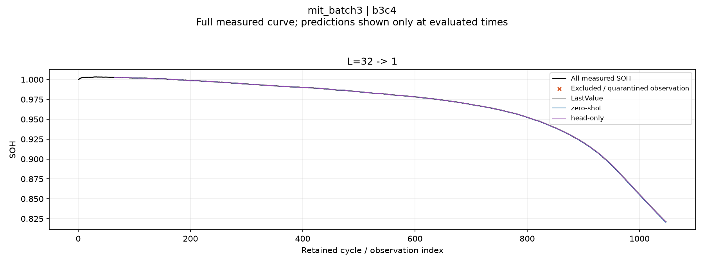
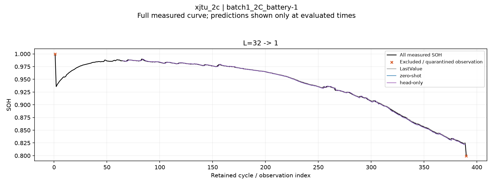
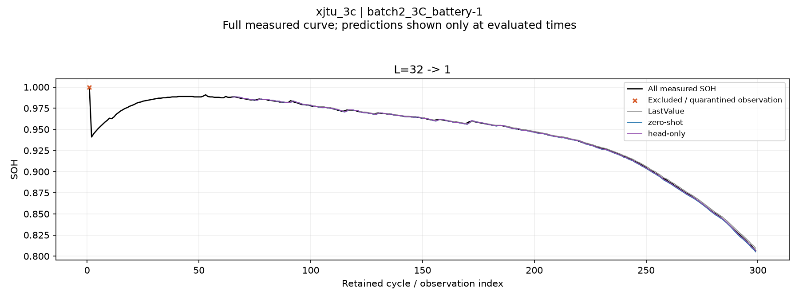

# C2 현재 SOH: 입력 이력 64개에서 32개로 축소

**32→1 실험이다.** 과거 t−32~t−1의 SOH 기록 위치로 y_t 하나를 예측한다. 64→32 미래 다중 예측이 아니다.

- Linear는 이번 실험과 비교표에서 제외했다. LastValue, C2 zero-shot, C2 head-only만 비교한다.
- reviewed_native_v3의 Q/Qref·SOH·정제 마스크를 그대로 사용했다. 64개 입력 창의 뒤쪽 32개 위치만 남겼으며 결측은 NaN으로 유지했다. 보간하거나 시간을 압축하지 않았다.
- 64→1 실험과 같은 배터리 분할·학습/검증 정답·97,868개 테스트 정답 시점이다. 32개로 예측 가능해진 초기 시점을 추가하지 않았다. LastValue 예측도 두 입력 길이에서 동일함을 확인했다.
- NASA/CALCE 4-fold, 나머지는 기존 고정 분할. 각 fold는 학습 배터리 2개×4 labels=8개, 검증 배터리 1개×4 labels=4개다. 테스트 배터리 자체를 calibration한 실험은 아니다.
- 각 fold/LR는 순정 C2에서 독립 시작하고 output_patch_embedding만 학습했다. LR 1e-6/1e-5, 각각 100 steps, batch 4, seed 42. 검증 손실과 분위수 역전 guard로 선택하며 step 0도 허용한다. 모든 head를 고른 뒤 테스트를 실행했다.
- 실제 과거 SOH로 매 시점 입력을 갱신하는 rolling one-step이다. CALCE의 관측 간 누락 물리 cycle과 MIT CV 계측 불일치에 대한 기존 제한은 그대로다.

## LastValue 대비 성능

배터리 기록마다 `1 − MSE_model / MSE_LastValue`를 계산한 뒤 동일 가중 평균했다. 아래는 그 값을 100배 한 **MSE 감소율(%)**이다. 양수는 개선, 음수는 악화다. 평균 RMSE의 비율이나 R²가 아니다. 분모 0은 NaN으로 두고 CSV에 제외 수를 기록한다.

| 데이터셋 | 64 zero-shot | 64 head-only | 32 zero-shot | 32 head-only |
|---|---:|---:|---:|---:|
| nasa_aging | -9.65% | -2.89% | -18.79% | -11.67% |
| calce_cs2_1c | -1.41% | -3.97% | -3.43% | -25.22% |
| mit_batch1 | +46.85% | +46.85% | +35.66% | +35.66% |
| mit_batch2 | +49.70% | +49.70% | +57.03% | +72.51% |
| mit_batch3 | +62.04% | +67.28% | +63.69% | +77.57% |
| xjtu_2c | -0.02% | -0.02% | -20.30% | -4.15% |
| xjtu_3c | +52.70% | +75.33% | +48.21% | +76.67% |

## 32→1 절대 오차

RMSE·MAE는 SOH 비율 단위이며 배터리 기록별 오차의 동일 가중 평균이다. R²는 summary.csv의 보조 지표로만 남겼다.

| 데이터셋 | LastValue RMSE | Zero-shot RMSE | Head-only RMSE | Head-only MAE |
|---|---:|---:|---:|---:|
| nasa_aging | 0.008843 | 0.009610 | 0.009310 | 0.005122 |
| calce_cs2_1c | 0.005686 | 0.005783 | 0.006294 | 0.004160 |
| mit_batch1 | 0.000615 | 0.000499 | 0.000499 | 0.000298 |
| mit_batch2 | 0.000956 | 0.000636 | 0.000506 | 0.000298 |
| mit_batch3 | 0.000368 | 0.000219 | 0.000166 | 0.000090 |
| xjtu_2c | 0.001049 | 0.001158 | 0.001082 | 0.000670 |
| xjtu_3c | 0.001587 | 0.001066 | 0.000696 | 0.000538 |

## 입력 축소와 head 학습의 효과

입력 축소 효과는 **같은 LastValue 기준**의 MSE 감소율이 64개에서 32개로 얼마나 변했는지 비교한다. 첫 두 열은 위 성능표의 `32 − 64`이며 단위는 감소율의 percentage point(%p)다. 양수가 개선이다. 마지막 열은 32개 입력에서 head-only의 zero-shot 대비 MSE 감소율이다.

| 데이터셋 | 64→32 zero-shot 변화(%p) | 64→32 head-only 변화(%p) | 32 head vs zero-shot MSE 감소율 |
|---|---:|---:|---:|
| nasa_aging | -9.14 | -8.78 | +6.01% |
| calce_cs2_1c | -2.02 | -21.25 | -20.61% |
| mit_batch1 | -11.19 | -11.19 | +0.00% |
| mit_batch2 | +7.32 | +22.80 | +42.00% |
| mit_batch3 | +1.64 | +10.29 | +42.99% |
| xjtu_2c | -20.28 | -4.13 | +13.65% |
| xjtu_3c | -4.49 | +1.34 | +56.34% |

32개 head-only는 LastValue 기준으로 MIT batch2·3, XJTU 3C에서 64개 조건보다 높은 감소율을 보였다. NASA·CALCE·MIT batch1·XJTU 2C는 낮아졌다. MIT batch1은 step 0이 선택돼 head 학습의 추가 이득이 없다. CALCE는 검증으로 선택한 head가 테스트에서는 zero-shot보다 악화됐다.

같은 LastValue 분모를 쓰는 위 비교를 주 비교로 삼는다. 참고 파일 `context32_vs64_summary.csv`는 각 모델의 64개 입력 MSE를 분모로 한 별도 상대비교다. 배터리별 분모가 달라 두 평균의 순위가 달라질 수 있으므로 두 수치를 같은 지표로 해석하지 않는다.

32개 head-only의 테스트 분위수 역전 비율은 NASA 7.69%, CALCE 17.37%, XJTU 2C 9.12%다. CALCE에는 q10>q90인 예측도 있어 해당 기록의 구간 폭·포함률을 NaN으로 남겼다. 검증에서의 guard가 테스트의 분위수 순서를 보장하지는 않는다. 위 표는 중앙값 예측의 점오차다.

단일 seed의 점추정이다. 상세 CSV에 배터리별 값, 중앙값, 개선한 기록 수, 분모 0 제외 수를 함께 기록했다. 일부 MIT 물리 배터리는 연속 기록이 나뉘어 있어 여기의 동일 가중 단위는 기존 실험과 같은 배터리 기록이다.

## 평가 범위

| 데이터셋 | 테스트 기록 | 정답 시점 | 최소 유효 입력 / 32 | 결측 입력이 있는 시점 |
|---|---:|---:|---:|---:|
| nasa_aging | 4 | 380 | 32 | 0 |
| calce_cs2_1c | 4 | 3,549 | 27 | 2,527 |
| mit_batch1 | 43 | 33,478 | 20 | 121 |
| mit_batch2 | 45 | 21,057 | 29 | 657 |
| mit_batch3 | 37 | 35,681 | 31 | 224 |
| xjtu_2c | 5 | 1,690 | 32 | 0 |
| xjtu_3c | 12 | 2,033 | 32 | 0 |

## 선택한 head

| 데이터셋 / fold | LR | step |
|---|---:|---:|
| nasa_aging / test_B0005 | 1e-06 | 100 |
| nasa_aging / test_B0006 | 1e-05 | 100 |
| nasa_aging / test_B0007 | 0 | 0 |
| nasa_aging / test_B0018 | 1e-05 | 20 |
| calce_cs2_1c / test_CS2_35 | 1e-05 | 100 |
| calce_cs2_1c / test_CS2_36 | 1e-05 | 100 |
| calce_cs2_1c / test_CS2_37 | 1e-05 | 80 |
| calce_cs2_1c / test_CS2_38 | 1e-05 | 100 |
| mit_batch1 / fixed | 0 | 0 |
| mit_batch2 / fixed | 1e-05 | 20 |
| mit_batch3 / fixed | 1e-06 | 60 |
| xjtu_2c / fixed | 1e-06 | 20 |
| xjtu_3c / fixed | 1e-06 | 20 |

step 0은 검증에서 학습 전 순정 가중치가 선택되어 zero-shot과 같은 예측을 썼다는 뜻이다. 분위수는 사후 정렬하지 않으며 역전이 있으면 구간 지표에 드러낸다.

## 대표 예측

대표 배터리는 이전과 같은 첫 테스트 배터리다. 전체 측정 곡선을 보이고 예측선만 평가 가능한 시점에 표시한다.

## 상세 파일

[LastValue 대비 전체·구간별 비교](lastvalue_comparison.csv) · [배터리별 비교](lastvalue_battery_metrics.csv) · [같은 LastValue 기준 입력 축소 효과](context32_vs64_lastvalue_change.csv)
[절대 오차](summary.csv) · [평가 범위](coverage.csv) · [학습 정답](label_budget.csv) · [프로토콜](protocol.json) · [검증](verification.json)
실험 재현: `.venv\Scripts\python.exe scripts/run_c2_context32.py --stage all`. 최종 표시 재현: `.venv\Scripts\python.exe scripts/render_c2_context32_results.py`.
