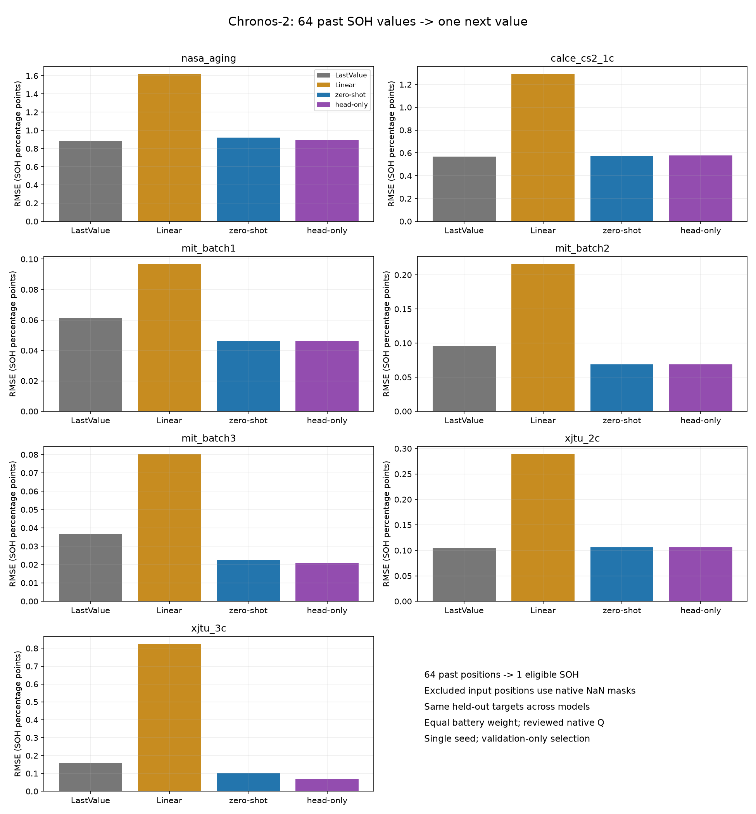
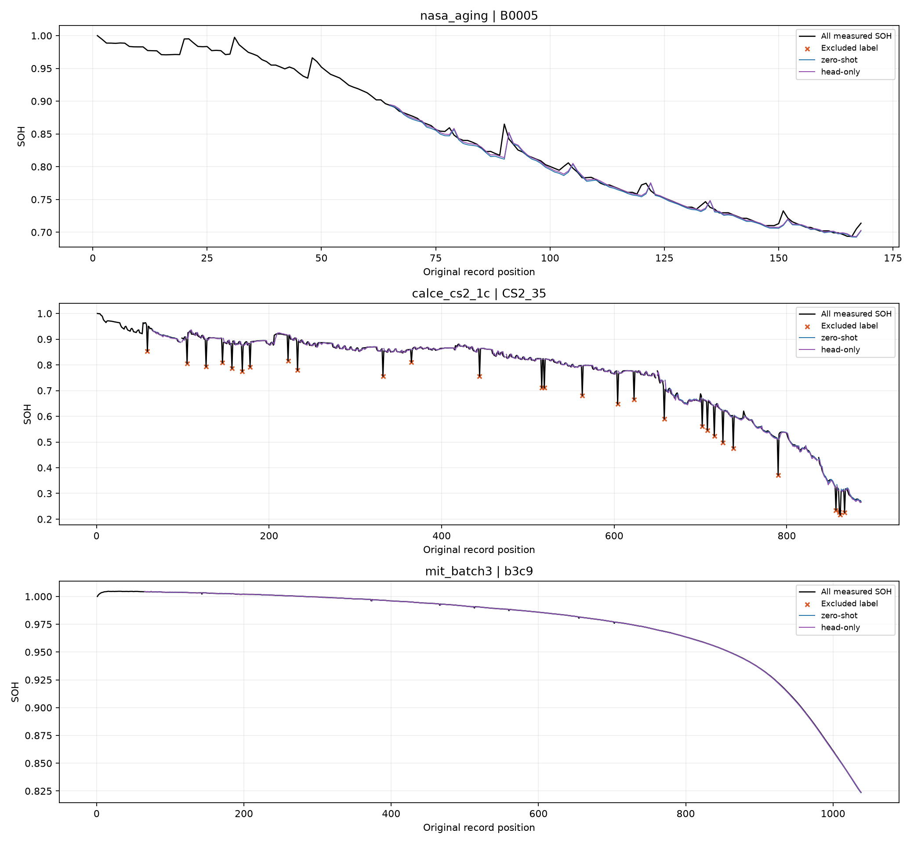
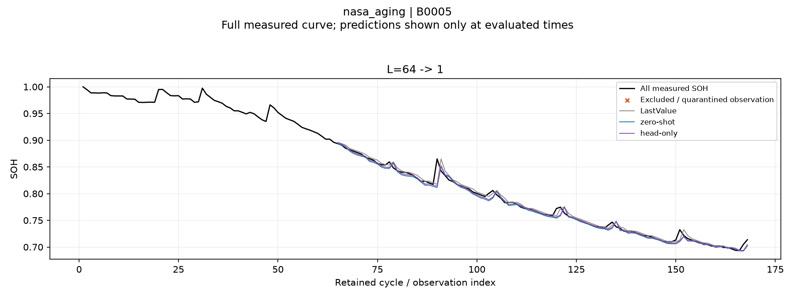
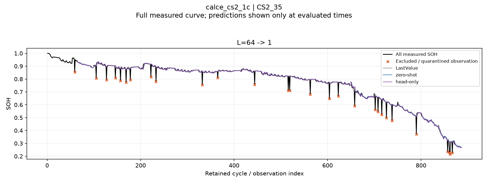
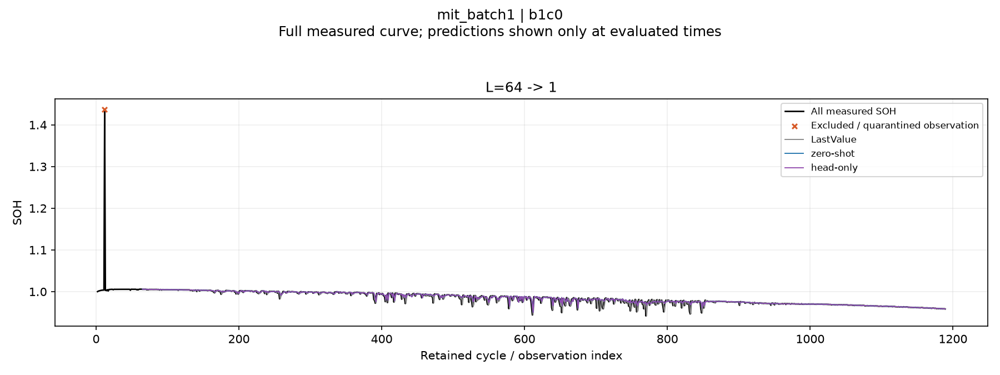
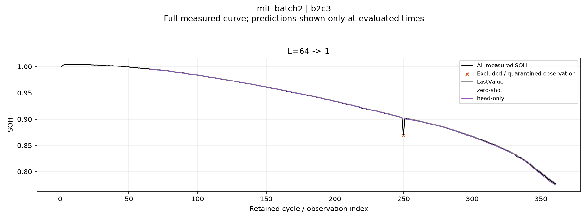
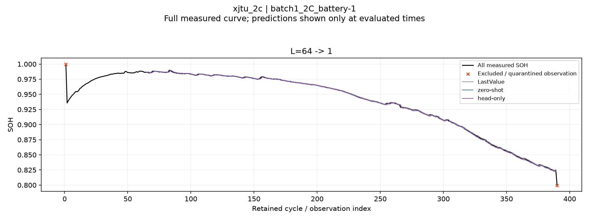
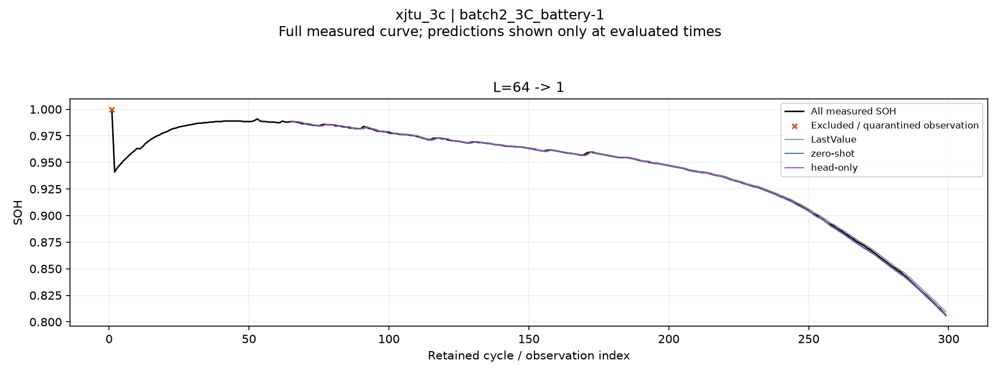

# C2 현재 SOH 예측: 전처리 재검토 후 64→1 재실험

입력은 t-64~t-1의 SOH 기록 위치 64개, 정답은 y_t 하나다. 실제 과거 관측으로 매번 입력을 갱신하는 rolling one-step이며 센서 신호만으로 현재 SOH를 추정한 실험은 아니다. 입력 길이 감소·RUL은 실행하지 않았다.

## 데이터와 평가 범위

- `reviewed_native_v3`: 원본 Q/Qref·SOH·cycle은 유지했다. NASA의 충전 로그 부재 3건은 독립 방전 대조 후 유지했다. MIT의 원본 QDischarge를 우선하며 적분 불일치·기록 공백만으로 제외하지 않는다. MIT의 CV 계측 불일치 원인이 해결됐다는 뜻은 아니다. 카운터 reset·충방전 혼재·기타 실제 이상과 사전 noisy 채널 6개는 제외한다.
- CALCE의 불완전 충전 관측은 정답에서 제외한다. 과거 입력에서 제외된 위치는 NaN으로 두고 C2의 native mask로 처리한다. 행을 삭제해 시간을 압축하거나 SOH를 보간하지 않는다. 결측이 있으면 유효 입력은 64개보다 적다.
- 선형 기준선이 정의되도록 유효 과거 입력 최소 2개를 요구한다. 실제 최소 유효 입력 수는 아래 표에 보고한다. LastValue는 64개 위치 안의 마지막 유효 SOH, Linear는 유효값을 원래 위치 좌표에 회귀해 t를 예측한다.
- 모든 모델은 같은 유효 정답 시점·같은 입력값과 마스크로 평가했다. CALCE는 파일 간 누락 물리 cycle이 알려지지 않은 관측 순서이며, MIT 연속 기록은 기존 record 경계에서 입력창을 재시작한다.
- 기존과 대상 시점·일부 학습 label 위치가 바뀌었으므로 과거 strict_v2 점수와 수치만 비교해 모델 개선율로 해석하지 않는다.

| 데이터셋 | 테스트 기록 | 이전 → 이번 정답 시점 | 결측 입력이 있는 시점 | 최소 유효 입력 / 64 |
|---|---:|---:|---:|---:|
| nasa_aging | 4 | 185 → 380 | 0 | 64 |
| calce_cs2_1c | 4 | 191 → 3,549 | 3,358 | 57 |
| mit_batch1 | 43 | 32,773 → 33,478 | 302 | 50 |
| mit_batch2 | 45 | 19,857 → 21,057 | 1,265 | 61 |
| mit_batch3 | 37 | 23,147 → 35,681 | 448 | 63 |
| xjtu_2c | 5 | 1,685 → 1,690 | 5 | 63 |
| xjtu_3c | 12 | 2,021 → 2,033 | 12 | 63 |

## 학습·지표

- C2 `amazon/chronos-2`, pinned revision `29ec3766d36d6f73f0696f85560a422f50e8498c`, float32. Zero-shot은 순정 가중치, head-only는 output_patch_embedding만 학습하고 본체를 고정했다.
- 기존 물리 배터리 분할 유지: NASA/CALCE 4-fold, 나머지 고정 분할, 총 13개 head. 각 fold는 별도 train 배터리 2개 × 정답 4개 = 8개 학습 label, validation 배터리 1개 × 4개 = 4개 검증 label이다. 테스트 배터리 자체를 calibration한 실험은 아니다. 과거 입력 SOH도 관측 비용이다.
- 원래 C2에서 fold/LR별 독립 초기화, LR 1e-6/1e-5, 각 100 steps, batch 4, seed 42. 20 steps마다 검증하고 step 0도 후보에 포함했다. 정답 1개만 loss에 사용하고 내부 16-wide patch의 나머지는 mask한다. 모든 head 선택을 끝낸 뒤 테스트 추론을 실행했다.
- 선택은 validation normalized native quantile loss이며 분위수 역전·잘못된 구간 비율이 순정보다 나빠지는 후보는 선택하지 않는다. 테스트 성능으로 학습·정제·체크포인트를 고르지 않았다.
- 아래 RMSE는 배터리별 RMSE의 동일 가중 평균이며 **SOH percentage point(pp)** 단위다. CSV는 SOH 비율 단위다. 1-point window R²는 정의되지 않아 사용하지 않는다. CSV의 temporal_r2는 여러 예측 시점을 모은 보조 지표다.
- 분위수를 사후 정렬·clipping하지 않았다. q10>q90인 관측이 있으면 해당 배터리의 PICP/구간폭은 NaN으로 노출한다. 단일 seed 결과다.

| 데이터셋 | LastValue RMSE(pp) | Linear RMSE(pp) | C2 zero-shot RMSE(pp) | C2 head-only RMSE(pp) |
|---|---:|---:|---:|---:|
| nasa_aging | 0.88430 | 1.62089 | 0.92114 | 0.89464 |
| calce_cs2_1c | 0.56857 | 1.29297 | 0.57272 | 0.57932 |
| mit_batch1 | 0.06147 | 0.09690 | 0.04604 | 0.04604 |
| mit_batch2 | 0.09562 | 0.21624 | 0.06890 | 0.06890 |
| mit_batch3 | 0.03676 | 0.08043 | 0.02272 | 0.02086 |
| xjtu_2c | 0.10492 | 0.28963 | 0.10633 | 0.10633 |
| xjtu_3c | 0.15873 | 0.82514 | 0.10214 | 0.07061 |

## 선택한 head

| 데이터셋 / fold | LR | step | 학습 / 검증 label |
|---|---:|---:|---:|
| nasa_aging / test_B0005 | 1e-06 | 60 | 8 / 4 |
| nasa_aging / test_B0006 | 1e-06 | 60 | 8 / 4 |
| nasa_aging / test_B0007 | 0 | 0 | 8 / 4 |
| nasa_aging / test_B0018 | 1e-06 | 100 | 8 / 4 |
| calce_cs2_1c / test_CS2_35 | 1e-06 | 100 | 8 / 4 |
| calce_cs2_1c / test_CS2_36 | 1e-06 | 100 | 8 / 4 |
| calce_cs2_1c / test_CS2_37 | 1e-06 | 100 | 8 / 4 |
| calce_cs2_1c / test_CS2_38 | 1e-06 | 100 | 8 / 4 |
| mit_batch1 / fixed | 0 | 0 | 8 / 4 |
| mit_batch2 / fixed | 0 | 0 | 8 / 4 |
| mit_batch3 / fixed | 1e-05 | 100 | 8 / 4 |
| xjtu_2c / fixed | 0 | 0 | 8 / 4 |
| xjtu_3c / fixed | 1e-06 | 20 | 8 / 4 |

step 0은 검증 기준에서 학습한 head가 선택되지 않아 순정 C2와 같은 결과라는 뜻이다.

## 이전 누락 사례의 재예측

NASA B0005, CALCE CS2_35, MIT b3c9는 이전 감사에서 구간 누락을 확인한 사례로, 모델 점수와 무관하게 표시했다. 검은 선은 전체 실제 측정값이고 예측선만 평가 가능한 정답 시점에 표시한다.

## 대표 테스트 배터리

### nasa_aging

### calce_cs2_1c

### mit_batch1

### mit_batch2

### mit_batch3

### xjtu_2c

### xjtu_3c

## 상세 결과와 재현

[프로토콜](protocol.json) · [검증 결과](verification.json) · [요약 점수](summary.csv) · [배터리별·초중후반 점수](battery_metrics.csv) · [체크포인트](selected_checkpoints.csv) · [학습 label·입력 범위](label_budget.csv)
[평가 범위](coverage_comparison.csv) · [결측 유무별 점수](context_subset_summary.csv) · [데이터 변경 내역](../../preprocessing_reviewed_native_v3/reclassified_observations.csv) · [전처리 정책](../../preprocessing_reviewed_native_v3/policy.json)
재현 명령: `.venv\Scripts\python.exe scripts/run_c2_one_step_context.py --reviewed --stage all`. 기존 strict_v2 결과·가중치와 다른 디렉터리에 저장했다.
