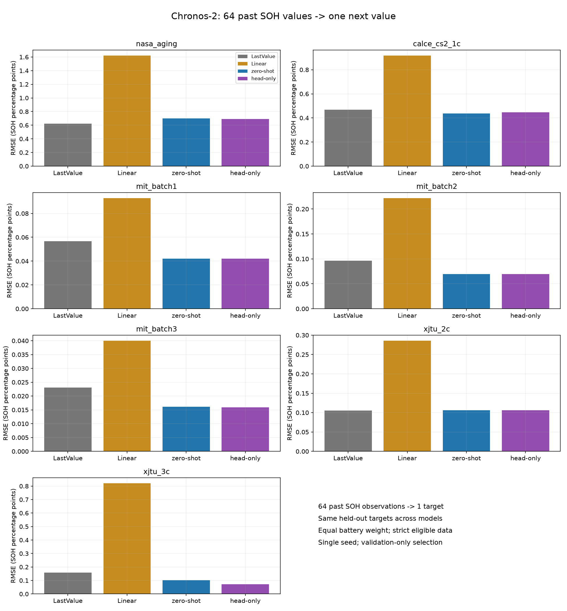
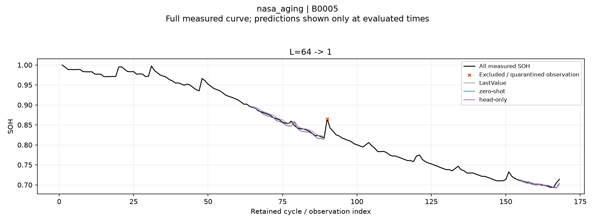
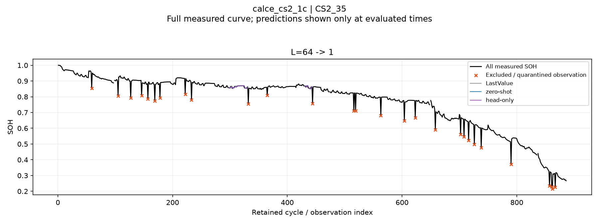
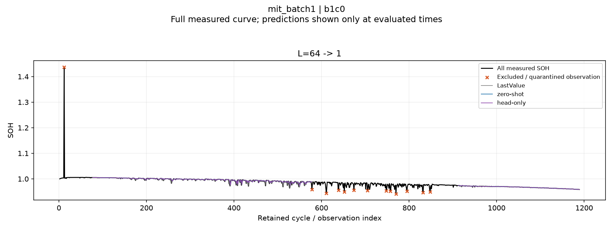
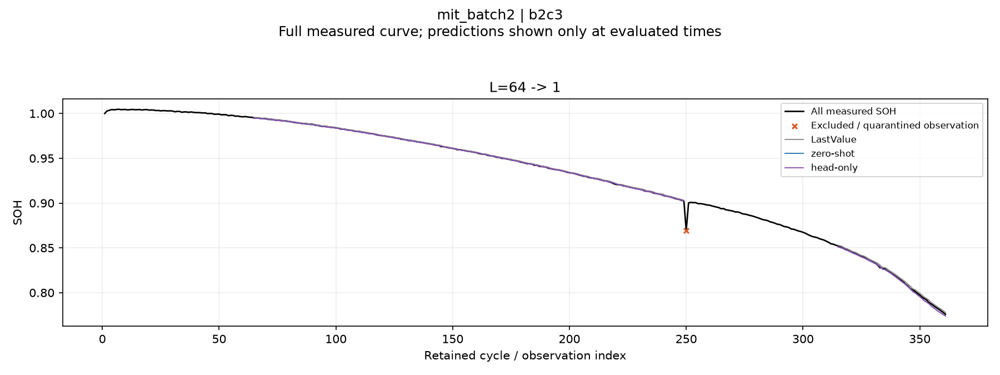
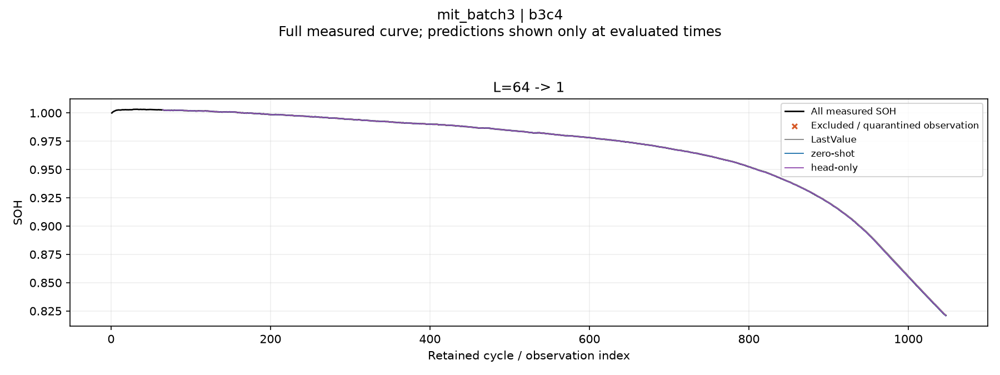
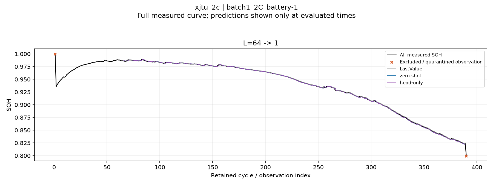
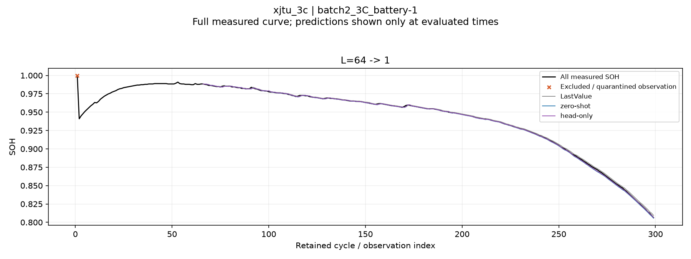

# C2 SOH: 과거 64개 → 다음 1개

> 전처리 재검토: 이 표는 기존 strict_v2 마스크의 부분 평가 결과다. NASA 중간 구간 제외, MIT Batch 3의 대규모 적분 대조 보류, CALCE의 낮은 구간 커버리지가 확인됐다. 전체 열화 구간 성능이나 확정 모델 순위로 사용하지 않는다. [전체 감사](../../preprocessing_review_all/report.md)

입력 SOH 64개로 바로 다음 SOH 1개를 예측했다. 모든 모델을 같은 테스트 시점에서 비교했다.

## 실험 조건

- 사용자 요청에 따라 64→1만 먼저 실행했다. 입력 길이 감소·구간 calibration·RUL은 이번 결과에 포함하지 않았다.
- strict_v2 정제 데이터와 기존 배터리 분할을 사용했다. 제외된 MIT 6개 배터리는 포함하지 않는다. NASA/CALCE는 4-fold, MIT/XJTU는 기존 고정 분할이다.
- 64→1의 모든 유효 테스트 시점을 사용했다. 기존 64→16과 테스트 시점 수가 달라 점수를 직접 비교하지 않는다.
- 학습/검증은 별도 배터리의 완료된 이력에서 source별 최대 4개 단일 정답을 시점만으로 균등 선택했다. context에 포함된 SOH도 관측 비용이며 label_budget.csv에 정확한 범위를 기록했다. 기존 64→16의 학습창 수와 정답 개수가 같다는 뜻은 아니다.
- 각 길이·fold·LR은 순정 C2에서 독립적으로 시작했다. 본체 고정, output head만 학습. LR 1e-6/1e-5, 각 100 steps, batch 4, seed 42, 20 steps마다 검증. step 0 허용, validation refit 없음.
- C2는 내부적으로 16개 출력 patch를 만들지만 정답은 1개만 제공하고 나머지 15개는 loss에서 마스킹한다. 패딩으로 희석된 loss를 16배 보정했다. 학습 손실은 native quantile loss이며 검증의 역전 비율이 순정보다 악화되지 않는 후보 중 선택한다.
- 모든 head 선택을 잠근 뒤 테스트를 평가했다. 한 seed의 첫 실험이며 일반화 결론에는 반복 검증이 필요하다.
- 주지표는 배터리별 MAE·RMSE의 동일 가중 평균이다. SOH 비율 단위이므로 0.001은 0.1 percentage point다. LastValue는 직전 실제 SOH, Linear는 주어진 입력 이력의 선형 외삽이다.
- 한 점짜리 window의 R²는 정의되지 않아 보고하지 않는다. CSV의 temporal_r2는 배터리별 여러 one-step 시점 전체를 모아 계산한 보조 지표다. 기존 Mean window R²와 다르며 미정의 배터리 수를 기록한다.
- 모델 중앙값과 분위수는 정렬·clipping하지 않는다. q10>q90이 하나라도 있으면 해당 배터리/그룹의 PICP80·폭을 NaN으로 둔다. 이번 작업에는 구간 보정이 없다.
- 실제 관측값으로 매 시점 입력을 갱신하는 rolling 1-step 예측이다. 원시 센서 기반 현재 SOH 추정과 구분한다. 초·중·후반은 원래 관측 범위를 3등분한 것이며 전체 수명 구간을 뜻하지 않는다.
- 엄격한 품질 마스크를 통과한 관측 조건부 결과다. CALCE의 간격은 보존된 관측 순서를 뜻하며 파일 사이 누락 cycle의 불확실성이 남는다.

| 데이터셋 | 길이 | 모델 | 배터리 / 시점 | MAE | RMSE |
|---|---:|---|---:|---:|---:|
| nasa_aging | 64 | LastValue | 4 / 185 | 0.004399 | 0.006234 |
| nasa_aging | 64 | Linear | 4 / 185 | 0.013246 | 0.016231 |
| nasa_aging | 64 | zero-shot | 4 / 185 | 0.004617 | 0.006990 |
| nasa_aging | 64 | head-only | 4 / 185 | 0.004750 | 0.006904 |
| calce_cs2_1c | 64 | LastValue | 4 / 191 | 0.003218 | 0.004693 |
| calce_cs2_1c | 64 | Linear | 4 / 191 | 0.007774 | 0.009186 |
| calce_cs2_1c | 64 | zero-shot | 4 / 191 | 0.003183 | 0.004364 |
| calce_cs2_1c | 64 | head-only | 4 / 191 | 0.003258 | 0.004461 |
| mit_batch1 | 64 | LastValue | 43 / 32,773 | 0.000357 | 0.000568 |
| mit_batch1 | 64 | Linear | 43 / 32,773 | 0.000600 | 0.000929 |
| mit_batch1 | 64 | zero-shot | 43 / 32,773 | 0.000247 | 0.000420 |
| mit_batch1 | 64 | head-only | 43 / 32,773 | 0.000247 | 0.000420 |
| mit_batch2 | 64 | LastValue | 45 / 19,857 | 0.000651 | 0.000964 |
| mit_batch2 | 64 | Linear | 45 / 19,857 | 0.001430 | 0.002220 |
| mit_batch2 | 64 | zero-shot | 45 / 19,857 | 0.000412 | 0.000693 |
| mit_batch2 | 64 | head-only | 45 / 19,857 | 0.000412 | 0.000693 |
| mit_batch3 | 64 | LastValue | 37 / 23,147 | 0.000135 | 0.000231 |
| mit_batch3 | 64 | Linear | 37 / 23,147 | 0.000227 | 0.000400 |
| mit_batch3 | 64 | zero-shot | 37 / 23,147 | 0.000088 | 0.000162 |
| mit_batch3 | 64 | head-only | 37 / 23,147 | 0.000087 | 0.000159 |
| xjtu_2c | 64 | LastValue | 5 / 1,685 | 0.000746 | 0.001051 |
| xjtu_2c | 64 | Linear | 5 / 1,685 | 0.002201 | 0.002858 |
| xjtu_2c | 64 | zero-shot | 5 / 1,685 | 0.000664 | 0.001064 |
| xjtu_2c | 64 | head-only | 5 / 1,685 | 0.000664 | 0.001064 |
| xjtu_3c | 64 | LastValue | 12 / 2,021 | 0.001260 | 0.001593 |
| xjtu_3c | 64 | Linear | 12 / 2,021 | 0.006732 | 0.008212 |
| xjtu_3c | 64 | zero-shot | 12 / 2,021 | 0.000779 | 0.001023 |
| xjtu_3c | 64 | head-only | 12 / 2,021 | 0.000539 | 0.000722 |

## 모델별 오차

[요약 CSV](summary.csv) · [배터리별 CSV](battery_metrics.csv) · [학습창](label_budget.csv) · [체크포인트](selected_checkpoints.csv) · [프로토콜](protocol.json)

## 대표 배터리의 rolling 예측

대표 배터리는 기존 분할의 첫 테스트 배터리로 점수와 무관하게 고정했다. 검은 선은 평가 여부와 무관한 전체 실제 관측이며, 주황 표식은 strict_v2 제외·보류 관측이다. 예측선만 평가 시점에 표시하고 예측 공백을 연결하지 않는다. 과거 결과의 예측값·평가 마스크는 변경하지 않았다.

### nasa_aging

[전체 단일 시점 예측 CSV](nasa_aging/predictions.csv.gz)

### calce_cs2_1c

[전체 단일 시점 예측 CSV](calce_cs2_1c/predictions.csv.gz)

### mit_batch1

[전체 단일 시점 예측 CSV](mit_batch1/predictions.csv.gz)

### mit_batch2

[전체 단일 시점 예측 CSV](mit_batch2/predictions.csv.gz)

### mit_batch3

[전체 단일 시점 예측 CSV](mit_batch3/predictions.csv.gz)

### xjtu_2c

[전체 단일 시점 예측 CSV](xjtu_2c/predictions.csv.gz)

### xjtu_3c

[전체 단일 시점 예측 CSV](xjtu_3c/predictions.csv.gz)

