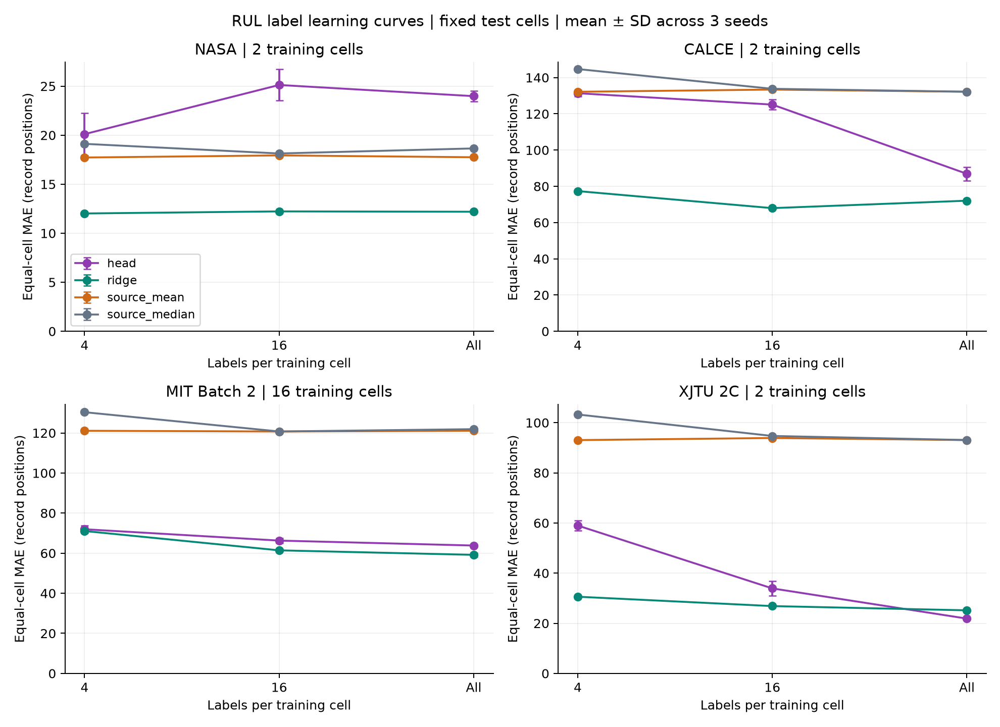
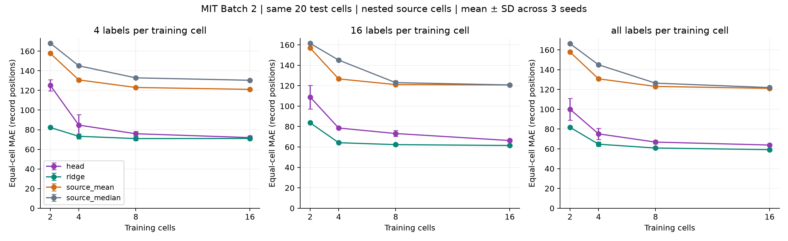
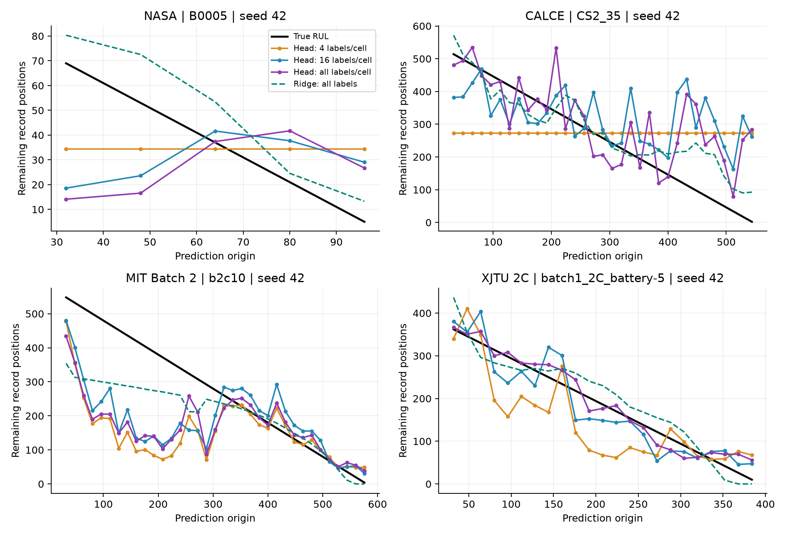

# RUL 학습 셀 수·정답 수 후속 실험

새 전처리와 SOH 80% EOL 정의를 유지한 Head-only 진단 실험이다. Full·LoRA·SOH 현재 예측을 재실행한 결과가 아니다. 기존 v4 결과는 보존했다.

## 비교 조건

- 입력: 최근 SOH 32개. 미래 SOH 궤적 없이 RUL을 직접 출력한다. 셀의 cycle 번호나 미래 EOL은 모델 입력에 넣지 않는다.
- NASA·CALCE·XJTU 2C: EOL 관측 셀 4개씩. 기존 LOBO 4분할, 학습2/검증1/시험1을 유지한다. 이 자료만으로 학습 셀 수를 늘리는 실험은 불가능하다.
- MIT Batch 2: 기존 학습2개를 유지하고, 기존 시험40개에서 고정 RNG로 공통 시험20개·추가 검증2개·학습 후보18개를 나눈다. 기존 검증1개와 합쳐 검증3개다. 수명이나 이전 오차를 기준으로 셀을 선택하지 않았다.
- MIT 학습 셀 수 2·4·8·16개. 모든 데이터셋에서 셀당 정답4·16·전체를 비교한다. 각 단계의 정답과 MIT 학습 셀은 중첩된다.
- seed42·43·44: Head 초기화/미니배치 반복; MIT는 추가 학습 셀 순서도 바뀐다. 시험 셀은 고정되어 독립된 시험 집단 3개가 아니다.
- 셀당 전체 정답은 적격 pre-EOL stride1 관측이다. 인접 창은 상관되어 있고 하나의 완료된 셀 EOL에서 유도되므로 독립 배터리 수가 늘어나는 것은 아니다. 전체 정답 조건은 few-shot으로 부르지 않는다.
- 모든 조건에 동일한 1,000 steps × LR2개, batch16, 셀 균등 샘플링. 모든 검증 시점의 셀 균등 MAE로 step0 포함 선택하며 전체144개 모델 선택 후 시험 예측한다.
- 기존 실험의 200 steps·검증4정답과 달라, 이전 보고서와의 변화 전부를 데이터 증가 효과로 설명할 수 없다. 이 보고서 안의 통제된 조건끼리 비교한다.
- 기준: 학습 셀 균등 RUL 평균/중앙값과, 동일 SOH 입력의 수준·기울기 등 6개 특징을 쓰는 Ridge. Ridge의 정규화는 학습 자료로만 계산하고 alpha는 검증으로 선택한다.
- MAE/RMSE는 셀별 계산 후 같은 가중치로 평균한다. R²는 셀별 여러 단일 RUL 정답·예측을 모아 계산하고 음수를 유지한다. 표의 점수는 3seed 평균, 그래프 막대는 seed 간 표준편차이며 신뢰구간이 아니다.
- CALCE 축은 보존된 관측 레코드이며 파일 사이 미관측 물리 cycle 수를 알 수 없다. 다른 데이터셋과 MAE 숫자를 직접 비교하지 않는다.
- 기존에 살펴본 데이터로 하는 후속 탐색이다. 새로운 외부 검증셋의 성능을 입증하지 않는다. 우측 검열 셀과 데이터셋 간 전이는 이 진단에서 제외했다.

## 관측된 변화

- NASA 학습2셀: Head MAE 4정답 20.11 → 16정답 25.12 → 전체 23.98. 동일 전체 정답 Ridge는 12.19.
- CALCE 학습2셀: Head MAE 4정답 131.38 → 16정답 125.11 → 전체 86.90. 동일 전체 정답 Ridge는 72.07.
- MIT Batch 2 학습16셀: Head MAE 4정답 71.95 → 16정답 66.29 → 전체 63.82. 동일 전체 정답 Ridge는 59.17.
- XJTU 2C 학습2셀: Head MAE 4정답 58.97 → 16정답 33.91 → 전체 21.86. 동일 전체 정답 Ridge는 25.17.
- MIT 전체 정답 조건의 Head MAE: 2셀 100.04 → 4셀 75.13 → 8셀 66.81 → 16셀 63.82.

자료량을 늘릴수록 반드시 좋아진다고 가정하지 않는다. 큰 정답 예산에서의 정체·악화와 Ridge 대비 우위 여부를 함께 확인해야 한다. 반복 간 산포는 표준편차이며 통계적 유의성 검정 결과가 아니다.

## 셀당 정답 수 비교 — MAE

| dataset | n_train_cells | budget | head | ridge | source_mean | source_median |
| --- | --- | --- | --- | --- | --- | --- |
| calce_cs2_1c | 2 | 4 | 131.38 | 77.37 | 132.18 | 144.72 |
| calce_cs2_1c | 2 | 16 | 125.11 | 67.97 | 133.39 | 133.81 |
| calce_cs2_1c | 2 | all | 86.90 | 72.07 | 132.19 | 132.21 |
| mit_batch2 | 16 | 4 | 71.95 | 71.06 | 121.08 | 130.35 |
| mit_batch2 | 16 | 16 | 66.29 | 61.42 | 120.74 | 120.73 |
| mit_batch2 | 16 | all | 63.82 | 59.17 | 121.09 | 121.89 |
| nasa_aging | 2 | 4 | 20.11 | 12.02 | 17.72 | 19.12 |
| nasa_aging | 2 | 16 | 25.12 | 12.23 | 17.94 | 18.13 |
| nasa_aging | 2 | all | 23.98 | 12.19 | 17.75 | 18.65 |
| xjtu_2c | 2 | 4 | 58.97 | 30.59 | 93.05 | 103.26 |
| xjtu_2c | 2 | 16 | 33.91 | 26.86 | 93.89 | 94.70 |
| xjtu_2c | 2 | all | 21.86 | 25.17 | 93.06 | 93.07 |



## MIT 학습 셀 수 비교 — MAE

| n_train_cells | budget | head | ridge | source_mean | source_median |
| --- | --- | --- | --- | --- | --- |
| 2 | 4 | 125.20 | 82.24 | 157.77 | 168.17 |
| 2 | 16 | 108.87 | 83.66 | 156.93 | 161.38 |
| 2 | all | 100.04 | 81.79 | 157.77 | 166.26 |
| 4 | 4 | 84.67 | 73.27 | 130.71 | 145.08 |
| 4 | 16 | 78.54 | 64.16 | 126.66 | 145.08 |
| 4 | all | 75.13 | 64.68 | 130.74 | 144.93 |
| 8 | 4 | 75.89 | 70.95 | 123.01 | 132.82 |
| 8 | 16 | 73.16 | 62.27 | 121.06 | 122.99 |
| 8 | all | 66.81 | 60.81 | 123.04 | 126.35 |
| 16 | 4 | 71.95 | 71.06 | 121.08 | 130.35 |
| 16 | 16 | 66.29 | 61.42 | 120.74 | 120.73 |
| 16 | all | 63.82 | 59.17 | 121.09 | 121.89 |



## 대표 셀의 RUL 갱신

각 데이터셋 시험 셀의 문자열 ID 첫 번째, seed42를 고정 표시한다. 결과를 보고 좋은 셀을 골라 표시하지 않는다. 제외된 관측을 보간하거나 평활화하지 않는다.



[전체 지표·seed 표준편차·R²](summary.csv) · [seed별 지표](seed_metrics.csv) · [셀별 지표](cell_metrics.csv) · [고정 프로토콜](protocol.json)

## 재현

```powershell
python scripts/run_c2_rul_learning_curve.py --out results/c2-battery/rul-learning-curve-v1
python scripts/report_c2_rul_learning_curve.py --out results/c2-battery/rul-learning-curve-v1 --gpu-verify
```

원본 새 전처리 데이터와 고정 Chronos revision 캐시가 필요하며 학습은 CUDA에서 실행된다. 완료 폴더는 덮어쓰지 않는다. 동일 프로토콜의 중단된 학습은 저장된 체크포인트를 검증한 뒤 재개한다.
