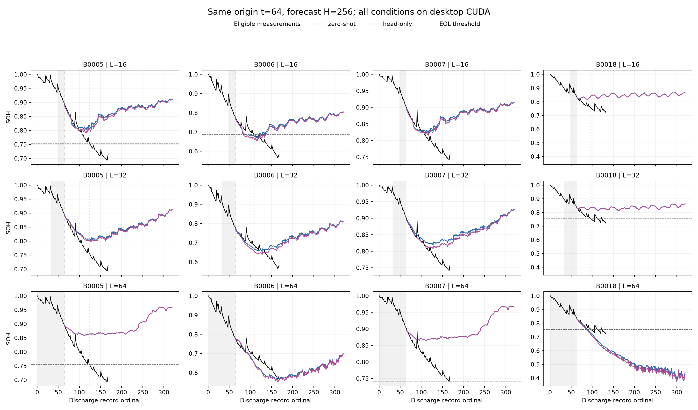
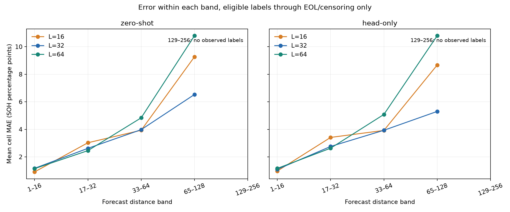

# NASA RUL: 입력 16·32·64, 동일 t=64 비교

모든 조건은 같은 데스크톱 CUDA에서 새로 실행했다. 입력 길이만 바꾸고 미래 SOH 256개를 예측한다.

- NASA 4개 셀, 실제 EOL 관측 3개. B0007은 우측 검열이다.
- EOL은 유효 용량 최초 1.4 Ah 이하. 미도달은 RUL > 256으로 유지한다.
- 각 fold의 학습 2개 셀·검증 1개 셀·테스트 1개 셀은 서로 다르다. 모두 t=64이며 미래 학습 정답도 길이 간 완전히 같다.
- Head-only는 LR 1e-6/1e-5 각 100 steps, seed 42. 검증 SOH 손실 및 분위수 역전 기준으로 step 0 포함 선택. 12개 head를 테스트 전에 모두 고정했다.
- 16/32개 입력은 64개 이력의 마지막 위치를 잘랐다. t=16/32에서 시작한 실험이 아니다.
- 미래 실측 재입력·보간·평활화·단조화·임의 외삽 없음. 제외 관측은 그림에서 숨겼다.
- 장기 SOH 오차는 동일 H256 예측의 구간별 진단이다. H16/H32를 따로 생성한 결과가 아니다.
- 실제 EOL 또는 관측 종료까지만 채점한다. 정답이 없는 구간은 N/A이며 0점으로 취급하지 않는다.
- 조건부 MAE는 유한하게 EOL을 예측한 사례만의 점수다. 미도달 개수와 함께 해석해야 한다.
- 테스트 결과를 이미 본 탐색 연구, 단일 seed, 적은 셀 수이므로 최적 길이 또는 범용 RUL 성능을 확정하지 않는다.

## 배터리별 RUL

| 셀 | 실제 RUL | 16 zero | 16 head | 32 zero | 32 head | 64 zero | 64 head |
|---|---:|---:|---:|---:|---:|---:|---:|
| B0005 | 61 | > 256 | > 256 | > 256 | > 256 | > 256 | > 256 |
| B0006 | 45 | 24 | 20 | 35 | 28 | 36 | 35 |
| B0007 | > 104 | > 256 | > 256 | > 256 | > 256 | > 256 | > 256 |
| B0018 | 33 | > 256 | > 256 | > 256 | > 256 | 24 | 22 |

## 사건 관측 셀 3개 요약

| 입력 | 모델 | 유한 예측 수 | 미도달 수 | 조건부 MAE | 전체 MAE 하한 |
|---:|---|---:|---:|---:|---:|
| 16 | zero-shot | 1 | 2 | 21.00 | 147.00 |
| 16 | head-only | 1 | 2 | 25.00 | 148.33 |
| 32 | zero-shot | 1 | 2 | 10.00 | 143.33 |
| 32 | head-only | 1 | 2 | 17.00 | 145.67 |
| 64 | zero-shot | 2 | 1 | 9.00 | 71.33 |
| 64 | head-only | 2 | 1 | 10.50 | 72.33 |

MAE 하한은 정확한 전체 MAE의 대체값이 아니다. B0007의 실제 RUL은 미관측이므로 별도 검열 모순 여부를 CSV에 기록한다.

[RUL 원점수](rul_predictions.csv) · [구간별 오차](horizon_diagnostics.csv) · [기울기·임계값 진단](trajectory_diagnostics.csv) · [이전 XPU와 새 CUDA L64 비교](backend_l64_comparison.csv) · [검증](verification.json)
