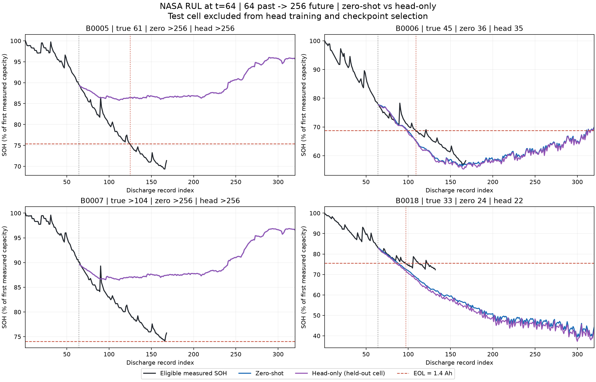
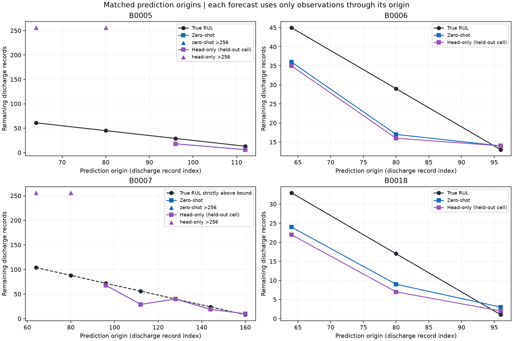

# NASA RUL: zero-shot / few-shot head-only 비교

같은 64개 입력 → 256개 미래 SOH → 1.4 Ah 최초 도달 시점으로 RUL을 계산한 NASA 4개 배터리 파일럿이다.
각 테스트 배터리를 제외한 2개 배터리의 열화 경로로 학습하고, 별도 1개 배터리로 head를 선택했다.

## 학습과 평가 조건

- 모델: 동일한 원본 Chronos-2 revision, float32. 본체 고정, output_patch_embedding만 학습.
- 각 source 배터리에서 t=64 한 창만 사용. 학습 2창·검증 1창. 학습 정답은 fold별 172 또는 208개 SOH 점이며 입력 SOH 128개도 관측 정보다.
- NASA 기록은 t=64 이후 68~104개만 남는다. 실제로 관측된 정답만 사용하고 이후 256까지는 NaN으로 마스킹했다. 가용 기록에는 EOL 이후 측정도 포함된다. 미관측 미래값은 만들지 않았다.
- RUL 정답을 학습하지 않는다. 미래 SOH의 native 21분위수 손실을 셀별 유효 정답 수로 정규화하여 학습했다.
- fold 및 학습률별 원본에서 독립 초기화. LR 1e-6/1e-5, 각 100 steps, seed 42, 20 steps마다 검증. 두 학습 경로를 한 batch로 사용.
- 검증 SOH loss로만 선택하며 검증 분위수 역전이 순정보다 늘어나면 제외한다. step 0도 후보다. 네 head를 모두 확정한 뒤 테스트 추론을 수행했다.
- 테스트 입력·정답·EOL·17개 평가 시점은 이전 zero-shot과 동일하다. t=64가 주 평가이고 이후 겹치는 시점은 보조 평가다.
- 검증은 미래 SOH 손실 기준이다. 검증 RUL이나 테스트 RUL로 head를 고르지 않았다.
- 예측값 보정·평활화·단조화·추가 외삽 없음. excluded point는 그림에서 숨기고 원래 cycle 위치를 유지했다.
- 미래 SOH 분위수는 시점별 구간이며 RUL 신뢰구간으로 해석하지 않는다. 미래 운전 조건을 별도로 입력하지 않는다.
- 같은 노트북 XPU에서 수행했으며 cached frozen-encoder 계산을 native forward 및 loss와 대조했다. 완료 head 파일을 다시 읽어 검증 결과를 재현했다.

## 동일한 t=64에서의 RUL

| 배터리 | 실제 RUL | Zero-shot | Head-only | Zero 오차 | Head 오차 |
|---|---:|---:|---:|---:|---:|
| B0005 | 61 | > 256 | > 256 | N/A | N/A |
| B0006 | 45 | 36 | 35 | -9 | -10 |
| B0007 | > 104 | > 256 | > 256 | N/A | N/A |
| B0018 | 33 | 24 | 22 | -9 | -11 |

단위: 방전 기록 수. 오차 = 예측−실제이며 양수는 늦은 EOL 예측이다. B0007은 실제 EOL이 관측되지 않아 정확한 오차를 계산하지 않는다.

| 주 평가 지표 | Zero-shot | Head-only |
|---|---:|---:|
| 실제 EOL 관측 셀 수 | 3.00 | 3.00 |
| 유한 RUL 예측 수 | 2.00 | 2.00 |
| 256 내 미도달 수 | 1.00 | 1.00 |
| 유한 사례 조건부 MAE | 9.00 | 10.50 |
| 유한 사례 조건부 RMSE | 9.00 | 10.51 |
| 유한 사례 조건부 bias | -9.00 | -10.50 |
| 모든 사건 셀의 MAE 하한 | 71.33 | 72.33 |
| 기술적 셀 간 R² | N/A | N/A |

미도달이 있는 모델의 MAE/RMSE는 유한 예측 사례에 한정된다. 모델 간 유한 사례 수가 다르면 조건부 평균만 직접 비교하면 안 된다. MAE 하한도 실제 MAE의 대체값이 아니다. R²는 실제 EOL 관측 3개 셀 모두에서 유한한 예측이 있을 때만 제시한다.

## 선택한 head

| 테스트 배터리 | 학습 배터리 | 검증 배터리 | LR | Step | 검증 loss 전 → 후 |
|---|---|---|---:|---:|---|
| B0005 | B0007, B0018 | B0006 | 0 | 0 | 2.6565 → 2.6565 |
| B0006 | B0005, B0018 | B0007 | 1e-06 | 40 | 6.3631 → 5.9067 |
| B0007 | B0005, B0006 | B0018 | 0 | 0 | 3.0850 → 3.0850 |
| B0018 | B0006, B0007 | B0005 | 1e-06 | 100 | 8.4745 → 7.4865 |

## 보조 평가와 한계

| 보조 지표 | Zero-shot | Head-only |
|---|---:|---:|
| 실제 EOL 관측 배터리의 전체 평가 시점 | 10 | 10 |
| 그중 256 내 미도달 | 2 | 2 |
| B0007 검열 시점 수 | 7 | 7 |
| B0007의 관측된 생존 기간과 모순되는 EOL 예측 | 4 | 4 |

- 전체 RUL 결과는 `rul_predictions.csv`, SOH 경로는 `soh_predictions.csv.gz`, 거리별 SOH 오차는 `soh_prefix_metrics.csv`에 있다.
- SOH prefix 점수는 같은 256개 예측의 앞부분을 평가한 것으로, 별도 짧은 horizon 실행 결과와 다르다.
- 실제 EOL 관측 3개 셀, 단일 seed, 검증 1개 셀에 한정된다. 일반적인 RUL 우위나 타 데이터셋 성능을 주장할 수 없다.
- 이 연구는 이전 NASA 결과를 보고 설계한 탐색적 후속 실험이다. 별도 미사용 외부 테스트셋 검증은 아니다.
- 학습 정답은 최대 104개 미래 관측까지만 존재한다. 256개 전체 열화 경로가 학습된 것으로 해석하지 않는다.
- 다음 설정을 고르기 위해 이번 테스트 결과를 반복적으로 최적화하지 않았다. 기존 zero-shot 파일과 전처리·현재 SOH 실험은 보존했다.
