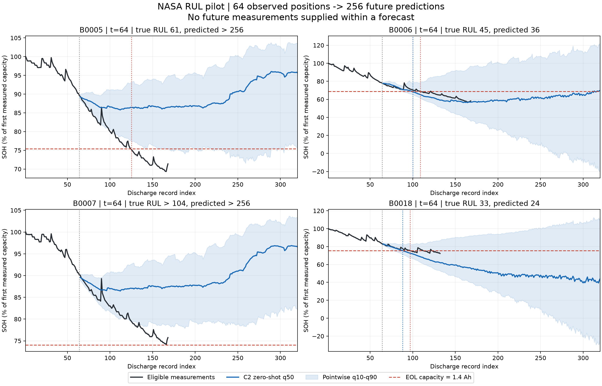
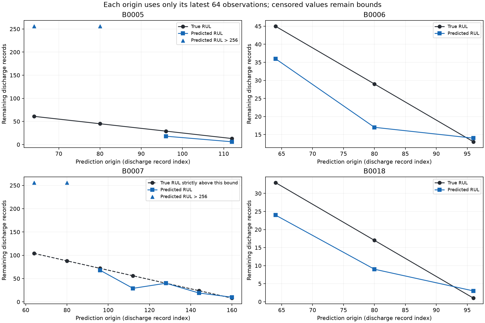

# C2 RUL 파일럿: NASA, SOH 경로를 통한 간접 예측

최초 NASA 4개 배터리 zero-shot 파일럿이다. 입력 64개 → 미래 SOH 256개 → 1.4 Ah 최초 도달 시점으로 RUL을 계산했다.
이 실행은 head-only 실험이나 전체 데이터셋 검증이 아니다. 단위는 NASA 방전 기록 순번이다.

## 고정한 정의

- EOL: 유효 실측 용량이 최초로 1.4 Ah 이하인 기록. [NASA 원자료 기준](https://data.nasa.gov/dataset/li-ion-battery-aging-datasets).
- 현재 t까지 64개 이력만 사용한다. 한 번의 256개 예측 중 실제 미래 관측을 넣지 않는다.
- t=64를 주 평가로 고정하고, t=80,96,...에서 이미 EOL을 관측하지 않은 경우에만 추가 평가한다. 수명 비율로 시점을 고르지 않았다.
- 초기 관측 용량으로 정규화한 SOH를 유지하고 EOL 선은 각 배터리에서 1.4/Qref로 변환했다. SOH 70%를 일괄 적용하지 않았다.
- 임계값 최초 도달을 사용하며 순간 하락도 이 정의의 일부다. 3개 연속 하회 시작 시점은 정답 민감도 진단으로만 기록했다.
- B0007은 실제 EOL 미관측이다. 관측 종료를 EOL로 만들지 않고 정확한 RUL MAE/RMSE에서 제외하며 관측 종료 이전의 거짓 도달 예측을 별도 표시한다.
- 예측이 256 이내 임계값에 도달하지 않으면 RUL > 256으로 남긴다. 256으로 채우거나 해당 예측을 조용히 제외하지 않는다.
- q10~q90은 시점별 SOH 구간이며 RUL 신뢰구간이 아니다. 분위수 역전도 수정하지 않는다.
- 제외된 관측은 그래프에 표시하지 않고 이력에서는 NaN 위치로 유지한다. 보간·평활화·단조화·추가 외삽은 없다.

## 동일한 t=64에서의 결과

| 배터리 | 실제 EOL | 실제 RUL | 예측 RUL | 예측−실제 |
|---|---:|---:|---:|---:|
| B0005 | 125 | 61 | > 256 | — |
| B0006 | 109 | 45 | 36 | -9 |
| B0007 | — | > 104 | > 256 | — |
| B0018 | 97 | 33 | 24 | -9 |

실제 EOL 관측 셀 3개 중 유한 RUL 예측 2개, 256 내 미도달 1개.
유한 예측만의 MAE 9.00, RMSE 9.00, bias -9.00 (방전 기록 수). 모든 사건 셀의 MAE 하한 71.33.

예측 미도달이 있으면 유한 사례 점수는 조건부 점수다. 하한은 실제 오차의 대체 점수가 아니다. 주 평가의 셀 수가 3개뿐이므로 R²는 정의될 때만 기술적으로 제시한다.

주 평가의 기술적 셀 간 R²: None. 서로 겹치는 여러 예측 시점을 독립 표본으로 취급하지 않는다.

## 추가 시점 결과

배터리별 오차를 계산한 뒤 사건이 관측된 배터리들을 동일 가중 평균했다. 실제 잔여수명이 짧은 추가 시점이 포함되므로 조기 수명 예측 성능으로 일반화하지 않는다.

| 배터리 | 시점 수 | 실제 EOL 관측 | 유한 예측 수 | 조건부 MAE | 조건부 RMSE | 조건부 bias |
|---|---:|---|---:|---:|---:|---:|
| B0005 | 4 | True | 2 | 9.00 | 9.22 | -9.00 |
| B0006 | 3 | True | 3 | 7.33 | 8.68 | -6.67 |
| B0007 | 7 | False | 0 | — | — | — |
| B0018 | 3 | True | 3 | 6.33 | 7.05 | -5.00 |

## 해석 범위와 파일

- 이 파일럿은 관측된 NASA 4개 이력에 한정된다. 데이터셋 간 일반화나 특정 기준 모델 대비 우위를 주장하지 않는다.
- 실제 정답이 관측된 3개 셀에 대한 오차와 B0007의 우측 검열 결과를 구분한다.
- 저장한 256개 예측의 일부 구간을 채점한 SOH prefix 점수는 별도 64→16 실험 점수와 같지 않다. 정답이 남아 있는 유효 관측부터 EOL까지만 채점한다.
- 기존 8/16/32/64→1 실험 및 데이터는 변경하지 않았다.
- `eol_audit.csv`: EOL·검열·정규화 기준. `rul_predictions.csv`: 모든 예측 시점과 RUL 오차.
- `soh_predictions.csv.gz`: 미래 SOH 분위수와 유효 실측값. `soh_prefix_metrics.csv`: 거리별 가용 점수.
- `protocol.json`, `runtime.json`, `verification.json`: 사전 정의, 실행 환경, 검증.
