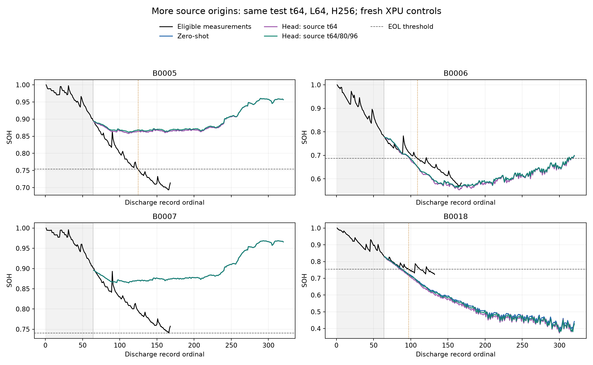

# NASA RUL: 학습 시작 시점 확장 비교

입력 64, 예측 256은 유지했다. 학습 시작 시점만 t64 하나에서 t64·80·96 세 개로 늘렸다. 두 head 조건과 zero-shot 모두 같은 노트북 XPU에서 새로 실행했다.

- 각 fold는 학습 2셀, 검증 1셀, 평가 1셀로 분리한다. 검증 및 평가는 t64로 고정한다.
- 각 셀의 창 수가 같아 셀별 가중치는 동일하다. 창마다 유효 정답 평균 손실을 계산한 뒤 창별로 평균한다.
- 학습 창은 2→6개지만 고유 미래 SOH 정답 수는 증가하지 않는다. 중복 정답 노출과 입력 열화 구간의 다양성이 늘어난다.
- LR 1e-6/1e-5 각 100 steps, seed42, 검증 SOH loss와 분위수 역전 기준으로 step0 포함 선택. 8개 head를 모두 고정한 후 평가한다.
- EOL은 최초 유효 용량 1.4Ah 이하. B0007은 우측 검열. 미도달은 >256이며 오류 집계에서 숨기지 않는다.
- 훈련용 미래 정답은 기존과 같이 관측된 post-EOL 용량도 포함한다. 시험 SOH 오차는 EOL 또는 관측 종료까지만 계산한다.
- 평활화·보간·단조화·미래 실측 재입력 없음. 제외 관측은 그림에 표시하지 않는다.

| 셀 | 실제 RUL | Zero-shot | 기존 t64 head | t64/80/96 head |
|---|---:|---:|---:|---:|
| B0005 | 61 | >256 | >256 | >256 |
| B0006 | 45 | 36 | 35 | 36 |
| B0007 | >104 | >256 | >256 | >256 |
| B0018 | 33 | 24 | 22 | 24 |

실제 EOL이 관측된 3셀 기준:

| 조건 | EOL 미도달 | 유한 예측 조건부 MAE | 전체 MAE 하한 |
|---|---:|---:|---:|
| zero-shot | 1/3 | 9.00 | 71.33 |
| single | 1/3 | 10.50 | 72.33 |
| multi | 1/3 | 9.00 | 71.33 |

오차 단위는 방전 기록 수. 조건부 MAE는 EOL 도달 예측 사례만의 값이며, 전체 MAE 하한은 정확한 MAE가 아니다.

단일 seed, NASA 4셀(사건 3셀)의 탐색 연구다. 기존 시험 결과를 본 뒤 설계한 후속 실험이므로 독립 외부 검증으로 해석하지 않는다.

[정답 수와 중복 노출](label_budget.csv) · [RUL 원점수](rul_predictions.csv) · [검증 결과](verification.json)
