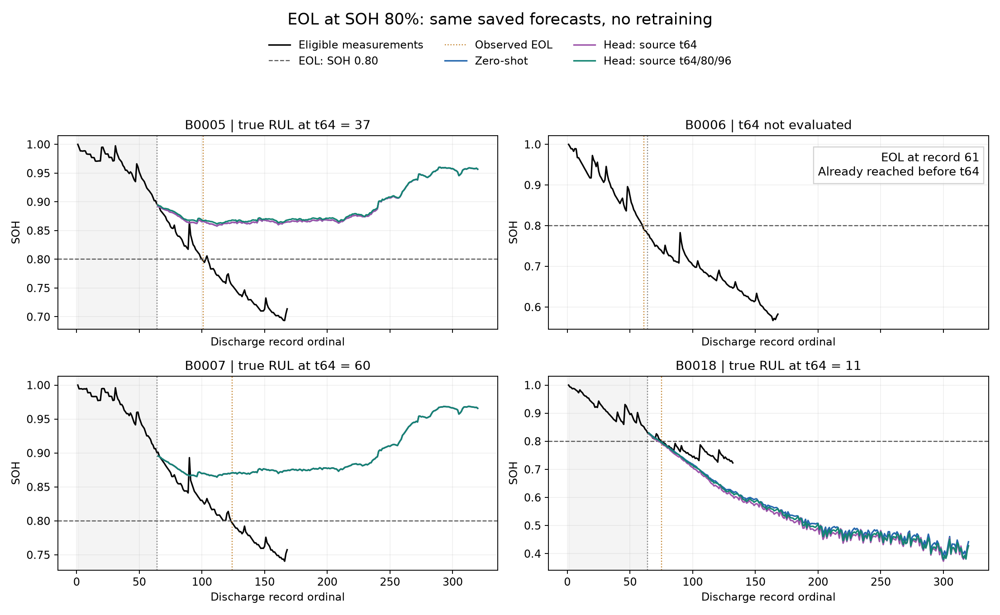

# NASA RUL: SOH 80% 기준 재평가

기존 미래 SOH 예측은 변경하지 않고, EOL을 최초 유효 SOH ≤ 0.8로 다시 정의했다. 재학습·재추론·체크포인트 재선택은 하지 않았다.

- SOH = Q / Q_ref. 기준은 셀별 Q_ref의 80%이며 정격 2Ah의 80%(1.6Ah)가 아니다.
- EOL은 처음 관측된 임계값 도달 기록이다. 이후 용량이 회복해도 이벤트를 취소하지 않는다.
- 해당 시점까지 EOL이 이미 관측된 예측 원점은 제외한다. B0006은 EOL=61이므로 t64에서 평가하지 않는다.
- B0007은 새 기준에서 EOL=124가 관측된다. 이전 1.4Ah 평가의 우측 검열 사례와 구분한다.
- 주 결과는 최신 XPU 학습 시점 비교의 저장된 t64 예측이다. CUDA 입력 16/32/64 및 초기 다중 평가 시점도 별도 표에 재채점했다.
- Head의 기존 학습·검증 조건은 유지했다. 원래 학습 시점은 1.4Ah 기준으로 설정되어 일부 창은 새 80% EOL 이후에 있다. 따라서 80% 기준으로 새롭게 설계·학습한 모델 결과는 아니다.
- 1.4Ah 결과와 평가 셀 및 정답이 달라졌으므로 점수 차이를 모델 개선으로 해석하지 않는다.
- 제외된 측정점은 그림에서 숨겼으며, 평가 제외 원점의 예측 경로도 표시하지 않았다.

| 셀 | 기존 EOL: 1.4Ah | 새 EOL: SOH 80% | t64 실제 RUL |
|---|---:|---:|---:|
| B0005 | 125 | 101 | 37 |
| B0006 | 109 | 61 | 평가 제외: 이미 EOL 도달 |
| B0007 | 미관측 | 124 | 60 |
| B0018 | 97 | 75 | 11 |

| 셀 | 실제 RUL | Zero-shot | 기존 head | 학습 시점 확장 head |
|---|---:|---:|---:|---:|
| B0005 | 37 | >256 | >256 | >256 |
| B0007 | 60 | >256 | >256 | >256 |
| B0018 | 11 | 10 | 9 | 10 |

| 방법 | EOL 미도달 / 사건 수 | 유한 사례 조건부 MAE | 전체 MAE 하한 |
|---|---:|---:|---:|
| zero-shot | 2/3 | 1.00 | ≥139.33 |
| single | 2/3 | 2.00 | ≥139.67 |
| multi | 2/3 | 1.00 | ≥139.33 |

단위는 방전 기록 수. 조건부 MAE는 도달 시점이 산출된 사례만 포함하며 전체 성능을 대표하지 않는다. 미도달 RUL>256의 오차 하한은 max(0,257−실제 RUL)로 계산한다.

입력 길이 비교는 [primary_context_sweep.csv](primary_context_sweep.csv), 기존 다중 시점 재평가는 [summary.csv](summary.csv)에 있다. 다중 시점 요약은 원점 단위의 기술통계이며 독립 배터리 평균으로 해석하지 않는다.

[배터리별 EOL](eol_audit.csv) · [전체 RUL 원점수](rul_predictions.csv) · [제외 원점](excluded_origins.csv) · [검증](verification.json)
