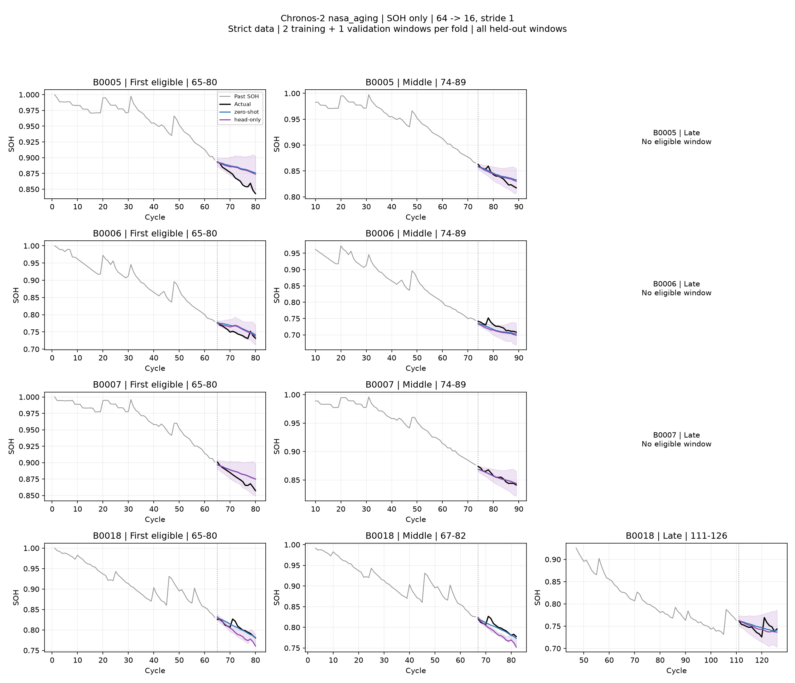
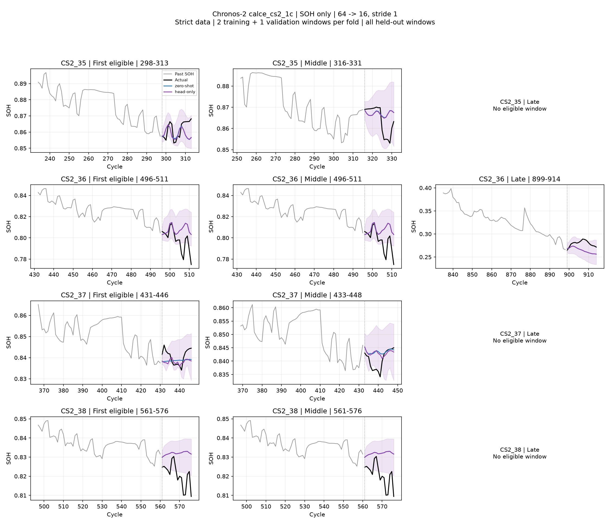
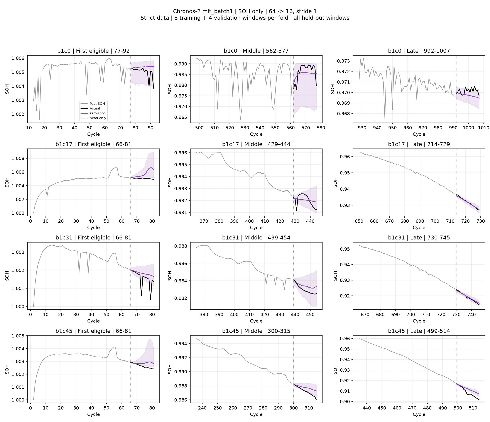
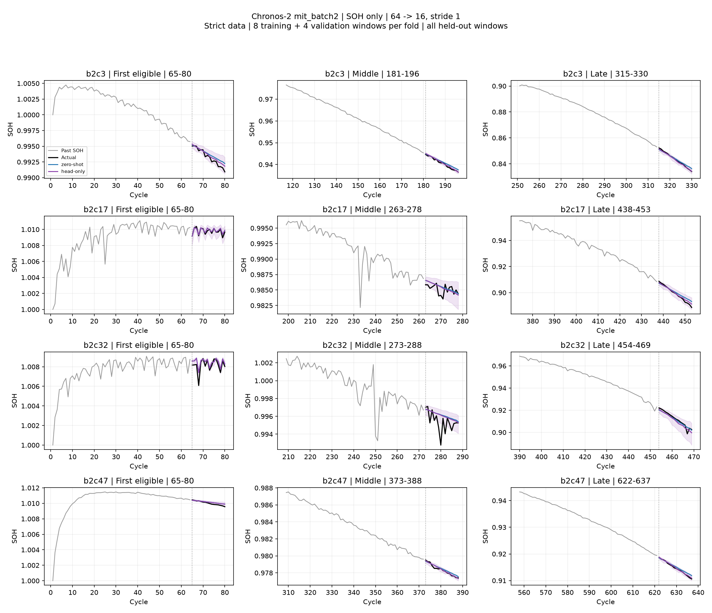
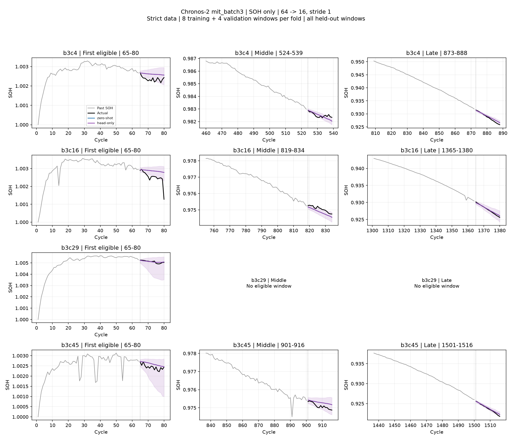
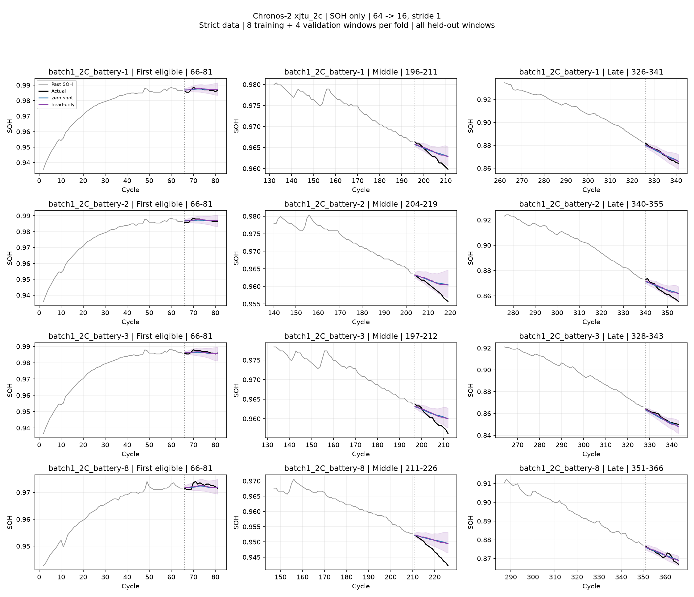
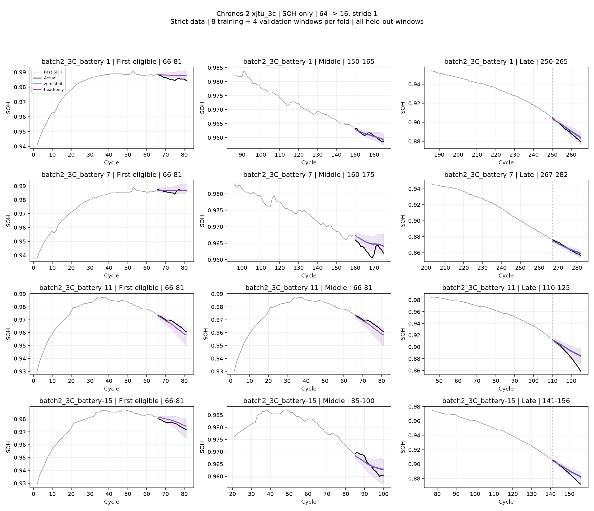

# Chronos-2: 정제 데이터 zero-shot / few-shot head-only

Head mode: **retrain**. SOH 단독, 64→16, stride 1. 두 모델을 동일한 미학습 배터리·동일한 유효 창에서 평가했다.

| 데이터셋 | 모델 | 배터리 / 창 | RMSE | R² 평균 | R² 중앙값 | 음수 창 | WQL | PICP80 |
|---|---|---:|---:|---:|---:|---:|---:|---:|
| nasa_aging | zero-shot | 4 / 83 | 0.012871 | -0.021 | 0.322 | 39.3% | 0.009936 | 88.3% |
| nasa_aging | head-only | 4 / 83 | 0.014385 | -0.491 | 0.255 | 43.1% | 0.011899 | N/A (구간 역전) |
| calce_cs2_1c | zero-shot | 4 / 69 | 0.011434 | -3.958 | -0.662 | 87.0% | 0.010267 | 71.2% |
| calce_cs2_1c | head-only | 4 / 69 | 0.011444 | -3.985 | -0.712 | 88.3% | 0.010299 | 68.5% |
| mit_batch1 | zero-shot | 43 / 32,068 | 0.000911 | -0.549 | 0.398 | 33.8% | 0.000469 | 71.1% |
| mit_batch1 | head-only | 43 / 32,068 | 0.000911 | -0.549 | 0.398 | 33.8% | 0.000469 | 71.1% |
| mit_batch2 | zero-shot | 45 / 18,912 | 0.001121 | 0.515 | 0.833 | 12.5% | 0.000575 | 74.3% |
| mit_batch2 | head-only | 45 / 18,912 | 0.000926 | 0.581 | 0.914 | 11.2% | 0.000465 | 80.7% |
| mit_batch3 | zero-shot | 37 / 22,451 | 0.000291 | -0.299 | 0.543 | 31.6% | 0.000153 | 72.9% |
| mit_batch3 | head-only | 37 / 22,451 | 0.000291 | -0.299 | 0.543 | 31.6% | 0.000153 | 72.9% |
| xjtu_2c | zero-shot | 5 / 1,610 | 0.002649 | -0.258 | 0.288 | 36.7% | 0.001550 | 65.1% |
| xjtu_2c | head-only | 5 / 1,610 | 0.002605 | -0.234 | 0.311 | 35.2% | 0.001511 | 68.5% |
| xjtu_3c | zero-shot | 12 / 1,841 | 0.004115 | 0.195 | 0.489 | 19.1% | 0.002464 | 61.7% |
| xjtu_3c | head-only | 12 / 1,841 | 0.003813 | 0.252 | 0.553 | 17.7% | 0.002236 | 65.4% |

## 실험 조건

- 기존 전체 데이터셋 common8 실험의 배터리 분할을 고정했다. XJTU는 4·5번 학습, 6번 검증, 나머지 테스트. NASA/CALCE는 배터리별 4-fold, MIT는 동일 물리 배터리의 배치 간 누수를 차단했다.
- 재학습은 본체 고정, output head 3.06%만 변경한다. 기존 공통 설정 LR 1e-6/1e-5, 각 100 steps, seed 42, 20 steps마다 검증, 순정(step 0)도 후보이며 validation refit은 없다. 새 Optuna 탐색은 없다.
- 기존 common8 비교를 재실행한 것으로, XJTU 전용 Optuna20 또는 LoRA와 다른 실험이다.
- 재학습 시 가능한 비중복 정답 창 수에 따라 NASA/CALCE는 source별 1창(학습 2·검증 1), MIT/XJTU는 source별 4창(학습 8·검증 4)을 쓴다. 겹치는 정답을 복제해 예산을 채우지 않았다. 모든 정확한 cycle 범위는 protocol.json에 있다.
- 다른 배터리의 완료된 이력을 사용하는 offline supervised few-shot이다. 테스트 배터리 정답은 학습과 체크포인트 선택에 사용하지 않았다. 모든 head 선택을 확정한 후 두 모델 점수 비교를 생성했다.
- R²는 각 16개 예측 창 안에서 계산한다. 창별 값을 배터리별 평균 후 배터리 동등 가중 평균한다. 중앙값·음수 비율은 동일 배터리 가중치의 창별 분포다. 음수 유지, 상수 창만 미정의. 초·중·후반은 원래 관측 수명 범위의 3등분이며, 없는 구간은 점수를 만들지 않는다.
- MIT 확인 보류 관측까지 제외한 조건부 평가다. 전체 수명 성능으로 일반화할 수 없다. NASA/CALCE는 정제 후 창이 적고 수명 범위도 좁으므로 결과의 불확실성이 크다.
- 기존 결과보다 점수가 좋아져도 테스트 창이 달라 전처리 자체의 개선 효과로 단정할 수 없다. 기존 결과와 모델 가중치는 보존했다.

- MIT 원작자가 noisy channel로 제외한 b3c2, b3c23, b3c32, b3c37, b3c42, b3c43은 학습·검증·테스트에서 모두 제외했다.
- NASA head-only는 B0018 테스트에서 q10>q90 구간 역전이 발생하여 PICP80을 N/A로 표시했다. 검증에서 없던 문제가 테스트에서 발생한 것이며, 분위수 정렬로 숨기거나 테스트 성능을 보고 체크포인트를 바꾸지 않았다.

## 선택한 head

| 데이터 | fold | 학습/검증 창 | LR | 선택 step | 검증 loss: 순정→선택 |
|---|---|---:|---:|---:|---:|
| nasa_aging | test_B0005 | 2/1 | 1e-06 | 20 | 1.2409 → 1.1120 |
| nasa_aging | test_B0006 | 2/1 | 1e-06 | 40 | 1.1645 → 0.9924 |
| nasa_aging | test_B0007 | 2/1 | 0 | 0 | 0.8668 → 0.8668 |
| nasa_aging | test_B0018 | 2/1 | 1e-05 | 40 | 2.3478 → 1.4361 |
| calce_cs2_1c | test_CS2_35 | 2/1 | 1e-06 | 100 | 6.2109 → 5.9588 |
| calce_cs2_1c | test_CS2_36 | 2/1 | 0 | 0 | 3.8857 → 3.8857 |
| calce_cs2_1c | test_CS2_37 | 2/1 | 1e-05 | 100 | 12.7253 → 11.5117 |
| calce_cs2_1c | test_CS2_38 | 2/1 | 0 | 0 | 3.5523 → 3.5523 |
| mit_batch1 | fixed | 8/4 | 0 | 0 | 1.4469 → 1.4469 |
| mit_batch2 | fixed | 8/4 | 1e-06 | 100 | 1.3106 → 1.1550 |
| mit_batch3 | fixed | 8/4 | 0 | 0 | 1.0707 → 1.0707 |
| xjtu_2c | fixed | 8/4 | 1e-06 | 100 | 2.8328 → 2.7047 |
| xjtu_3c | fixed | 8/4 | 1e-06 | 20 | 1.5967 → 1.4760 |

## 대표 예측 그래프

### nasa_aging

### calce_cs2_1c

### mit_batch1

### mit_batch2

### mit_batch3

### xjtu_2c

### xjtu_3c

