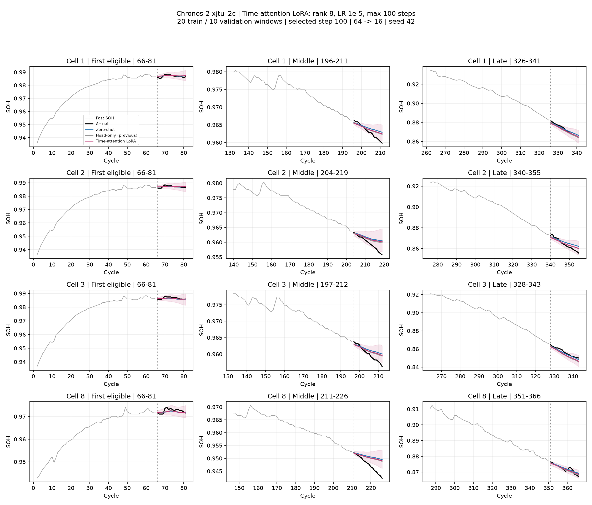
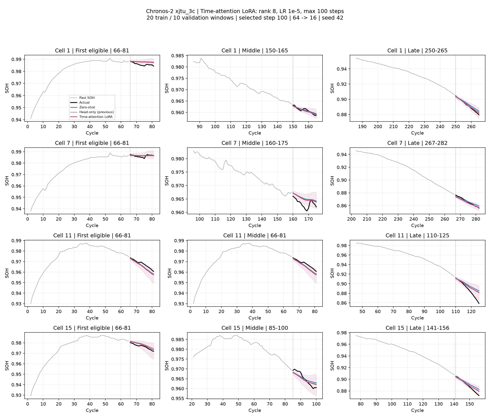

# C2 시간 Attention LoRA: 단일 설정 빠른 실험

시간 Attention Q/K/V/O에만 rank 8, alpha 16 LoRA. 학습률 1e-5, 최대 100 step, seed 42. 학습 20창·검증 10창과 분할은 이전 실험과 동일. 출력 head·그룹 Attention·FFN 등 기존 가중치는 고정했다.

학습: 4·5번 각 10창, 검증: 6번 10창. 두 조건의 체크포인트를 검증으로 확정한 뒤 모든 미학습 배터리를 평가했다. 순정 step 0도 선택 후보이며, 분위수 역전율이 순정보다 늘어나는 체크포인트는 기존 규칙대로 제외했다.

- xjtu_2c: 선택 step 100, 검증 loss 2.4776 → 2.2368; 학습·검증 27.4초.
- xjtu_3c: 선택 step 100, 검증 loss 2.1089 → 1.8343; 학습·검증 24.4초.

## all_test

| 조건 | 모델 | RMSE | R² 평균 | R² 중앙값 | 음수 창 | WQL | PICP80 |
|---|---|---:|---:|---:|---:|---:|---:|
| xjtu_2c | zero-shot | 0.002653 | -0.257 | 0.288 | 36.6% | 0.001552 | 65.1% |
| xjtu_2c | previous_head20 | 0.002449 | -0.179 | 0.413 | 31.9% | 0.001438 | 70.1% |
| xjtu_2c | time_attention_lora | 0.002472 | -0.162 | 0.389 | 32.3% | 0.001463 | 68.1% |
| xjtu_3c | zero-shot | 0.004115 | 0.195 | 0.489 | 19.1% | 0.002464 | 61.7% |
| xjtu_3c | previous_head20 | 0.003300 | 0.333 | 0.663 | 15.8% | 0.001926 | 72.6% |
| xjtu_3c | time_attention_lora | 0.003428 | 0.325 | 0.627 | 15.5% | 0.002021 | 71.0% |

## slide90

| 조건 | 모델 | RMSE | R² 평균 | R² 중앙값 | 음수 창 | WQL | PICP80 |
|---|---|---:|---:|---:|---:|---:|---:|
| xjtu_2c | zero-shot | 0.003985 | -0.694 | 0.185 | 40.0% | 0.001867 | 63.5% |
| xjtu_2c | previous_head20 | 0.003797 | -0.589 | 0.371 | 38.9% | 0.001734 | 69.4% |
| xjtu_2c | time_attention_lora | 0.003745 | -0.542 | 0.276 | 38.9% | 0.001736 | 67.2% |
| xjtu_3c | zero-shot | 0.003008 | -0.032 | 0.442 | 31.1% | 0.001768 | 63.8% |
| xjtu_3c | previous_head20 | 0.002547 | 0.059 | 0.562 | 31.1% | 0.001516 | 73.0% |
| xjtu_3c | time_attention_lora | 0.002634 | 0.096 | 0.516 | 31.1% | 0.001578 | 70.9% |

R²는 각 16-cycle 예측창 안에서 표준 1−SSE/SST로 계산 후 배터리 내 창 평균·배터리 간 동등 가중 평균. 중앙값·음수 비율도 배터리 동등 가중 분포이다. RMSE/WQL/PICP도 배터리 동등 가중이며 상수 창 R²는 미정의. q10>q90 발생 시 PICP는 N/A이며 분위수는 보정하지 않았다.

단일 설정·단일 seed의 탐색 결과로 LoRA의 최적 성능이나 일반적 우위를 입증하지 않는다. 20창은 미래 라벨 320개와 과거 context를 사용한다. 다른 배터리의 완료된 이력을 이용한 적응이며 대상 배터리 초반만 쓰는 설정이 아니다. 테스트는 실제 과거 SOH를 갱신하는 rolling 64→16, stride 1; 겹치는 창은 독립 표본이 아니다.

