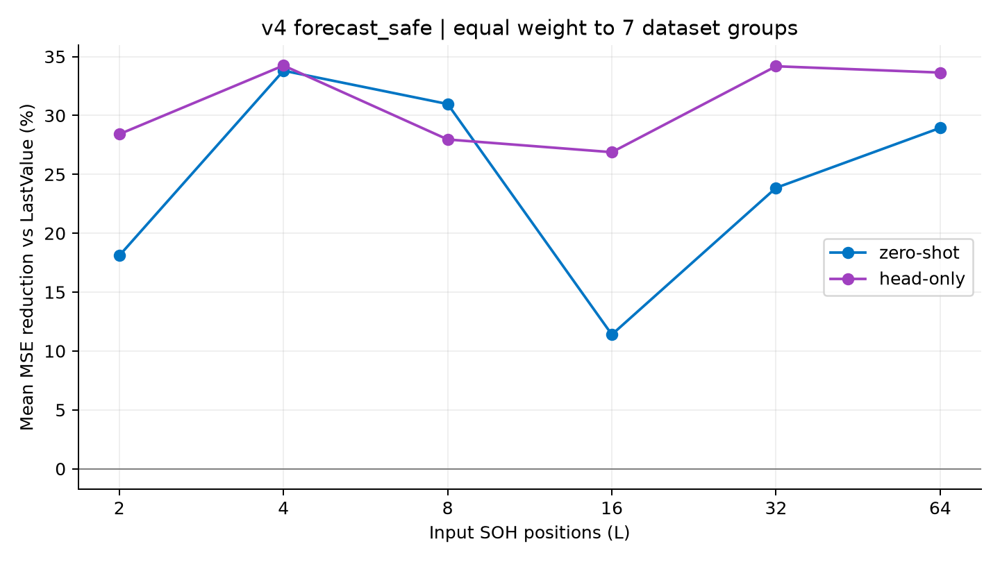
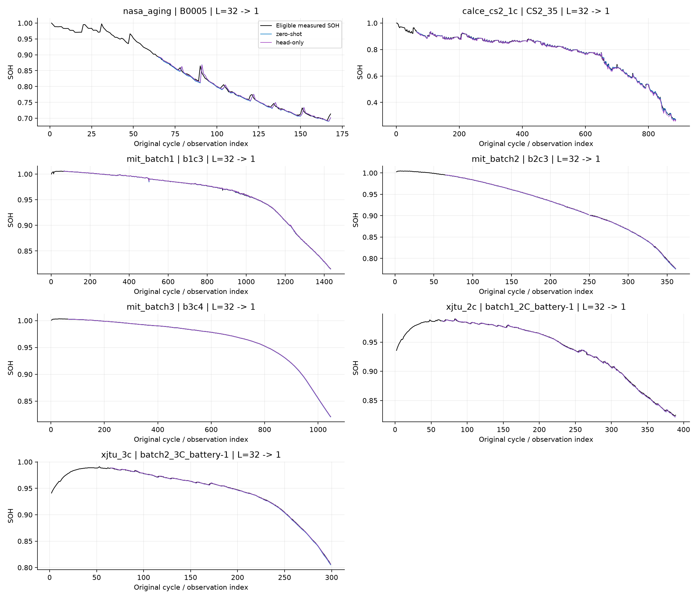
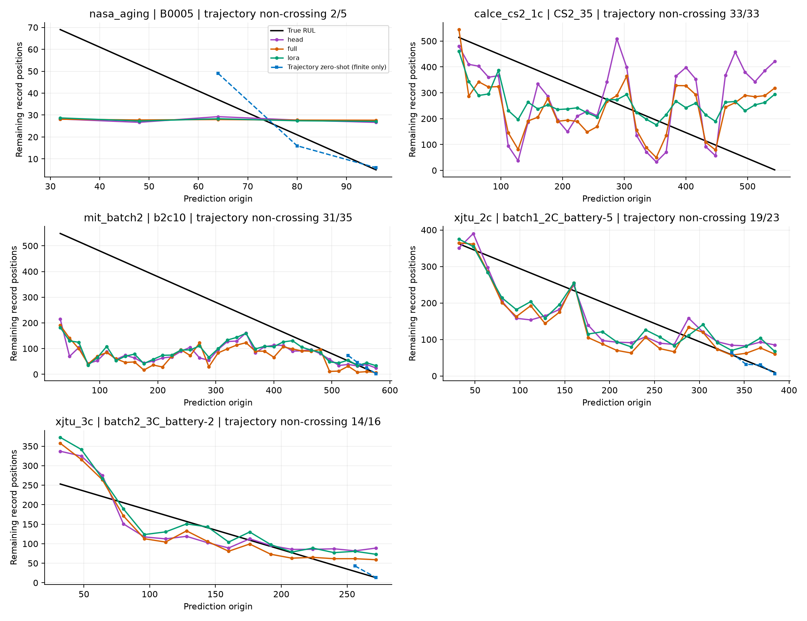
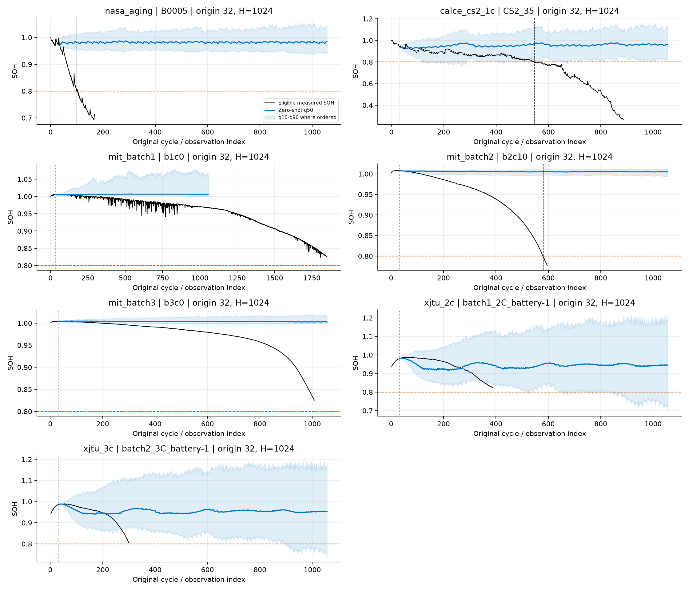

# C2 v4 GPU 실험: 현재 SOH · 궤적 RUL · 직접 RUL

새 전처리 `reviewed_v4/forecast_safe`로 새로 학습·예측한 결과다. 이전 v3 점수의 재채점이 아니다.

검증: 117개 모델 선택, SOH 145셀 × 6개 입력 길이, 길이당 94,516개 공통 시점. 직접 RUL은 157개 시험 셀, 방법당 6,816개 동일 시점.

## 실행 조건

- SSH `home-pc`의 NVIDIA GeForce RTX 3080, CUDA 13.0, PyTorch 2.14.0+cu130; float32, seed 42.
- SOH: 과거 L개 기록 위치 → 현재 한 점. L=2·4·8·16·32·64, LastValue / zero-shot / native SOH head-only. 매 시점 실측 과거 입력을 갱신한다.
- MIT 연속 기록을 물리 셀로 병합한 v4에서 분할을 새로 고정했다. v3와 시험 셀 구성도 달라 기존 점수와의 차이를 전처리만의 개선 효과로 해석하지 않는다.
- RUL: 과거 32개 SOH, t=32부터 16개 기록 위치 간격. Q/Q_ref ≤ 0.8 최초 적격 관측이 EOL이다. 정격용량 80%와 혼동하지 않는다.
- 궤적 RUL: 순정 C2 q50 미래 1,024개 위치를 한 번에 출력한다. 미래 실측 투입·평활화·단조화·보간 없이 최초 80% 교차를 찾는다. 미도달은 >1024로 남긴다.
- 직접 RUL: C2 REG token + 입력 정규화 loc/scale + 마지막 적격 SOH → 새 RUL head. 입력에 cycle, 데이터셋 ID, EOL, RUL 정답을 넣지 않는다. 출력은 softplus로 비음수다.
- Head 51,015 / LoRA 1,230,663 / Full 115,875,399개 파라미터 학습. Full은 사용하지 않는 원래 SOH 출력층을 제외한 본체 전체와 새 RUL head를 학습한다. LoRA는 attention q/k/v/o에 rank 8, alpha 16을 적용한다.
- 매 fold: 다른 학습 셀 2개 × 정답 4개 = 8 labels, 별도 검증 셀 1개 × 4개 = 4 labels. 입력 이력과 완료된 source 셀의 EOL 관측 비용은 별도다. 8개 독립 배터리를 학습했다는 뜻이 아니다.
- SOH 2개 LR × 100 steps; RUL 방식별 2개 LR × 200 steps, batch 4, 20 steps마다 검증, step 0 허용. RUL은 train-label median으로 스케일한 Huber loss, 검증 MAE로 선택한다.
- 세 직접 방식의 source 셀·라벨·초기 head·미니배치 순서가 같다. 모든 모델 선택을 잠근 뒤 시험 평가했다. 내부 역전파 범위·동결 가중치·체크포인트 재로딩을 확인했다.
- CALCE의 cycle 단위는 보존한 관측 순서다. 파일 사이 미관측 물리 cycle 수가 불명확하므로 물리 cycle 수명과 동일시하지 않는다.
- 한 seed 및 작은 고정 예산의 첫 비교다. 최적 튜닝 성능이나 통계적으로 확정된 순위로 해석하지 않는다.

## 현재 SOH

배터리별 MSE 감소율을 평균한 다음, 7개 데이터셋에 같은 가중치를 준 평균이다. R²는 셀의 여러 단일 시점 정답·예측을 모은 temporal R²이며 음수도 그대로 유지한다.

| context_length | method | mse_reduction_pct |
|---|---|---|
| 2 | head-only | 28.41 |
| 2 | zero-shot | 18.10 |
| 4 | head-only | 34.24 |
| 4 | zero-shot | 33.80 |
| 8 | head-only | 27.96 |
| 8 | zero-shot | 30.97 |
| 16 | head-only | 26.88 |
| 16 | zero-shot | 11.39 |
| 32 | head-only | 34.18 |
| 32 | zero-shot | 23.86 |
| 64 | head-only | 33.64 |
| 64 | zero-shot | 28.94 |

[데이터셋별 SOH 요약](soh_summary.csv) · [셀별 점수](soh_battery_metrics.csv)

## RUL 정확한 정답이 있는 시험 셀

아래 MAE는 원점별 집계다. 궤적 방식의 conditional MAE는 **80% 교차를 예측한 시점에 한정**되므로 직접 방식의 전체 MAE와 단독 비교하면 안 된다. 미도달 수와 전체 오차 하한을 함께 본다. 직접 방식의 하한 열은 정확한 MAE와 같다.

| dataset | scope | method | n_event_batteries | n_event_origins | n_no_crossing_event_predictions | conditional_mae_cycles | mae_lower_bound_all_event_origins |
|---|---|---|---|---|---|---|---|
| calce_cs2_1c | within_dataset | trajectory-zero-shot | 4 | 129 | 127 | 26.50 | 747.39 |
| mit_batch2 | within_dataset | trajectory-zero-shot | 40 | 1189 | 1052 | 6.39 | 669.33 |
| nasa_aging | within_dataset | trajectory-zero-shot | 4 | 16 | 8 | 7.25 | 493.00 |
| xjtu_2c | within_dataset | trajectory-zero-shot | 4 | 93 | 81 | 10.83 | 709.35 |
| xjtu_3c | transfer | trajectory-zero-shot | 2 | 34 | 29 | 6.60 | 736.68 |
| calce_cs2_1c | within_dataset | full | 4 | 129 | 0 | 134.83 | 134.83 |
| calce_cs2_1c | within_dataset | head | 4 | 129 | 0 | 151.40 | 151.40 |
| calce_cs2_1c | within_dataset | lora | 4 | 129 | 0 | 127.46 | 127.46 |
| mit_batch2 | within_dataset | full | 40 | 1189 | 0 | 134.36 | 134.36 |
| mit_batch2 | within_dataset | head | 40 | 1189 | 0 | 123.08 | 123.08 |
| mit_batch2 | within_dataset | lora | 40 | 1189 | 0 | 123.04 | 123.04 |
| nasa_aging | within_dataset | full | 4 | 16 | 0 | 22.57 | 22.57 |
| nasa_aging | within_dataset | head | 4 | 16 | 0 | 24.42 | 24.42 |
| nasa_aging | within_dataset | lora | 4 | 16 | 0 | 24.51 | 24.51 |
| xjtu_2c | within_dataset | full | 4 | 93 | 0 | 69.65 | 69.65 |
| xjtu_2c | within_dataset | head | 4 | 93 | 0 | 64.15 | 64.15 |
| xjtu_2c | within_dataset | lora | 4 | 93 | 0 | 66.00 | 66.00 |
| xjtu_3c | transfer | full | 2 | 34 | 0 | 45.57 | 45.57 |
| xjtu_3c | transfer | head | 2 | 34 | 0 | 46.21 | 46.21 |
| xjtu_3c | transfer | lora | 2 | 34 | 0 | 42.90 | 42.90 |

[같은 시험 시점의 궤적 결과](rul_zero_matched_predictions.csv) · [직접 예측 원시 결과](rul_direct_predictions.csv)

[최초 공통 예측 시점 t=32만의 별도 비교](rul_origin32_summary.csv) — 전체 원점 결과와 구분한다. 이전 v3의 t=64·H=256 결과와는 데이터·시점·horizon이 모두 달라 직접 개선율을 계산하지 않는다.

## RUL 셀별 동일 가중 평균 및 R²

R²는 셀의 여러 예측 원점을 모아 계산한 뒤 셀별 평균한다. 궤적 방식에서 미도달 예측이 있는 셀은 전체 R²가 정의되지 않아 제외하고, 정의된 셀 수를 명시한다. 서로 다른 포함 셀 수의 R²를 순위로 비교하지 않는다.

| dataset | scope | method | macro_conditional_mae | macro_mae_lower_bound | mean_cell_r2 | n_defined_cell_r2 |
|---|---|---|---|---|---|---|
| calce_cs2_1c | within_dataset | full | 134.59 | 134.59 | -0.183 | 4 |
| calce_cs2_1c | within_dataset | head | 151.15 | 151.15 | -0.451 | 4 |
| calce_cs2_1c | within_dataset | lora | 127.49 | 127.49 | -0.142 | 4 |
| calce_cs2_1c | within_dataset | trajectory-zero-shot | 26.50 | 747.35 | — | 0 |
| mit_batch2 | within_dataset | full | 131.66 | 131.66 | -0.332 | 40 |
| mit_batch2 | within_dataset | head | 120.40 | 120.40 | -0.130 | 40 |
| mit_batch2 | within_dataset | lora | 120.37 | 120.37 | -0.165 | 40 |
| mit_batch2 | within_dataset | trajectory-zero-shot | 6.20 | 671.44 | — | 0 |
| nasa_aging | within_dataset | full | 22.19 | 22.19 | -3.315 | 4 |
| nasa_aging | within_dataset | head | 23.49 | 23.49 | -2.962 | 4 |
| nasa_aging | within_dataset | lora | 23.81 | 23.81 | -3.413 | 4 |
| nasa_aging | within_dataset | trajectory-zero-shot | 6.33 | 596.22 | — | 0 |
| xjtu_2c | within_dataset | full | 69.75 | 69.75 | 0.342 | 4 |
| xjtu_2c | within_dataset | head | 63.89 | 63.89 | 0.504 | 4 |
| xjtu_2c | within_dataset | lora | 66.16 | 66.16 | 0.383 | 4 |
| xjtu_2c | within_dataset | trajectory-zero-shot | 11.02 | 708.44 | — | 0 |
| xjtu_3c | transfer | full | 45.30 | 45.30 | 0.532 | 2 |
| xjtu_3c | transfer | head | 46.19 | 46.19 | 0.532 | 2 |
| xjtu_3c | transfer | lora | 42.67 | 42.67 | 0.535 | 2 |
| xjtu_3c | transfer | trajectory-zero-shot | 6.67 | 738.38 | — | 0 |

## 미도달 셀과 전이 예측

- MIT Batch 1·3은 현재 데이터에서 SOH 80% 도달 정답이 없다. MIT Batch 2의 2개 학습 셀·1개 검증 셀로 정한 모델을 그대로 적용한 전이 예측이다.
- XJTU 3C는 도달 셀이 2개뿐이다. 별도 학습/검증/시험 분리를 만들 수 없어 XJTU 2C 첫 fold 모델을 그대로 적용했다. 이 2개 셀의 MAE는 조건이 달라진 전이 성능이다.
- XJTU 2C의 미도달 셀은 첫 fold의 시험에만 포함했다. 미도달 셀에는 정확한 RUL MAE/R²를 만들지 않는다.
- 아래 모순 수는 예측 RUL이 실제 무고장 관측 기간보다 짧은 경우다. 모순이 없다고 정확한 RUL을 맞혔다고 볼 수 없다.
- EOL이 관측된 source 셀만으로 정확한 회귀를 학습했으므로 관측 종료 전에 고장난 셀을 선택한 편향이 있다. 검열을 직접 학습에 활용하는 생존 모델은 이번 범위에 포함하지 않았다.

| dataset | scope | method | censored_origins | censored_contradictions |
|---|---|---|---|---|
| mit_batch1 | transfer | trajectory-zero-shot | 2566 | 0 |
| mit_batch3 | transfer | trajectory-zero-shot | 2519 | 0 |
| xjtu_2c | within_dataset | trajectory-zero-shot | 93 | 1 |
| xjtu_3c | transfer | trajectory-zero-shot | 177 | 9 |
| mit_batch1 | transfer | full | 2566 | 2438 |
| mit_batch1 | transfer | head | 2566 | 2362 |
| mit_batch1 | transfer | lora | 2566 | 2350 |
| mit_batch3 | transfer | full | 2519 | 2482 |
| mit_batch3 | transfer | head | 2519 | 2420 |
| mit_batch3 | transfer | lora | 2519 | 2418 |
| xjtu_2c | within_dataset | full | 93 | 62 |
| xjtu_2c | within_dataset | head | 93 | 57 |
| xjtu_2c | within_dataset | lora | 93 | 56 |
| xjtu_3c | transfer | full | 177 | 75 |
| xjtu_3c | transfer | head | 177 | 56 |
| xjtu_3c | transfer | lora | 177 | 62 |

## 선택·재현성

- 원본·v3·전처리 v4 데이터와 이전 모델 결과를 덮어쓰지 않았다. 전처리 및 실행 코드 해시, 입력 bundle 해시, split, 라벨 위치, 환경, 예측값, checkpoint 해시를 저장했다.
- 그래프는 적격 실측만 표시한다. 제외된 point는 그리지 않으며 원래 cycle과 NaN 공백을 유지한다.
- 첫 개발 실행(v1)은 새 캐시 학습 손실의 pinball 방향 오류를 시험 평가 전에 발견해 폐기했다. 이 v2는 예측값·학습 손실 모두 공식 C2와 일치하는 검사를 통과한 별도 실행이다.
- 모델 선택 중 step 0: SOH 15/78, 직접 RUL 3/39. Step 0 직접 RUL은 학습 source의 평균 RUL로 초기화한 회귀 head이며 zero-shot이라 부르지 않는다.
- 원격 실행 폴더: `C:\Users\master\Lab\chronos-battery-soh\experiments\c2-v4-suite-v2`. 실행 환경은 상위 프로젝트 `.venv`다.
- 새 출력 폴더에서 재실행: `python -X utf8 scripts/run_c2_v4_suite.py --out <새 결과 폴더> --cache-root <Chronos-2 캐시>`; `--smoke-only`로 먼저 CUDA·역전파·재로딩을 검사할 수 있다. 완료 결과는 덮어쓰지 않는다.
- 검증/보고서 재생성: `python -X utf8 scripts/verify_report_c2_v4_suite.py --out <결과 폴더>`. 모든 checkpoint 파일이 있어야 기본 검증이 통과한다.

[고정 프로토콜](protocol.json) · [정답 예산](label_budget.csv) · [EOL 감사](eol_audit.csv) · [모델 선택](selected_models.csv) · [검증](verification.json) · [환경](environment.json)
