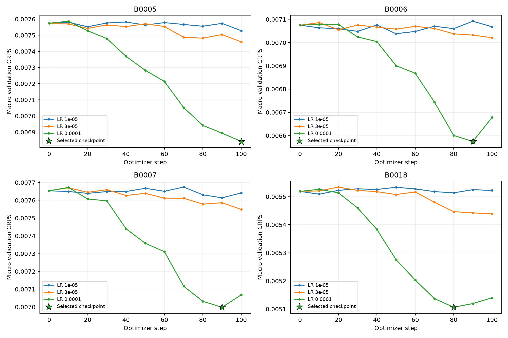
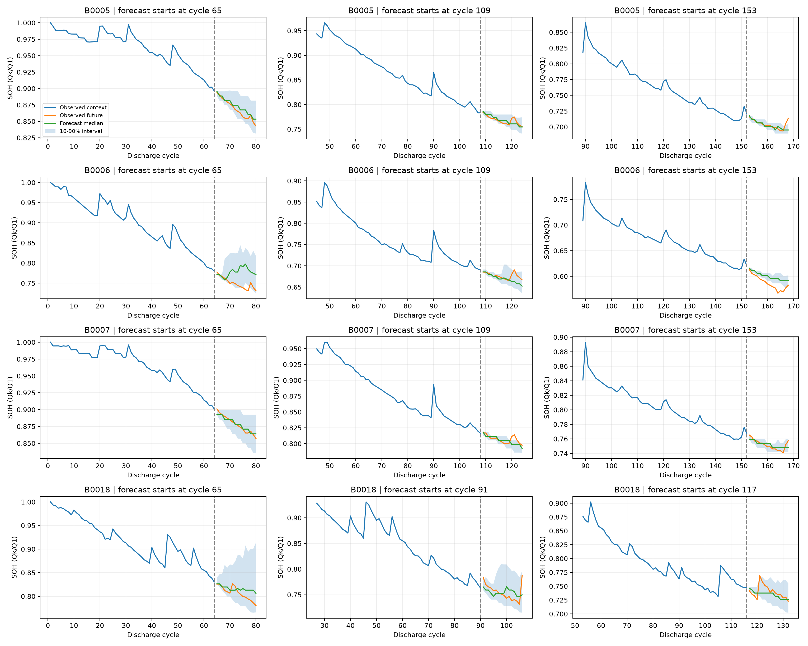

# EOS loss 제외 + best checkpoint + 학습률 3개 비교

실행: `20260929T175636Z_checkpointlora_39b551`. 기준 zero-shot: `20260923T063348Z_zeroshot_b57856`.

## 고정한 프로토콜

- 학습률 `1e-5`, `3e-5`, `1e-4`만 비교했다. Optuna는 사용하지 않고 세 후보를 모두 실행했다.
- 각 outer fold는 평가 배터리를 제외한 세 배터리의 앞쪽 구간으로만 학습했다. 뒤쪽 20% target은 validation으로 유지했다.
- 입력 EOS와 decoder 입력은 유지했다. 마지막 출력 EOS label만 마스킹하고 loss에 `16/17`을 곱해 기존 미래값 토큰 가중치를 유지했다.
- LoRA q/v, rank 8, alpha 16, dropout 0.05, batch 16, gradient accumulation 1. 후보마다 같은 초기화·shuffle·학습 seed를 사용했다.
- 후보당 최대 100 optimizer steps, 10 steps마다 검증했다. epoch는 기록용이며 학습량을 결정하지 않는다. 조기 종료나 pruning은 하지 않았다.
- Validation은 seed [31415, 31416, 31417], 각각 32 samples. 각 seed·배터리의 CRPS를 계산한 뒤 같은 가중치로 평균했다. sample을 합쳐 한 분포로 만들지 않았다.
- Step 0도 후보이며 CRPS가 1e-05보다 크게 감소할 때만 교체했다. 유사한 점수는 먼저 평가한 step/학습률을 유지했다. RMSE·coverage도 기록했지만 추가 선택 조건으로 사용하지 않았다.
- 네 fold의 학습률과 checkpoint를 모두 고정한 뒤 test 예측을 시작했다. 선택한 adapter를 다시 불러왔고 **full-data refit은 하지 않았다**.
- 최종 학습 seed [42], 추론 seed [42, 43, 44], window당 100 samples. 모델 revision과 실행 환경은 zero-shot과 동일하다.

## 선택 결과

| battery | train_seed | learning_rate | selected_step | executed_steps_per_candidate | selected_examples_seen | validation_crps | median_r2 | mean_r2 |
| --- | --- | --- | --- | --- | --- | --- | --- | --- |
| B0005 | 42 | 0.0001 | 100 | 100 | 1512 | 0.0068422 | -0.0302701 | 0.128117 |
| B0006 | 42 | 0.0001 | 90 | 100 | 1360 | 0.0065747 | -0.2569056 | -0.0529587 |
| B0007 | 42 | 0.0001 | 90 | 100 | 1360 | 0.0069983 | -0.0849841 | 0.1012705 |
| B0018 | 42 | 0.0001 | 80 | 100 | 1203 | 0.0051063 | 0.3676346 | 0.3612957 |

Step 0을 선택한 모델은 0/4개다. Step 0 결과는 LoRA 학습의 이득으로 해석하지 않는다. 선택 step이 100이면 탐색 상한에서 선택됐다는 뜻이며, 더 긴 학습의 효과는 이번에 확인하지 않았다.

## 평가 결과

배터리와 추론 반복에 같은 가중치를 준 평균이다. `mean_rmse`는 sample mean으로 만든 점예측의 RMSE다. 비율 열은 0~1 단위다.

`median_r2`와 `mean_r2`는 각 점예측의 결정계수 R²다. 배터리·seed마다 전체 window와 horizon을 펼쳐 `1 - SSE/SST`로 계산한 뒤 동일 가중 평균한다. 1이면 완전 예측, 0이면 평가 target의 평균 예측과 같고 음수도 유효하다. 정답이 상수이면 NaN이다. R²는 높을수록 좋으며 모델 선택에는 사용하지 않았다.

| model | median_rmse | median_mae | median_r2 | mean_rmse | mean_r2 | crps | coverage80 | width80 | above2_rate |
| --- | --- | --- | --- | --- | --- | --- | --- | --- | --- |
| ZeroShot | 0.016307 | 0.011607 | 0.676844 | 0.01854 | 0.616669 | 0.008769 | 0.803182 | 0.04241 | 6.3e-05 |
| SelectedLoRA | 0.014355 | 0.00992 | 0.733519 | 0.015202 | 0.705528 | 0.007461 | 0.765325 | 0.033405 | 2.8e-05 |

Zero-shot 대비 오차 감소율: 중앙값 RMSE **+11.97%**, 평균 예측 RMSE **+18.00%**, CRPS **+14.92%**. 양수는 개선, 음수는 악화다.

R² 절대 변화: 중앙값 **+0.056674**, 평균 예측 **+0.088859**. R²에는 백분율 개선율을 적용하지 않는다.

| battery | ZeroShot | SelectedLoRA | error_change_pct | ZeroShot_R2 | SelectedLoRA_R2 |
| --- | --- | --- | --- | --- | --- |
| B0005 | 0.012601 | 0.009637 | -23.526999 | 0.937543 | 0.963486 |
| B0006 | 0.0189 | 0.017375 | -8.069156 | 0.845382 | 0.869341 |
| B0007 | 0.011423 | 0.009932 | -13.051637 | 0.910154 | 0.932077 |
| B0018 | 0.022303 | 0.020476 | -8.18912 | 0.014299 | 0.16917 |

배터리 표의 `error_change_pct`는 오차 증가율이므로 음수가 개선이다.

## 결과를 해석할 때

- 이전 EOS 제외 진단의 중앙값 RMSE 0.014894는 세 학습 배터리 전체로 기존 epoch만큼 학습한 결과다. 이번에는 validation을 남기고 checkpoint와 학습률을 CRPS로 선택하므로 학습 데이터·학습량·선택 방식이 다르다. 이번 점수 차이를 특정 변경 한 가지의 인과 효과로 해석하지 않는다.
- 이 네 배터리는 이미 관찰한 데이터다. 새로운 독립 벤치마크나 통계적 유의성 검증은 아니다. 현재 학습 seed 하나에 대해 세 학습률을 탐색했으며, 추론 seed 반복은 학습 안정성 검증을 대체하지 않는다.
- 중첩 window는 독립적인 배터리 표본이 아니다. Validation은 기존 학습 배터리의 미래 구간으로, 새 배터리의 분포 차이를 완전히 대변하지 않는다.
- Test 결과로 후보·선택 규칙을 다시 고르지 않았다. 원시 samples에 clipping이나 평활화를 적용하지 않았다.

## 검증

- 원시 예측에서 point metric 24행, distribution metric 24행을 재계산했다. 후보 12개와 adapter·산출물 해시를 확인했다.
- 선택된 4개 adapter를 재로딩했을 때 validation 원시 sample 배열 36/36개가 checkpoint 저장 시점과 정확히 같았다. Macro CRPS 절대 차이의 최댓값은 0다.
- EOS gradient 제외, validation 난수 복구, 정확한 step 예산, 마지막 가중치 대신 best checkpoint 저장, validation 기반 후보 선택을 단위 테스트로 검사했다.

학습 직후와 resume 경로에서 한 sample 배열의 9,728개 값 중 1개가 달라 test 예측 전에 비트 단위 비교가 여러 번 실패했다. 새 프로세스의 별도 검사에서는 네 adapter의 모든 저장 tensor가 정확히 로드되는지 확인했으며, 각 모델의 validation을 두 번씩 반복해 원본과 정확히 일치함을 확인했다. 실행 경로별 차이가 남아 `scripts/resume_checkpoint_verified.py`에서 가중치는 완전 일치를 요구하되, sample은 차이를 저장하고 macro CRPS 차이가 기존 선택 기준 `min_delta=1e-5` 미만인지 검사하도록 **평가 재현성 검사만 변경했다**. 이 변경은 held-out 예측 생성 전에 결정했다. 학습 코드·가중치·학습률·선택 step은 바꾸지 않았다. 별도 평가 코드 해시와 재생성한 validation 배열도 보관했다. 불일치의 원인은 확정하지 않았으며, 모든 실행에서 bitwise 재현성을 보장한다는 뜻은 아니다. [중단 기록](replay_interruption.json) · [별도 재검증](replay_diagnostic.json)

설정: `configs/lora_checkpoint.json`. 실행: `python scripts/run_checkpoint_lora.py`.
기존 epoch/refit 실험은 별도 소스·결과로 보존한다. 이 보고서와 03 노트북의 현재 프로토콜은 `src/soh_checkpoint.py`에 구현돼 있다.
