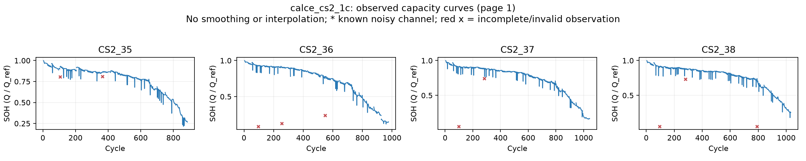

# calce_cs2_1c SOH 추출

기록 **4개**, cycle **3,937개**. 필수 확인: **complete**.

용량·cycle 배열, 중복·순서, 정규화 계산을 확인했다. 유효하지 않거나 불완전한 관측은 표시해서 예측 window에서 제외한다. 고유 관측과 원래 capacity는 보존하며 보간·평활화·이상치 자동 제거를 하지 않았다.

누적 Discharge_Capacity(Ah)의 방전 종료값에서 방전 직전 값을 빼 cycle 용량을 계산했다. 날짜별 파일의 Cycle_Index가 다시 1부터 시작하므로 시간순 관측 번호와 원본 cycle 번호를 함께 보존한다. 완료되지 않은 방전은 표시하고 예측에서 제외하며, window는 파일 경계를 넘지 않는다. 기준은 첫 완료 방전 용량이다. 같은 측정 구간과 용량을 중복 내보낸 관측은 한 번만 사용하고 원본 파일 이름을 모두 기록한다. 원래 기록에 없는 cycle은 보간하지 않는다.



| Battery | 관측 수 | 예측 제외 | 64→16 windows | 마지막 SOH | 상태 |
|---|---:|---:|---:|---:|---|
| CS2_35 | 886 | 6 | 0 | 0.2667 | passed_with_exclusions |
| CS2_36 | 976 | 6 | 0 | 0.1505 | passed_with_exclusions |
| CS2_37 | 1043 | 7 | 0 | 0.1685 | passed_with_exclusions |
| CS2_38 | 1032 | 7 | 0 | 0.2543 | passed_with_exclusions |

중복 내보내기 **100 cycle**을 한 번씩만 기록했다. 64→16 window 수가 0이면 현재 파일 내 연속 관측 길이가 부족하거나 제외 관측이 포함된 것이다. 예측 단계에서는 context를 줄이거나 파일 경계의 연속성을 별도로 확인해야 한다.

전체 공통 데이터: `data/processed/Calce/calce_cs2_1c`.
아직 모델 예측은 실행하지 않았다.

[데이터 제작자의 설명](https://web.calce.umd.edu/batteries/data/)

```powershell
.\.venv\Scripts\python.exe scripts\preprocess_remaining_batteries.py
```
