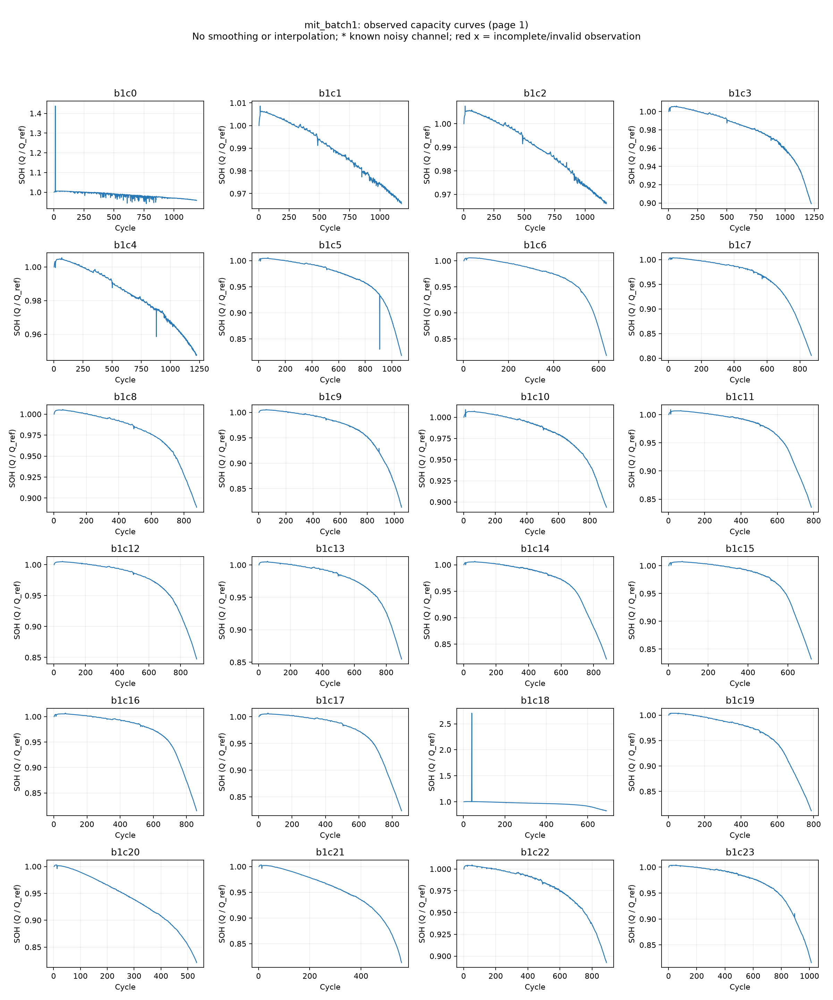
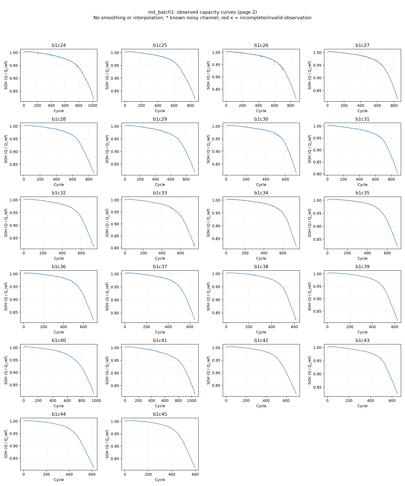

# mit_batch1 SOH 추출

기록 **46개**, cycle **38,811개**. 필수 확인: **complete**.

용량·cycle 배열, 중복·순서, 정규화 계산을 확인했다. 유효하지 않거나 불완전한 관측은 표시해서 예측 window에서 제외한다. 고유 관측과 원래 capacity는 보존하며 보간·평활화·이상치 자동 제거를 하지 않았다.

Batch 1의 cycle 1은 0인 미측정값으로 보존하고 SOH 기준은 cycle 2 용량으로 명시했다. batch를 이어 측정한 5개 기록은 원래 배터리의 기준 용량과 physical_battery_id를 공유한다. train/test 분리 시 이 ID를 함께 묶어야 한다. 제작자가 noisy channel로 표시한 Batch 3의 6개 기록은 곡선과 데이터에 보존하고 예측 window에서는 제외한다. 기록 140개는 물리 배터리 135개에 해당한다.





| Battery | 관측 수 | 예측 제외 | 64→16 windows | 마지막 SOH | 상태 |
|---|---:|---:|---:|---:|---|
| b1c0 | 1189 | 1 | 1109 | 0.9585 | passed_with_exclusions |
| b1c1 | 1178 | 1 | 1098 | 0.9655 | passed_with_exclusions |
| b1c2 | 1176 | 1 | 1096 | 0.9661 | passed_with_exclusions |
| b1c3 | 1225 | 1 | 1145 | 0.8992 | passed_with_exclusions |
| b1c4 | 1226 | 1 | 1146 | 0.9476 | passed_with_exclusions |
| b1c5 | 1073 | 1 | 993 | 0.8182 | passed_with_exclusions |
| b1c6 | 635 | 1 | 555 | 0.8180 | passed_with_exclusions |
| b1c7 | 869 | 1 | 789 | 0.8055 | passed_with_exclusions |
| b1c8 | 878 | 1 | 798 | 0.8890 | passed_with_exclusions |
| b1c9 | 1053 | 1 | 973 | 0.8134 | passed_with_exclusions |
| b1c10 | 905 | 1 | 825 | 0.8937 | passed_with_exclusions |
| b1c11 | 787 | 1 | 707 | 0.8356 | passed_with_exclusions |
| b1c12 | 901 | 1 | 821 | 0.8474 | passed_with_exclusions |
| b1c13 | 896 | 1 | 816 | 0.8549 | passed_with_exclusions |
| b1c14 | 879 | 1 | 799 | 0.8217 | passed_with_exclusions |
| b1c15 | 718 | 1 | 638 | 0.8321 | passed_with_exclusions |
| b1c16 | 861 | 1 | 781 | 0.8148 | passed_with_exclusions |
| b1c17 | 856 | 1 | 776 | 0.8239 | passed_with_exclusions |
| b1c18 | 690 | 1 | 610 | 0.8265 | passed_with_exclusions |
| b1c19 | 787 | 1 | 707 | 0.8118 | passed_with_exclusions |
| b1c20 | 533 | 1 | 453 | 0.8211 | passed_with_exclusions |
| b1c21 | 558 | 1 | 478 | 0.8131 | passed_with_exclusions |
| b1c22 | 890 | 1 | 810 | 0.8925 | passed_with_exclusions |
| b1c23 | 1013 | 1 | 933 | 0.8160 | passed_with_exclusions |
| b1c24 | 1016 | 1 | 936 | 0.8194 | passed_with_exclusions |
| b1c25 | 853 | 1 | 773 | 0.8186 | passed_with_exclusions |
| b1c26 | 869 | 1 | 789 | 0.8100 | passed_with_exclusions |
| b1c27 | 841 | 1 | 761 | 0.8167 | passed_with_exclusions |
| b1c28 | 859 | 1 | 779 | 0.8171 | passed_with_exclusions |
| b1c29 | 916 | 1 | 836 | 0.8156 | passed_with_exclusions |
| b1c30 | 708 | 1 | 628 | 0.8154 | passed_with_exclusions |
| b1c31 | 875 | 1 | 795 | 0.8048 | passed_with_exclusions |
| b1c32 | 730 | 1 | 650 | 0.8172 | passed_with_exclusions |
| b1c33 | 756 | 1 | 676 | 0.8056 | passed_with_exclusions |
| b1c34 | 741 | 1 | 661 | 0.8193 | passed_with_exclusions |
| b1c35 | 702 | 1 | 622 | 0.8221 | passed_with_exclusions |
| b1c36 | 703 | 1 | 623 | 0.8186 | passed_with_exclusions |
| b1c37 | 647 | 1 | 567 | 0.8219 | passed_with_exclusions |
| b1c38 | 616 | 1 | 536 | 0.8212 | passed_with_exclusions |
| b1c39 | 624 | 1 | 544 | 0.8136 | passed_with_exclusions |
| b1c40 | 965 | 1 | 885 | 0.8129 | passed_with_exclusions |
| b1c41 | 1050 | 1 | 970 | 0.8166 | passed_with_exclusions |
| b1c42 | 701 | 1 | 621 | 0.8152 | passed_with_exclusions |
| b1c43 | 650 | 1 | 570 | 0.8242 | passed_with_exclusions |
| b1c44 | 615 | 1 | 535 | 0.8117 | passed_with_exclusions |
| b1c45 | 598 | 1 | 518 | 0.8128 | passed_with_exclusions |

전체 공통 데이터: `data/processed/MIT/mit_batch1`.
아직 모델 예측은 실행하지 않았다.

[데이터 제작자의 설명](https://github.com/rdbraatz/data-driven-prediction-of-battery-cycle-life-before-capacity-degradation)

```powershell
.\.venv\Scripts\python.exe scripts\preprocess_remaining_batteries.py
```
