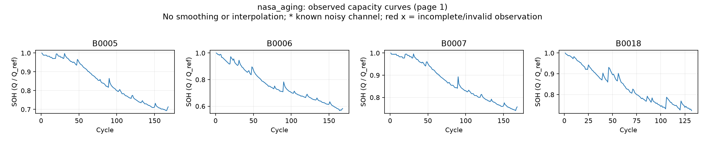

# nasa_aging SOH 추출

기록 **4개**, cycle **636개**. 필수 확인: **complete**.

용량·cycle 배열, 중복·순서, 정규화 계산을 확인했다. 유효하지 않거나 불완전한 관측은 표시해서 예측 window에서 제외한다. 고유 관측과 원래 capacity는 보존하며 보간·평활화·이상치 자동 제거를 하지 않았다.

discharge 기록의 data.Capacity를 사용하고 첫 방전 용량을 기준으로 SOH를 계산했다. 원본 MAT의 전체 기록 위치도 보존한다. 기존 NASA 02·03 실험과 같은 Q/Q1 기준이다.



| Battery | 관측 수 | 예측 제외 | 64→16 windows | 마지막 SOH | 상태 |
|---|---:|---:|---:|---:|---|
| B0005 | 168 | 0 | 89 | 0.7138 | passed |
| B0006 | 168 | 0 | 89 | 0.5825 | passed |
| B0007 | 168 | 0 | 89 | 0.7575 | passed |
| B0018 | 132 | 0 | 53 | 0.7229 | passed |

전체 공통 데이터: `data/processed/Nasa/nasa_aging`.
아직 모델 예측은 실행하지 않았다.

[데이터 제작자의 설명](https://data.nasa.gov/dataset/li-ion-battery-aging-datasets)

```powershell
.\.venv\Scripts\python.exe scripts\preprocess_remaining_batteries.py
```
