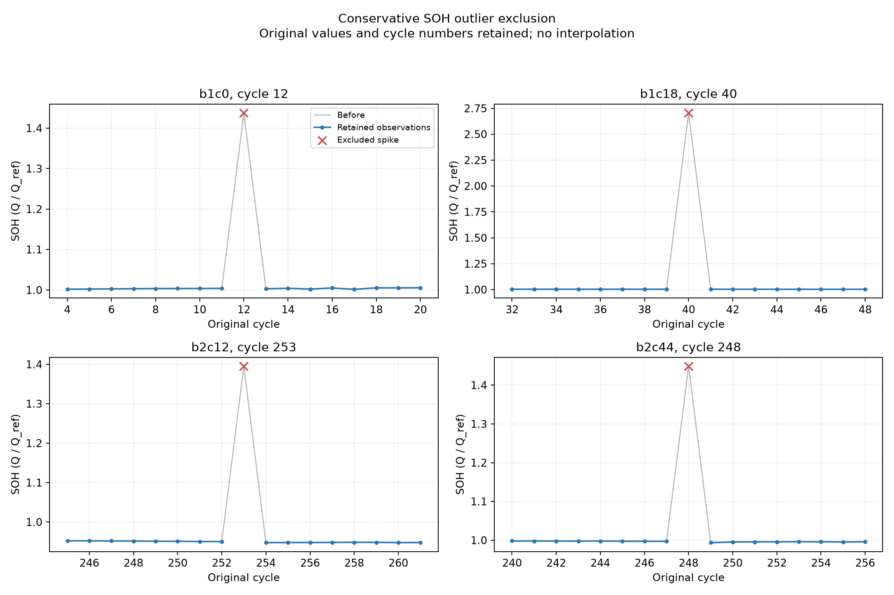

# SOH 이상치 제거 결과

전체 **126,272행**에서 급등 이상치 **4개**를 제외했다. 제거본은 **126,268행**이다.

고정한 보수적 규칙: SOH가 **120% 초과**이고, 직전 최대 10개 유효 관측의 중앙값보다 **20%p 초과** 높을 때 제외한다. 이전 유효 관측이 5개 이상 있어야 한다. 배터리·시험 조건·측정 구간이 바뀌면 과거 기준을 다시 시작한다.

현재 관측 이전 값만 사용하며 전체 수명 평균·미래 이웃값·예측 성능으로 기준을 조정하지 않았다. 이 규칙은 큰 급등에 한정한다. 정상적인 작은 용량 회복, 초기 시험 조건 전환, 급격한 열화, 순간 하락값은 자동 제거하지 않았다.

| 그룹 | 원래 행 | 제거 | 남은 행 | 64→16 windows 전 | 후 |
|---|---:|---:|---:|---:|---:|
| xjtu_2c | 3,219 | 0 | 3,219 | 2,579 | 2,579 |
| xjtu_3c | 3,742 | 0 | 3,742 | 2,542 | 2,542 |
| nasa_aging | 636 | 0 | 636 | 320 | 320 |
| mit_batch1 | 38,811 | 2 | 38,809 | 35,131 | 35,081 |
| mit_batch2 | 24,920 | 2 | 24,918 | 21,128 | 20,968 |
| mit_batch3 | 51,007 | 0 | 51,007 | 38,080 | 38,080 |
| calce_cs2_1c | 3,937 | 0 | 3,937 | 0 | 0 |

| Battery | Cycle | 제거한 SOH | 직전 유효값 중앙값 |
|---|---:|---:|---:|
| b1c0 | 12 | 143.74% | 100.29% |
| b1c18 | 40 | 270.51% | 100.33% |
| b2c12 | 253 | 139.48% | 95.19% |
| b2c44 | 248 | 144.84% | 99.79% |



원본과 기존 `data/processed/<dataset>/<group>` 묶음은 보존했다. 새 예측용 묶음은 `data/processed/clean/<group>/`에 저장했다.

- `soh.csv`: 급등 이상치를 제외한 데이터. 원래 cycle 번호와 나머지 capacity·SOH는 유지한다.
- `soh_flagged.csv`: 모든 원래 행을 유지하고 해당 관측에 `capacity_outlier`를 표시한 비교용 데이터.
- `audit.csv`, `batteries.csv`, `schema.json`, `manifest.json`: 제거 수·window 수·기준 용량·원본 묶음 해시를 기록한다.

제거된 cycle을 보간하거나 앞뒤 구간을 이어 붙이지 않는다. 이상치가 포함됐던 예측 window도 함께 제외되므로 제거 전후 성능을 비교할 때 같은 평가 구간을 사용해야 한다. target 품질 제외 여부는 해당 측정값을 관측한 후 결정된다. 이상치 처리가 실제 예측 성능을 개선했는지는 아직 평가하지 않았다.

[전처리와 데이터 누출에 관한 참고](https://scikit-learn.org/stable/common_pitfalls.html#data-leakage)

```powershell
.\.venv\Scripts\python.exe scripts\clean_soh_outliers.py
```
