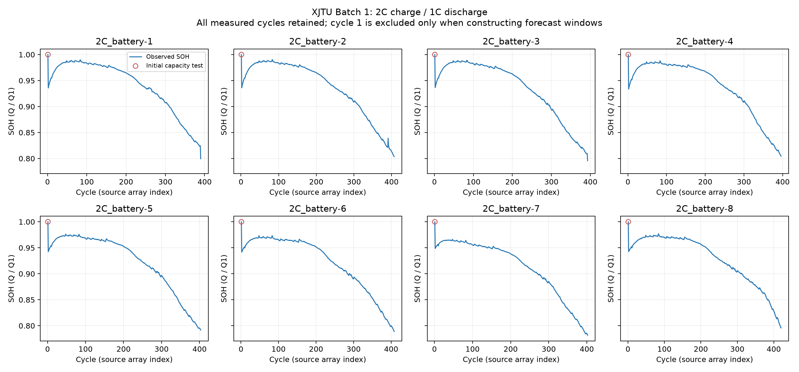

# XJTU 2C 데이터 Audit 및 공통 SOH 추출

상태: **complete**. 배터리 8개, cycle 관측 3,219개.

## 추출 규칙

- `summary.discharge_capacity_Ah`를 cycle별 용량으로 추출하고 `SOH = Q / Q1`로 계산했다.
- 모든 cycle을 보존했다. 첫 cycle은 0.5C 충전·0.2C 방전 초기 용량 시험으로 표시했다.
- 이후 cycle은 2C 충전·1C 방전이다. 이 규칙은 Batch 1만 지원한다.
- 용량 증가와 SOH > 1은 표시하고 보존한다. 보간·평활화·clipping·강제 단조 감소는 적용하지 않는다.
- 같은 시험 조건에서 SOH 변화가 1%p를 초과하면 추가 검토용으로 표시한다. 제외 기준으로 사용하지 않는다. 초기 시험 전환은 별도 표시한다.
- cycle은 공개 MAT `data` 배열의 1-based 위치다. 원래 장비 기록의 누락 cycle 여부는 이 인덱스만으로 판단할 수 없다.
- 예측 준비에서는 초기 시험 cycle과 비정상 관측을 제외하고, 연속된 실제 관측의 64 → 16 window만 사용한다.
- 원시 데이터와 기존 NASA 실험은 변경하지 않았다. 이번 작업에서 모델 예측은 실행하지 않았다.

[데이터 제작자의 시험 조건](https://wang-fujin.github.io/)

## 배터리별 확인

| Battery | 보존 cycle | Q1 (Ah) | 마지막 SOH | 용량 증가 횟수 | 큰 SOH 변화 | 64→16 windows | 상태 |
|---|---:|---:|---:|---:|---:|---:|---|
| batch1_2C_battery-1 | 390 | 1.991 | 0.799598 | 76 | 1 | 310 | passed_with_notes |
| batch1_2C_battery-2 | 407 | 1.988 | 0.803823 | 68 | 2 | 327 | passed_with_notes |
| batch1_2C_battery-3 | 393 | 1.987 | 0.795672 | 71 | 1 | 313 | passed_with_notes |
| batch1_2C_battery-4 | 396 | 1.990 | 0.804523 | 72 | 0 | 316 | passed_with_notes |
| batch1_2C_battery-5 | 403 | 2.017 | 0.791770 | 67 | 0 | 323 | passed_with_notes |
| batch1_2C_battery-6 | 408 | 2.024 | 0.789032 | 68 | 0 | 328 | passed_with_notes |
| batch1_2C_battery-7 | 402 | 2.043 | 0.781694 | 62 | 0 | 322 | passed_with_notes |
| batch1_2C_battery-8 | 420 | 2.008 | 0.795817 | 87 | 0 | 340 | passed_with_notes |

`passed_with_notes`는 오류가 아니라 초기 시험 조건 차이·용량 증가 관측 등을 기록했다는 뜻이다.
정규화 기준 Q1을 유지하므로 cycle 2의 SOH가 1보다 작은 것은 정상이다. 용량 증가를 열화 제거 대상으로 취급하지 않는다.

큰 SOH 변화는 측정 이상인지 실제 거동인지 확정하지 않았다. `quality_events.csv`에 초기 시험·조건 전환·큰 변화의 cycle을 기록했다.



## 산출물

전체 공통 데이터: `data\processed\XJTU\2C`.
`soh.csv`, `batteries.csv`, `audit.csv`, `schema.json`, `manifest.json`을 저장했다.
전체 가공 데이터는 gitignore 대상이다. 이 보고서 폴더에는 audit·메타데이터·해시·40행 미리보기·그림을 보관한다.

```powershell
.\.venv\Scripts\python.exe scripts\preprocess_xjtu_2c.py
```
