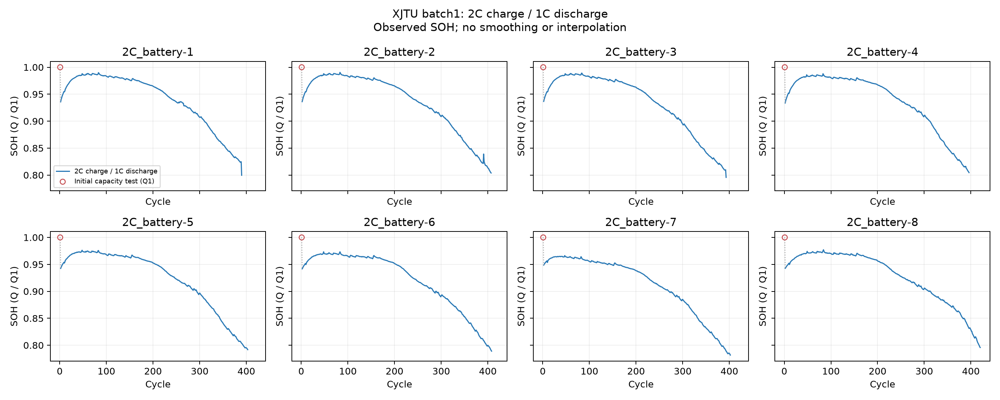

# XJTU 2C SOH 추출

배터리 **8개**, 관측 **3,219개**. 추출 상태: **complete**.

`summary.discharge_capacity_Ah`를 사용하고 `SOH = Q / Q1`로 계산했다. 용량 배열과 cycle 수 일치, 유효한 용량, 시험 조건, 중복 및 정규화 일관성을 확인했다.

첫 cycle은 0.5C 충전·0.2C 방전 초기 시험이다. 빨간 원으로 표시하고 이후 2C 충전·1C 방전 곡선과 점선으로 연결했다. 첫 구간의 급락에는 시험 조건 차이가 포함된다. 전 cycle을 보존하며 보간·평활화·단조 감소 보정을 하지 않았다. 용량 회복이나 급변만으로 오류로 판단하지 않는다.



| Battery | Cycles | Q1 (Ah) | 마지막 SOH | 64→16 windows | 확인 결과 |
|---|---:|---:|---:|---:|---|
| batch1_2C_battery-1 | 390 | 1.991 | 0.7996 | 310 | passed_with_notes |
| batch1_2C_battery-2 | 407 | 1.988 | 0.8038 | 327 | passed_with_notes |
| batch1_2C_battery-3 | 393 | 1.987 | 0.7957 | 313 | passed_with_notes |
| batch1_2C_battery-4 | 396 | 1.990 | 0.8045 | 316 | passed_with_notes |
| batch1_2C_battery-5 | 403 | 2.017 | 0.7918 | 323 | passed_with_notes |
| batch1_2C_battery-6 | 408 | 2.024 | 0.7890 | 328 | passed_with_notes |
| batch1_2C_battery-7 | 402 | 2.043 | 0.7817 | 322 | passed_with_notes |
| batch1_2C_battery-8 | 420 | 2.008 | 0.7958 | 340 | passed_with_notes |

`passed_with_notes`는 초기 시험 조건 차이·용량 회복 등을 기록한 상태이며 오류가 아니다. 기존 2C의 상세 표시는 공통 데이터의 `quality_flags`와 `audit.csv`에서 확인할 수 있다.

전체 데이터: `data/processed/XJTU/2C`.
cycle 번호는 공개 MAT 배열의 1부터 시작하는 위치다. 초기 시험은 예측 window에서 제외한다. 64→16 설정의 첫 예측 구간은 cycle 66~81이다. 아직 모델 예측은 실행하지 않았다.

검토 폴더에는 audit·배터리 메타데이터·보고서·곡선만 보관한다. 스키마·해시는 전체 데이터 묶음에 있다.

[제작자의 시험 조건 설명](https://wang-fujin.github.io/)

```powershell
.\.venv\Scripts\python.exe scripts\preprocess_xjtu.py --group 2c
```
