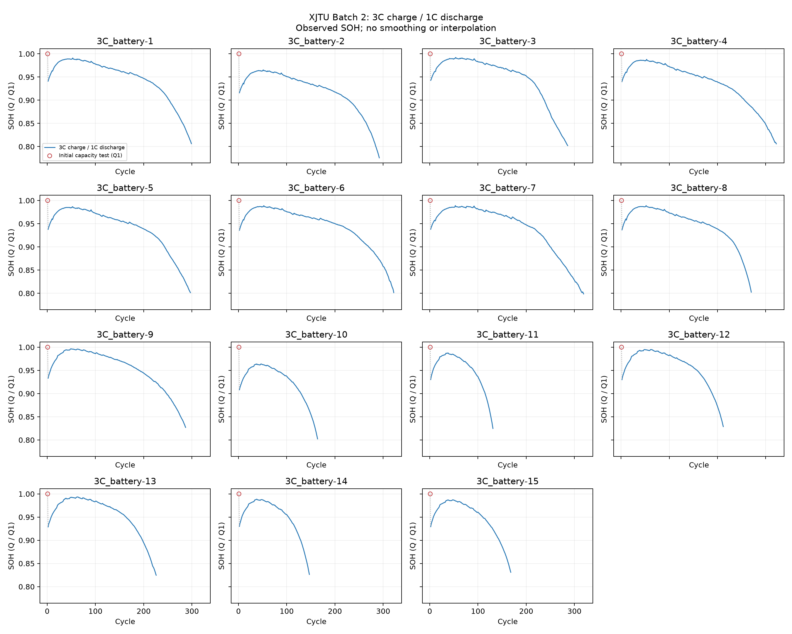

# XJTU 3C SOH 추출

배터리 **15개**, 관측 **3,742개**. 추출 상태: **complete**.

`summary.discharge_capacity_Ah`를 사용하고 `SOH = Q / Q1`로 계산했다. 용량 배열과 cycle 수 일치, 유효한 용량, 시험 조건, 중복 및 정규화 일관성을 확인했다.

첫 cycle은 0.5C 충전·0.2C 방전 초기 시험이다. 빨간 원으로 표시하고 이후 3C 충전·1C 방전 곡선과 점선으로 연결했다. 첫 구간의 급락에는 시험 조건 차이가 포함된다. 전 cycle을 보존하며 보간·평활화·단조 감소 보정을 하지 않았다. 용량 회복이나 급변만으로 오류로 판단하지 않는다.



| Battery | Cycles | Q1 (Ah) | 마지막 SOH | 64→16 windows | 확인 결과 |
|---|---:|---:|---:|---:|---|
| batch2_3C_battery-1 | 299 | 1.983 | 0.8064 | 219 | passed |
| batch2_3C_battery-2 | 292 | 2.056 | 0.7758 | 212 | passed |
| batch2_3C_battery-3 | 286 | 1.992 | 0.8022 | 206 | passed |
| batch2_3C_battery-4 | 322 | 1.984 | 0.8059 | 242 | passed |
| batch2_3C_battery-5 | 297 | 1.994 | 0.8014 | 217 | passed |
| batch2_3C_battery-6 | 322 | 1.989 | 0.8014 | 242 | passed |
| batch2_3C_battery-7 | 319 | 2.001 | 0.7986 | 239 | passed |
| batch2_3C_battery-8 | 270 | 1.989 | 0.8024 | 190 | passed |
| batch2_3C_battery-9 | 287 | 1.931 | 0.8270 | 207 | passed |
| batch2_3C_battery-10 | 164 | 1.993 | 0.8023 | 84 | passed |
| batch2_3C_battery-11 | 131 | 1.935 | 0.8248 | 51 | passed |
| batch2_3C_battery-12 | 212 | 1.928 | 0.8288 | 132 | passed |
| batch2_3C_battery-13 | 226 | 1.939 | 0.8247 | 146 | passed |
| batch2_3C_battery-14 | 147 | 1.929 | 0.8263 | 67 | passed |
| batch2_3C_battery-15 | 168 | 1.923 | 0.8310 | 88 | passed |

전체 데이터: `data/processed/XJTU/3C`.
cycle 번호는 공개 MAT 배열의 1부터 시작하는 위치다. 초기 시험은 예측 window에서 제외한다. 64→16 설정의 첫 예측 구간은 cycle 66~81이다. 아직 모델 예측은 실행하지 않았다.

검토 폴더에는 audit·배터리 메타데이터·보고서·곡선만 보관한다. 스키마·해시는 전체 데이터 묶음에 있다.

[제작자의 시험 조건 설명](https://wang-fujin.github.io/)

```powershell
.\.venv\Scripts\python.exe scripts\preprocess_xjtu.py --group 3c
```
