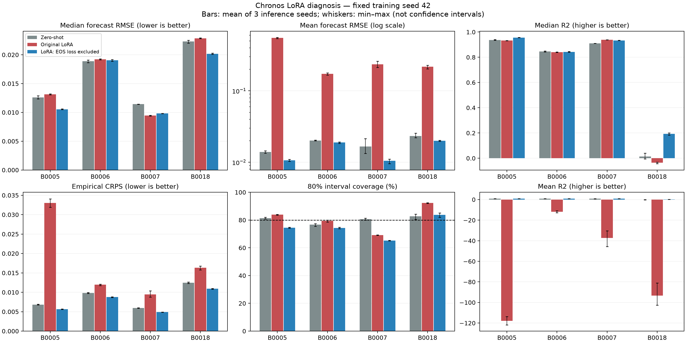

# Chronos LoRA 성능 저하 분리 검증 — 2026-09-29

기존 LoRA의 극단적인 예측을 만드는 주요 원인은 **현재 설정에서의 출력 EOS 학습**으로 좁혀졌다. 학습 데이터·학습률·업데이트 수를 고정하고 마지막 EOS 정답의 loss만 제외했을 때 네 배터리 모두 평균 예측 RMSE와 CRPS가 회복됐다. **재학습 시 업데이트 증가**도 B0005에서 별도로 성능을 악화시켰다. 작은 데이터나 LoRA rank 부족을 주원인으로 확정할 증거는 이번 실험에 없다.

## 검증 범위와 비교 조건

- 원본: zero-shot `20260923T063348Z_zeroshot_b57856`, LoRA `20260923T063628Z_lora_2df6cb`. 원본 소스·설정·노트북·체크포인트는 수정하지 않았다.
- 모델: `amazon/chronos-t5-base`, revision `ad294eaacead15db499b740ea4122266dd2a81a2`; q/v LoRA r=8, alpha=16, dropout=0.05; context=64, horizon=16, batch=16, AdamW lr=1e-4, 학습 seed=42.
- 각 실험은 해당 배터리를 제외한 다른 3개로 학습했다. 원래 선택된 epoch 9/10/9/7을 그대로 사용했다. 이번 test 점수로 checkpoint를 고르지 않았다.
- 한 요인 비교는 B0005 전체 89개 window, 추론 seed=42에서 수행했다. EOS 제외는 네 fold 전체와 추론 seed 42/43/44, window당 100개 sample로 확인했다.
- 아래 4배터리 표는 **seed별 RMSE를 평균한 값**이다. 전체 평균은 배터리에 같은 가중치를 준 macro 평균이며, 모든 오차를 합쳐 다시 계산한 pooled RMSE가 아니다.
- 이는 test 결과를 이미 본 뒤의 **사후 원인 진단**이다. 새로운 독립 벤치마크나 학습 seed 반복 검증은 아니다. 겹치는 window와 추론 seed를 독립된 배터리 표본처럼 해석하면 안 된다.

## 1. EOS loss의 영향: 한 항목만 바꾼 재학습

기존 정답은 `미래 SOH 토큰 16개 + EOS 1개`다. EOS는 '출력이 끝났다'는 표시로, 용량값이 아니다. 기존 loss는 `(16개 예측 loss 합 + EOS loss) / 17`이다.

변경 실험에서는 **입력 EOS를 유지**하고, 마지막 출력 EOS 정답만 `-100`으로 마스킹했다. 예측 16개 loss의 평균에 `16/17`을 곱해 각 예측 토큰의 원래 가중치도 유지했다. 마지막 label만 바꾸므로 teacher forcing의 decoder 입력도 같다. 차이는 EOS 학습 항의 유무다. 출력값 자르기나 후처리는 사용하지 않았다.

| 배터리 | Zero-shot 중앙값 RMSE | 기존 LoRA | EOS loss 제외 | Zero-shot 대비 오차 변화 | Zero-shot R² | 기존 LoRA R² | EOS 제외 R² |
| --- | --- | --- | --- | --- | --- | --- | --- |
| B0005 | 0.012601 | 0.013148 | 0.010545 | -16.32% | 0.937543 | 0.932022 | 0.956277 |
| B0006 | 0.018900 | 0.019232 | 0.019046 | +0.77% | 0.845382 | 0.839919 | 0.842996 |
| B0007 | 0.011423 | 0.009454 | 0.009813 | -14.09% | 0.910154 | 0.938452 | 0.933693 |
| B0018 | 0.022303 | 0.022868 | 0.020174 | -9.55% | 0.014299 | -0.036239 | 0.193560 |

음수 오차 변화는 개선이다. EOS 제외의 macro 중앙값 RMSE는 zero-shot보다 **8.66% 감소**했고, CRPS는 **13.88% 감소**했다. B0006 중앙값 RMSE는 zero-shot보다 여전히 나쁘고, B0007 중앙값은 기존 LoRA보다 나빠졌다. EOS 제거가 모든 점예측을 일괄 개선하는 것은 아니다.

| 모델 | 중앙값 RMSE | 평균 예측 RMSE | CRPS | SOH > 2 sample 비율 | 80% 구간 실제 포함률 | 중앙값 R² ↑ | 평균 예측 R² ↑ |
| --- | --- | --- | --- | --- | --- | --- | --- |
| Zero-shot | 0.016307 | 0.018540 | 0.008769 | 0.00633% | 80.32% | 0.676844 | 0.616669 |
| 기존 LoRA | 0.016176 | 0.294040 | 0.017684 | 1.67531% | 81.20% | 0.668538 | -65.167624 |
| EOS loss 제외 LoRA | 0.014894 | 0.015011 | 0.007552 | 0.00076% | 74.46% | 0.731631 | 0.732641 |

R²는 각 배터리·추론 seed의 전체 window/horizon에서 `1 - SSE/SST`로 계산한 후 같은 가중치로 평균한다. 음수도 유효하며 자르지 않는다. 정답이 상수이면 NaN이다. R²는 평가 지표로 추가했으며 기존 학습·선택을 바꾸지 않았다.

여기서 '평균 예측 RMSE'는 sample 100개를 평균해 만든 예측의 RMSE이고, 표 전체의 평균이라는 뜻이 아니다. CRPS는 정답과 예측 sample 분포를 함께 평가하는 점수로 작을수록 좋다. `SOH > 2`는 이번 데이터에서의 명백한 폭주를 추적하는 진단 기준이며, SOH의 일반적인 허용 범위를 정의한 것은 아니다.

극단값이 완전히 사라진 것은 아니다. 추가 추론 seed에서는 EOS 제외 모델에도 드물게 SOH 10 이상 sample이 남았다(관측 최대 약 14.17). 위 비율과 분포 점수는 이러한 sample도 포함해 계산했다. zero-shot에도 극단 sample이 있으므로 최대값 하나보다 빈도와 전체 분포를 함께 비교해야 한다.

80% 예측구간의 실제 포함률도 함께 보아야 한다. EOS 제외 후 B0007은 약 65% 수준으로 구간이 좁다. 따라서 **폭주 회복과 불확실성 보정 완료는 별개**다.



## 2. EOS가 학습을 방해했다는 추가 증거

B0005 fold의 고정 학습 batch 16개를 학습 전후 같은 조건에서 평가했다. 전체 학습 데이터의 loss 분해가 아니라, 이 batch에 대한 진단이다.

- 미래값 토큰 CE: `1.4945 → 1.4632`
- EOS CE: `17.3425 → 5.8226`
- 총 loss 감소 중 EOS 항의 기여: **95.83%** (`0.677645` / 총 `0.707112`)
- 학습 후 가중 gradient norm: 미래값 `0.3404`, EOS `0.5260`; 두 gradient cosine `-0.4954`.

즉 이 batch에서는 학습 loss가 내려간 대부분의 이유가 종료 표시를 잘 맞힌 것이었고, 미래값과 EOS의 gradient 방향도 충돌했다. EOS loss만 제외한 네 fold 실험이 이 관찰을 뒷받침한다. 다만 **EOS 학습이 왜 최대 수치 토큰의 확률을 올리는지에 대한 내부 경로까지 규명한 것은 아니다**.

EOS를 붙이는 형식 자체는 [Chronos 공식 구현](https://github.com/amazon-science/chronos-forecasting/blob/main/src/chronos/chronos.py)에도 있다. 따라서 단순 토큰 형식 오류로 단정하지 않는다. 현재 SOH 데이터·16-step 목적·학습량에서 그 항을 함께 최적화한 영향이 문제다.

## 3. 학습량과 학습률을 별도로 변경

| B0005 실험 | 업데이트 | 중앙값 RMSE | 평균 예측 RMSE | CRPS | SOH > 2 비율 | 중앙값 R² ↑ | 평균 예측 R² ↑ |
| --- | --- | --- | --- | --- | --- | --- | --- |
| 업데이트만 81회에서 중단 | 81 | 0.011743 | 0.041309 | 0.007221 | 0.10323% | 0.945783 | 0.329035 |
| 기존: 135회 | 135 | 0.013220 | 0.551199 | 0.032993 | 3.56039% | 0.931285 | -118.460420 |
| 학습률만 1e-4 → 3e-5 | 135 | 0.012229 | 0.017002 | 0.006763 | 0.01264% | 0.941196 | 0.886345 |
| EOS loss만 제외 | 135 | 0.010525 | 0.010318 | 0.005643 | 0.00351% | 0.956440 | 0.958138 |
| 검증 때 사용한 학습 prefix 유지* | 81 | 0.010975 | 0.043998 | 0.006790 | 0.10323% | 0.952641 | 0.238831 |

원본 재학습을 재현한 baseline의 sample 배열은 저장된 원본과 **완전히 일치**했다. 중간 평가 시 난수 상태를 복구해 이후 학습 경로를 보존했다.

- 같은 full-data 학습 경로의 81회와 135회를 비교하면, 중앙값 RMSE는 `0.011743 → 0.013220`, 평균 예측 RMSE는 `0.041309 → 0.551199`로 악화된다. 따라서 B0005에서는 추가 업데이트가 악화 요인이다.
- 학습률만 낮추어도 대부분의 폭주가 줄었다. 그러나 EOS 제외보다 중앙값·CRPS가 나쁘고 드문 극단값이 남는다. 낮은 학습률은 이 조건의 문제를 완화했지만, 최적 학습률을 찾은 실험은 아니다.
- *prefix 실험은 학습 데이터가 달라지고 원래 epoch를 유지해 step 수도 함께 달라진 보조 비교다. 이를 데이터 효과만의 순수한 분리 실험으로 해석하지 않는다. 반면 baseline의 81회/135회 비교는 같은 데이터와 같은 학습 경로다.

검증 단계와 full-data 재학습에서 같은 epoch를 사용하면 다음처럼 실제 optimizer 업데이트 수가 늘어난다.

| 배터리 fold | 선택 epoch | 검증 학습 업데이트 | 최종 재학습 업데이트 |
| --- | --- | --- | --- |
| B0005 | 9 | 81 | 135 |
| B0006 | 10 | 90 | 150 |
| B0007 | 9 | 81 | 135 |
| B0018 | 7 | 77 | 119 |

epoch 수를 그대로 옮기는 것이 일반적으로 항상 잘못은 아니다. 하지만 이번 B0005에서는 **그렇게 늘어난 학습이 실제 악화**와 연결됐다. 개선 시 step 예산을 기준으로 옮기거나, 최종 학습량을 훈련 배터리 내부 검증으로 다시 결정해야 한다.

## 4. 추론 구현·정밀도·토큰 복원 문제 확인

이 비교는 **B0005 앞 32개 window**에 한정한다. 전체 89개 결과와 숫자를 직접 섞지 않는다.

| 조건 | 중앙값 RMSE | 평균 예측 RMSE | 중앙값 R² ↑ | 평균 예측 R² ↑ | 해석 |
| --- | --- | --- | --- | --- | --- |
| 기존 adapter | 0.018730 | 0.679716 | 0.407832 | -778.860114 | 문제 재현; 원본 sample 동일 |
| adapter만 비활성화 | 0.016348 | 0.017326 | 0.548883 | 0.493281 | zero-shot sample과 완전히 동일 |
| PEFT generate wrapper 우회 | 0.018730 | 0.679716 | 0.407832 | -778.860114 | 기존 raw token과 완전히 동일 |
| 같은 checkpoint를 FP32로 추론 | 0.018669 | 0.683912 | 0.411682 | -788.519963 | 폭주 유지 |

- PEFT의 generate wrapper와 bf16 **추론** 반올림을 주원인으로 보기 어렵다. FP32로 재학습한 실험은 아니므로 학습 정밀도의 영향까지 배제하지 않는다.
- 원본 생성 raw token은 vocab 범위 안이다. 실제 sample에 EOS/PAD는 없고, 폭주에 최대 수치 bin인 **token 4095**가 많이 등장했다. 이 토큰이 tokenizer의 최상단 값으로 복원되는 과정은 정의와 맞는다. EOS를 SOH 숫자로 잘못 변환한 오류라는 가설은 이 sample에서 맞지 않는다.
- cache를 끈 추론은 XPU native assertion으로 중단됐다. **cache 영향은 미확인**이며 정상 통과한 비교로 세지 않았다. 상세: [no_cache_failure.json](inference/no_cache_failure.json).

## 5. 판정과 후속 적용 우선순위

1. **확인:** 현재 설정의 EOS 학습 항이 예측 분포 악화에 큰 인과적 영향을 준다. 다른 조건을 고정한 네 fold 개입으로 확인했다.
2. **확인 범위 B0005:** 같은 학습의 업데이트 증가가 악화를 심화한다. 학습률을 낮추면 완화된다. 나머지 fold에 대해 step/LR factorial 실험을 했다는 뜻은 아니다.
3. **평가상의 문제:** 중앙값 RMSE 하나는 sample 꼬리의 폭주를 거의 드러내지 못한다. checkpoint 선택에는 CRPS와 이상 sample 비율, 구간 포함률을 함께 기록해야 한다. CRPS로 다시 선택한 새 최종 모델은 이번에 만들지 않았다.
4. **남은 문제:** B0006의 zero-shot 대비 중앙값 열세, B0007의 좁은 예측구간, 학습 seed에 따른 변동. 데이터 부족·배터리 분포 차이·LoRA rank/적용 층 중 무엇이 잔여 오차의 원인인지는 아직 분리하지 못했다.

실용적인 다음 후보는 **출력 EOS loss 제외 + step 기반 학습량 관리 + 분포 지표를 포함한 내부 검증**이다. 현재 결과를 본 test 배터리로 이 조합의 하이퍼파라미터를 고르면 성능이 낙관적으로 보일 수 있으므로, 후보 비교는 훈련 배터리 내부에서 하고 추가 배터리/학습 seed로 확인해야 한다.

## 파일과 재현

- R²를 포함한 재평가 표는 [별도 평가 디렉터리](../../evaluation_r2/diagnostics/20260929)에 보관한다. 원본 학습·예측 파일은 변경하지 않았다.

- [추론 요인 비교](inference/inference_controls.csv), [FP32 비교](float32/inference_controls.csv)
- [B0005 학습 요인 비교](training/training_controls.csv), [나머지 fold EOS 비교](confirm_eos/training_controls.csv)
- [3개 추론 seed의 전체 지표](seed_confirmation/metrics.csv), [배터리별 요약](seed_confirmation/battery_summary.csv), [전체 요약](seed_confirmation/macro_summary.csv)
- 각 학습 case의 `complete.json`은 업데이트 수와 loss 이력을, `adapter/`는 진단용 LoRA를, `final.npz`는 raw token/sample을 보관한다. seed 42 sample은 해당 case의 `final.npz`, 추가 seed는 `seed_confirmation/`에 있다.
- `train_battery_tails.csv`는 full-data 재학습 모델에서는 학습에 포함된 구간 점수다. 독립 검증 점수로 사용하지 않았다. `selection_prefix` case만 해당 tail이 학습 밖이다.
- scripts: `scripts/diagnose_lora.py`, `scripts/diagnose_training.py`, `scripts/confirm_lora_diagnosis.py`, `scripts/report_lora_diagnosis.py`.

```powershell
.\.venv\Scripts\python.exe scripts\diagnose_training.py --battery B0005
.\.venv\Scripts\python.exe scripts\diagnose_training.py --battery B0006 B0007 B0018 --variant without_eos --output results\diagnostics\20260929\confirm_eos
.\.venv\Scripts\python.exe scripts\confirm_lora_diagnosis.py
.\.venv\Scripts\python.exe scripts\report_lora_diagnosis.py
```

학습 script는 `complete.json`이 있으면 해당 case를 건너뛴다. 완전한 새 재현은 `--output`에 별도 폴더를 지정한다. 추론 제어에서 cache-off를 포함하려면 실패 가능성과 위 기록을 먼저 확인한다.
