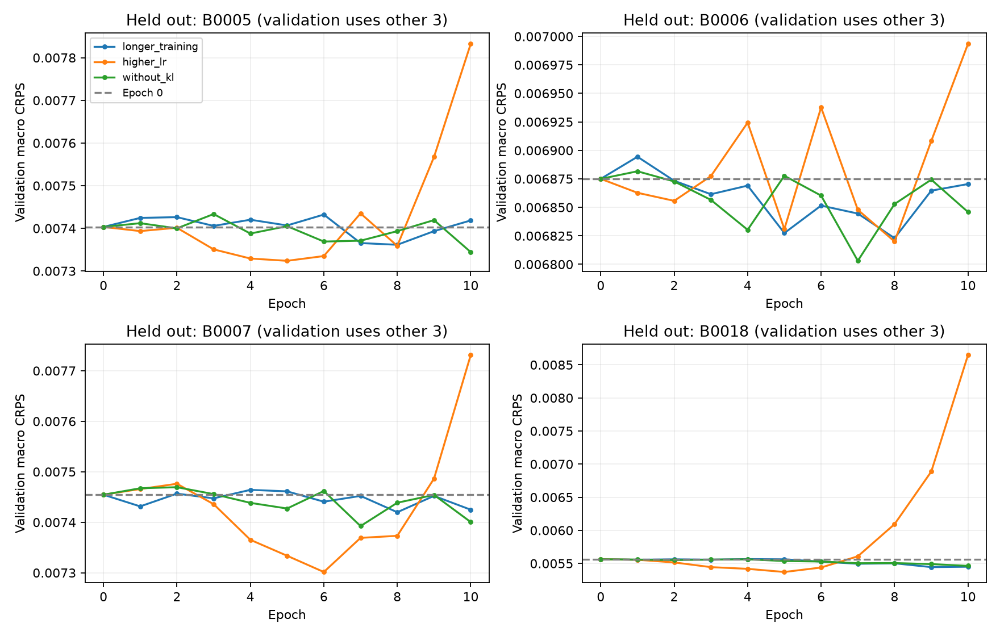

# LoRA 원인 분리 실험

실행: `20260924T082717Z_lora_ablation_958398`

학습 seed 42에서 학습률·KL·조기 종료를 비교하고, 각 outer fold의 다른 세 배터리 validation만으로 설정을 선택했습니다. 네 fold의 설정을 모두 고정한 뒤 학습 seed 42/43/44, 추론 seed 42/43/44로 평가했습니다. 모든 값은 배터리에 동일 가중치를 준 평균입니다.

| 모델 | Median RMSE | Median MAE | Mean RMSE | CRPS | 80% coverage | 80% width |
|---|---:|---:|---:|---:|---:|---:|
| Zero-shot | 0.016271 | 0.011556 | 0.019495 | 0.008717 | 80.56% | 0.042073 |
| Selected LoRA | 0.016159 | 0.011478 | 0.019422 | 0.008670 | 81.18% | 0.042645 |

Zero-shot 대비 감소율: median RMSE **+0.688%**, median MAE +0.672%, mean RMSE +0.373%, CRPS +0.543%.

12개 최종 모델 중 epoch 0 선택은 **3개**, 학습된 checkpoint 선택은 **9개**입니다. Epoch 0의 성능은 LoRA 학습 이득으로 계산하지 않습니다.

## 배터리별 결과

| 배터리 | 선택 설정 | Zero-shot RMSE | LoRA RMSE | RMSE 감소율 | 학습 seed별 epoch (42/43/44) |
|---|---|---:|---:|---:|---|
| B0005 | longer_training | 0.012636 | 0.012603 | +0.259% | 0/6/7 |
| B0006 | without_kl | 0.018609 | 0.018515 | +0.507% | 7/6/7 |
| B0007 | longer_training | 0.011358 | 0.011358 | -0.001% | 0/5/0 |
| B0018 | longer_training | 0.022479 | 0.022158 | +1.428% | 9/10/10 |

## 학습 seed 반복

| 학습 seed | Median RMSE | Median MAE | Mean RMSE | CRPS |
|---|---:|---:|---:|---:|
| 42 | 0.016180 | 0.011487 | 0.019429 | 0.008681 |
| 43 | 0.016154 | 0.011486 | 0.019479 | 0.008671 |
| 44 | 0.016142 | 0.011461 | 0.019359 | 0.008658 |

## Validation에서 분리한 영향

`longer_training`은 LR 3e-5, KL 0.5에서 patience만 3→10으로 변경했습니다. `higher_lr`은 이 설정에서 LR만 1e-4로, `without_kl`은 KL만 0으로 변경했습니다. 모두 최대 10 epoch, validation 64 samples, 같은 초기화와 학습 seed입니다.

짧은 학습 결과는 같은 학습 경로에서 patience=3을 재현한 것입니다. 중앙값 최소 epoch는 guard의 영향을 진단하는 값이며 최종 모델 선택에는 쓰지 않았습니다.

| 평가 제외 배터리 | 설정 | patience 3 epoch | patience 10 epoch | 선택 CRPS | 중앙값 최소 epoch | 해당 mean RMSE / epoch 0 |
|---|---|---:|---:|---:|---:|---:|
| B0005 | longer_training | 0 | 0 | 0.007403 | 8 | 1.083x |
| B0005 | higher_lr | 0 | 0 | 0.007403 | 10 | 3.954x |
| B0005 | without_kl | 0 | 0 | 0.007403 | 10 | 1.076x |
| B0006 | longer_training | 0 | 5 | 0.006827 | 8 | 1.093x |
| B0006 | higher_lr | 0 | 0 | 0.006875 | 10 | 4.727x |
| B0006 | without_kl | 0 | 7 | 0.006803 | 7 | 0.997x |
| B0007 | longer_training | 0 | 0 | 0.007455 | 2 | 1.010x |
| B0007 | higher_lr | 0 | 0 | 0.007455 | 10 | 5.339x |
| B0007 | without_kl | 0 | 0 | 0.007455 | 10 | 1.092x |
| B0018 | longer_training | 0 | 9 | 0.005444 | 10 | 0.993x |
| B0018 | higher_lr | 3 | 3 | 0.005444 | 6 | 3.144x |
| B0018 | without_kl | 0 | 9 | 0.005490 | 10 | 1.489x |

## 해석 범위

- 학습률과 KL의 상호작용을 탐색하는 전체 grid는 아닙니다. 이번 결과는 조사한 세 설정에 한정됩니다.
- 후보 설정 탐색 seed는 42 하나입니다. 43/44는 선택된 설정의 반복이며 독립적인 후보 탐색 반복은 아닙니다.
- validation은 학습 배터리의 뒤쪽 구간입니다. 새 배터리의 분포 차이를 완전히 대변하지 않습니다.
- 이 네 배터리는 이전 실험에서도 확인했습니다. 새 독립 benchmark나 통계적 유의성 검증으로 해석하지 않습니다.
- 추론 seed와 겹치는 window를 독립 배터리 표본으로 취급하지 않습니다.
- 원본 NPZ의 지표·해시를 재검산했고, 12개 adapter를 재로딩해 첫 추론 batch가 정확히 재현되는지 확인했습니다.

