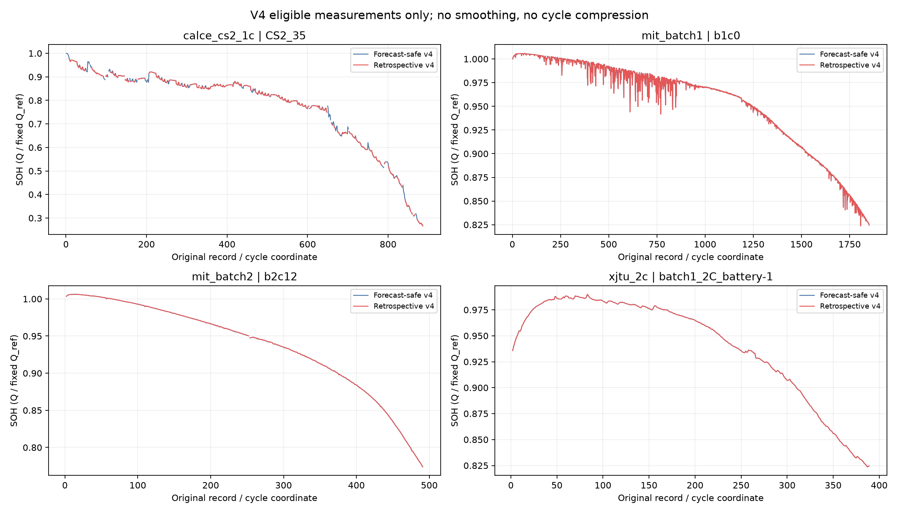

# BatteryML / BatteryLife 규칙을 반영한 SOH 전처리 v4

원본·v3·기존 모델 결과는 보존했다. 새 모델 학습이나 성능 재평가는 실행하지 않았다.

## 사용할 데이터

- 기본 예측용: `data/processed/reviewed_v4/forecast_safe/<group>/`. 현재 cycle의 측정 정보와 고정된 문헌 예외만 사용한다.
- 사후 정제 비교용: `data/processed/reviewed_v4/retrospective/<group>/`. CALCE 중앙값 필터와 MIT 미도달 셀 선택까지 적용한다. 미래 정보를 이용하므로 인과적 예측 성능으로 보고하지 않는다.
- `load_v4_bundle`은 retrospective 데이터를 명시적으로 허용하지 않으면 거부한다. 기존 C2 실행기는 고정된 v3를 계속 사용하며 v4 결과로 간주하면 안 된다.

## 실제 적용

- CALCE: 실제 날짜와 시험시간 순서를 확인하고 각 cycle에서 음의 전류를 우측 직사각형 적분해 방전량을 재계산했다. 기존 중복 export 제거와 원본 cycle 매핑은 유지했다. Q_ref도 같은 원래 기준 cycle의 재계산 용량으로 갱신했다.
- CALCE retrospective: scipy.signal.medfilt(Q,21)의 0 padding과 전체 residual 중앙값을 포함한 원래 `<3s`, `Q>0.1Ah` 규칙을 그대로 적용했다. s=0이면 전부 제외되는 원래 규칙도 임의 보정하지 않는다. 기존 원시파형 QC 제외와 교집합을 사용한다.
- MIT: b2c7/8/9/15/16을 b1c0/1/2/3/4로 합쳤다. 원시 인덱스 0은 합친 셀의 맨 처음에만 적용하며 continuation의 첫 관측은 추가 삭제하지 않는다.
- MIT: b1c0:11, b2c12:252, b2c44:247, b1c18:39의 원시 0-based 인덱스를 제외했다. 이후 관측을 앞으로 당기지 않는다. Batch 3 지정 6셀 제외도 명시적으로 반영한다.
- MIT: 80% 미도달 지정 5셀은 예측용에서 유지하며 retrospective에서만 제외한다. 미도달이 실제 용량 측정 오류를 뜻하지 않기 때문이다.
- XJTU: 현재 보유·선정 범위는 Batch 1(2C 충전) / Batch 2(3C 충전) 23셀이다. ±0.01C로 원본 용량을 분리하고 RPT/Cycling, 실제 방전 전류·종료 전압을 검증했다. 초기 RPT는 입력/정답에서 제외하고 1C, 2.5V 운전 관측만 허용했다.
- XJTU: 시간 리셋·중복은 샘플 순서를 유지하는 단조 elapsed 좌표로 진단했다. 이 좌표는 실제 시간 공백을 복원한 것이 아니며, 용량 적분이나 수명 정답에 사용하지 않는다. 원시 파형은 그대로 보존했다.
- NASA: v3의 용량·SOH·적격성은 그대로 유지했다.

## 의도적으로 유지한 정의

- 제외 관측은 감사용 행으로 남기고 quality_eligible=False로 표시한다. 그래프와 평가에서는 숨기며, 시간축을 압축하거나 보간·평활화하지 않는다.
- SOH 기본값은 기존 Q/Q_ref 정의이다. CALCE만 용량 계산 방식에 맞춰 같은 기준 cycle의 Q_ref를 재계산했다. MIT와 XJTU는 고정된 초기 교정값을 유지한다. XJTU 초기 RPT는 정규화 기준으로만 남고 운전 이력에 섞이지 않는다.
- 별도 soh_nominal 열은 정격용량으로 나눈 값이다. 80% EOL을 정할 때 soh와 soh_nominal을 혼동하면 안 된다. 새 EOL 라벨은 이번에 만들지 않았다.
- BatteryLife XJTU 수명 코드의 마지막 교차·보간·꼬리 외삽은 도입하지 않았다. 현재 프로젝트의 최초 실측 교차 정의와 다르다.
- CALCE CX 계열, MIT Batch 4, XJTU Batch 3–6은 현재 선택된 원본에 없어 적용하지 않았다.

## 커버리지

| 프로필 | 그룹 | 셀(적격 셀) | 전체 행 | 적격 관측 | 추가 제외 | 용량 변경 |
|---|---|---:|---:|---:|---:|---:|
| forecast_safe | nasa_aging | 4 (4) | 636 | 636 | 0 | 0 |
| forecast_safe | xjtu_2c | 8 (8) | 3219 | 3209 | 0 | 0 |
| forecast_safe | xjtu_3c | 15 (15) | 3742 | 3727 | 0 | 0 |
| forecast_safe | calce_cs2_1c | 4 (4) | 3937 | 3801 | 0 | 3921 |
| forecast_safe | mit_batch1 | 46 (46) | 42204 | 42138 | 0 | 0 |
| forecast_safe | mit_batch2 | 43 (43) | 21527 | 21462 | 43 | 0 |
| forecast_safe | mit_batch3 | 46 (40) | 51007 | 41193 | 40 | 0 |
| retrospective | nasa_aging | 4 (4) | 636 | 636 | 0 | 0 |
| retrospective | xjtu_2c | 8 (8) | 3219 | 3209 | 0 | 0 |
| retrospective | xjtu_3c | 15 (15) | 3742 | 3727 | 0 | 0 |
| retrospective | calce_cs2_1c | 4 (4) | 3937 | 3325 | 476 | 3921 |
| retrospective | mit_batch1 | 46 (41) | 42204 | 37673 | 4465 | 0 |
| retrospective | mit_batch2 | 43 (43) | 21527 | 21462 | 43 | 0 |
| retrospective | mit_batch3 | 46 (40) | 51007 | 41193 | 40 | 0 |

추가 제외는 합친 뒤 동일 원본 행에 대한 v3 적격성 대비이다. 용량 변경은 절대 차이가 1e-12 Ah를 넘는 행 수이다.

[셀별 집계](battery_coverage.csv) · [CALCE 필터 진단](calce_filter_diagnostics.csv) · [검증](verification.json)

재현: `.venv/Scripts/python.exe -X utf8 scripts/build_preprocessing_v4.py --output <새 출력 경로> --report <새 보고서 경로>`.
완료된 출력은 덮어쓰지 않는다. evidence 캐시는 원본과 추출기 해시가 같을 때만 재사용한다.
