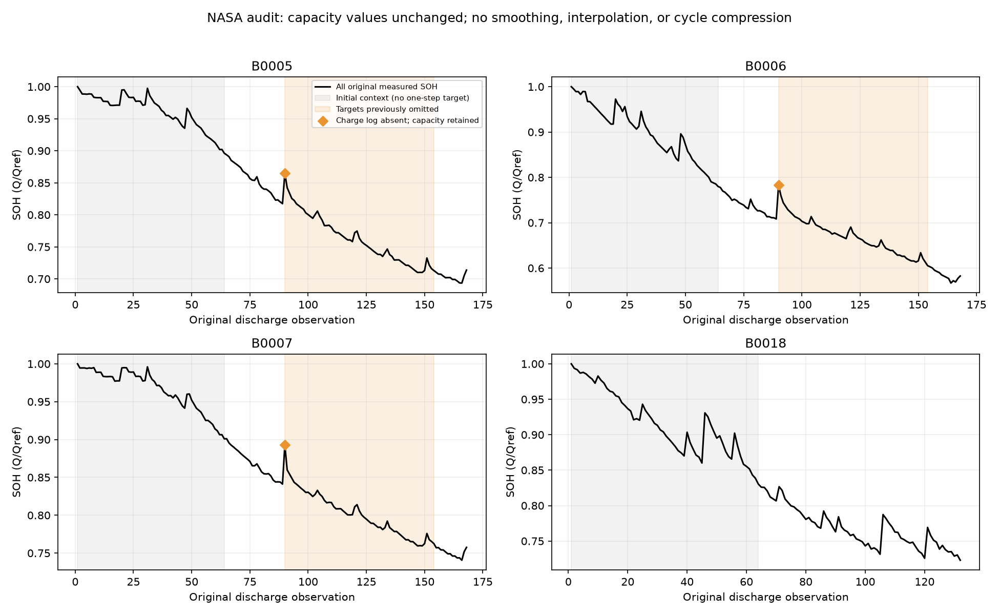

# NASA 중간 구간 누락 원인과 수정

원본 636개 관측은 삭제되지 않았다. 기존 strict_v2는 B0005·B0006·B0007의 90번 방전에 연결되는 충전 로그가 없다는 이유만으로 3개 용량 관측을 보류했다. 연속 64개 입력을 요구하므로 각 배터리에서 정답 90~154번까지 65개, 총 195개 예측 시점이 추가로 제외됐다.

예측 그래프의 실제값도 평가 시점만 표시한 별도의 표시 오류가 있었다. 전체 원본 SOH 곡선과 평가 가능한 예측 시점을 구분해서 표시해야 한다.

## 원시 자료 재확인

- 세 원본 방전은 4.22~4.23V에서 시작하고 약 2A로 방전하며 Capacity 정의의 2.7V까지 도달한다. 전압·전류·시간에 기존 제외 사유가 없고, 원본 Capacity와 전류 시간적분 차이는 약 0.17~0.18%다.
- 충전 로그가 없으므로 직전 충전이 규정된 CC-CV 과정을 완료했는지는 확정할 수 없다. 그러나 이것만으로 기록된 방전 용량이 잘못됐다고 판단할 근거도 없다. 이 경우는 관측을 유지하고 `preceding_charge_unrecorded_native_capacity_retained` 검토 표시를 남긴다.
- 실제로 기록된 충전 미완료, 방전 미완료, 비정상 전류, 시간 오류, 적분 불일치 등은 계속 제외한다. 다른 데이터셋의 누락 충전 기준을 이번 수정으로 해제하지 않는다.
- 원시 파일 체크섬, Q, Qref, SOH, cycle 번호를 모두 유지했다. 보간·평활화·단조화·번호 압축이 없다. 새 bundle은 `data/processed/nasa_review_v3/nasa_aging`이며 strict_v2는 비교 증거로 보존한다.
- 이 수정은 모델 점수를 보기 전에 원시 기록과 측정 의미를 기준으로 결정했다. 이전 NASA 점수는 중간 구간이 빠진 부분 평가이므로 전체 NASA 성능으로 사용하지 않는다.

| 배터리 | 전체 관측 | 이전 평가 시점 | 수정 평가 시점 | 복구 시점 |
|---|---:|---:|---:|---|
| B0005 | 168 | 39 | 104 | 90~154 (65개) |
| B0006 | 168 | 39 | 104 | 90~154 (65개) |
| B0007 | 168 | 39 | 104 | 90~154 (65개) |
| B0018 | 132 | 68 | 68 | 변경 없음 |

[90번 원시 검증 수치](cycle90_evidence.csv) · [판정 변경 3개 관측](reclassified_observations.csv) · [평가 범위](coverage.csv)

NASA 공식 설명에서 Capacity는 2.7V까지의 방전 용량(Ah)이다: [NASA 데이터 설명](https://data.nasa.gov/dataset/li-ion-battery-aging-datasets). 이 문서의 검토·제외 정책은 원 제작자의 삭제 권고가 아니라 본 프로젝트의 명시적 정책이다.
