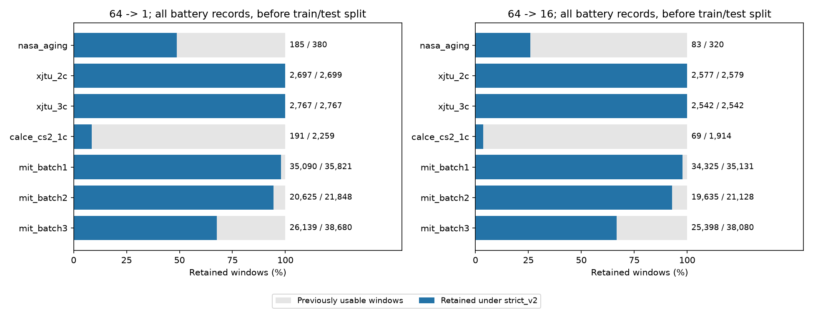
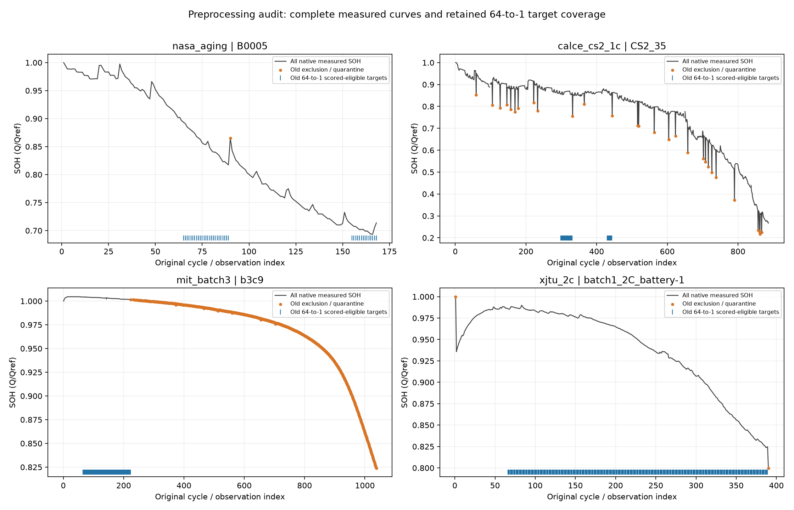

# 전체 데이터셋 전처리 재검토

검토 대상: 현재 C2 실험에 사용하는 NASA, CALCE CS2, MIT Batch 1–3, XJTU 2C/3C의 7개 실험군. 171개 파일상 배터리 기록(연속 기록 5쌍을 합치면 166개 물리 배터리), 126,272개 관측, 원본 파일 136개다. 사용하지 않는 XJTU 다른 프로토콜까지 검증했다는 뜻은 아니다.

**판정: 기존 strict_v2를 전체 열화 구간을 대표하는 확정 전처리로 사용하면 안 된다.** 값 자체의 손실과 평가 마스크에 의한 구간 손실을 구분해야 한다. NASA와 그래프 오류는 수정했고, MIT 적분 진단과 CALCE 연속창 설계에는 해결할 문제가 남았다. 모델 재학습·재추론은 이 감사에서 실행하지 않았다.

## 독립 대조에서 통과한 항목

- 136개 원시 파일 SHA-256이 기존 추출 manifest와 일치한다. 원본 bundle과 strict_v2의 행 식별자·cycle·Q·SOH가 일치한다. 재번호 부여·보간·평활화는 발견되지 않았다.
- MIT 전체 114,738개 원시 summary.QDischarge와 cycle/source-cycle 대응을 다시 확인했다. 전 사이클에서 native QDischarge가 원시 Qd 최댓값과 일치한다. **같은 장비의 요약값과 카운터이므로 독립적인 물리 정확도 증명은 아니다.**
- XJTU 6,961개 사이클은 summary와 방전 단계 카운터가 모두 일치하고, 방전 중 역행 시간 및 여러 방전 구간은 없다. 2C/3C는 충전율 이름이며 일반 방전은 둘 다 2A다. [제작자 프로토콜](https://wang-fujin.github.io/)
- CALCE 원시 export 4,037건을 다시 읽어 3,937개 보존 관측에 대응시켰다. 동일 관측의 중복 export 100건은 용량·시간·충방전 진단 수치가 일치한다. 서로 다른 실제 cycle을 중복으로 지운 증거는 없다. 유효 관측의 적분 대조 오차 최댓값은 약 0.00003171Ah다.
- 각 배터리 Qref 출처와 Q/Qref, MIT continuation 5쌍의 원래 기준용량을 확인했다. 13개 fold 내부 및 MIT batch 간 source/test의 물리 배터리 중복이 없다. MIT 첫 cycle의 46개 0 placeholder와 사전 제외 noisy 채널 6개는 의도된 기존 제외다. [제작자 처리 코드](https://github.com/rdbraatz/data-driven-prediction-of-battery-cycle-life-before-capacity-degradation/blob/master/Load%20Data.ipynb)

## 제외가 평가 범위에 미친 영향

아래는 **전체 배터리 기록에서 train/test 분할 전** 후보 창 수다. 기존 유효 기준에서도 제외하던 placeholder·noisy 채널·초기 별도 프로토콜·불완전 방전은 양쪽에서 공통 제외된다. CALCE 양쪽 모두 같은 관측 순서 연결 정책을 사용했다. 현재 테스트 전용 수치는 [held_out_coverage.csv](held_out_coverage.csv)에 따로 기록했다.

| 실험군 | 추가 제외·보류 관측 | 64→1 기존 → strict | 남은 비율 | 64→16 기존 → strict |
|---|---:|---:|---:|---:|
| nasa_aging | 3 | 380 → 185 | 48.7% | 320 → 83 |
| xjtu_2c | 2 | 2,699 → 2,697 | 99.9% | 2,579 → 2,577 |
| xjtu_3c | 0 | 2,767 → 2,767 | 100.0% | 2,542 → 2,542 |
| calce_cs2_1c | 110 | 2,259 → 191 | 8.5% | 1,914 → 69 |
| mit_batch1 | 37 | 35,821 → 35,090 | 98.0% | 35,131 → 34,325 |
| mit_batch2 | 22 | 21,848 → 20,625 | 94.4% | 21,128 → 19,635 |
| mit_batch3 | 9,869 | 38,680 → 26,139 | 67.6% | 38,080 → 25,398 |

## 발견한 문제와 처리 상태

### 1. 그래프에서 실제 SOH까지 사라지는 오류 — 수정

기존 64→1 대표 그래프는 예측 CSV에 들어 있는 정답만 실제 곡선으로 그렸다. 따라서 평가 대상이 아닌 초기 64개 관측, 제외 시점, 그 뒤 입력창이 회복되기 전 구간까지 실제값도 사라졌다. 전체 bundle의 원본 SOH를 검은 선으로 그리도록 수정했고, 예측선만 평가 시점 사이에서 끊는다. 기존 7개 대표 그림을 다시 만들었으며 예측 CSV 해시는 그대로다. 회귀 테스트로 실제 관측 90~154가 남고 해당 예측만 빈칸인 것을 확인한다.

### 2. NASA의 충전 로그 부재를 용량 사용 불가로 판단 — 수정본 분리

B0005/6/7의 90번 관측 3개는 충전 로그가 없지만 원시 방전 용량, 시작 전압, cutoff, 시간 적분을 대조하면 다른 제외 근거가 없다. native 측정 용량 예측에서는 검토 메모로 유지한다. 직전 CC-CV 완료를 인증한 것은 아니다. 별도 nasa_review_v3 bundle에서 64→1 대상이 185→380개로 복구됐다. 이전 strict_v2와 예측값은 증거로 보존했다. [NASA 상세 감사](../preprocessing_nasa_review_v3/report.md)

### 3. MIT Batch 3의 CV 적분을 일괄 신뢰한 판정 — 해결 필요

사전 제외 6개 noisy 채널을 뺀 41,240개 관측 중 9,867개가 오직 `capacity_integral_unverified`로 보류됐다. 추가 제외 9,869개 중 나머지 2개는 counter reset도 포함한다. CC 구간의 Qd 증가량 / raw I 시간적분 비율 중앙값은 Batch 1/2/3 모두 약 1.1001~1.1003이다. 반면 CV 구간은 Batch 1/2 약 1.0994/1.0996, Batch 3 약 0.6269다. Batch 3의 CV에서 1.1 배율 적분의 초과분 중앙값은 약 0.01842Ah다.

이는 1.1 배율을 모든 구간의 확정 단위 변환으로 간주할 수 없다는 증거다. 원인이 전류 export, 카운터, 시간 기록, 다른 계측 관례 중 무엇인지는 확정하지 못했다. 원본 Q와 Qd가 일치한다는 이유만으로 모두 정상이라고 확정하거나, 적분 차이가 3%를 넘는다는 이유만으로 용량 오류라고 확정해서는 안 된다. 원본 Q를 적분값으로 교체하지 않았으며, 이 감사에서는 9,867개를 일괄 복원하지 않았다.

### 4. MIT 적분 계산의 긴 공백·여러 방전 구간 처리 — 진단 결함 확인

Batch 1의 b1c3/4 cycle 12, b1c10/11 cycle 12, b1c20/21 cycle 13에는 약 24,466~24,532초(6.8시간)의 샘플 공백이 있다. 기존 사다리꼴 적분은 그 공백 전체를 양 끝 전류로 연결해 약 1.06~1.08Ah 기록을 3.06~18.02Ah로 계산했다. 이것은 그 시간 동안 실제 방전했다는 근거가 아니므로 해당 큰 적분 오차를 용량 손상 증거로 쓸 수 없다. 6건은 기존 코드에서도 보류로 표시됐으나 창에서는 제외됐다.

기존 진단은 음전류 구간 중 **샘플 수가 가장 많은 한 구간**을 택한다. 여러 방전 조각이 있을 때 전체 native Q와 일부 적분을 비교하는 문제가 있다. 예를 들어 b3c18 cycle 1014는 여러 음전류 구간을 합치면 0.972797Ah로 native 0.963131Ah와 3% 이내지만, 기존 단일 구간 비교에서는 보류됐다. 반대로 단순 합산으로 정상화되지 않는 사례도 있어 전부 자동 합산해 통과시키지 않았다. 방전 중 재충전·counter reset·실험 재시작과 단순 기록 단절을 구분하는 진단이 필요하다.

Batch 1/2의 모든 추가 제외도 다시 확인했다. b1c18의 일부 전압 이상은 실제 기록에 4~6.6V가 있고 충전/휴지 구간에 집중돼 있으며, 다른 cycle에는 방전 중 이상도 있다. 원시 전압 이상과 Q 자체의 오류는 동일하지 않다. reset·충전 종료 이상·기록 단절을 같은 이유로 뭉뚱그리지 않고 [사례별 수치](mit_exclusion_cases.csv.gz)에 남겼다.

### 5. CALCE — 실제 불완전 충전과 입력창 손실을 구분해야 함

CV 단계 누락 110건 모두 독립적인 전압·전류 탐지에서도 taper가 없다. 마지막 충전 전류는 0.54975~0.55050A다. 제작자 조건인 4.2V CV 후 0.05A 미만 종료와 다르다. 단계 번호만 잘못 읽은 오류가 아니다. 110건 중 1건은 기존에도 불완전 방전으로 제외됐으며, 별도로 CS2_36 cycle 927의 충전 종료 전류 0.40225A가 추가 제외돼 순증은 110건이다. [CALCE 제작자 조건](https://web.calce.umd.edu/batteries/data/)

충전 부족 때문에 작게 측정된 방전량을 그대로 건강 상태의 급락으로 학습시키는 것도 부적절하다. 그러나 64개 입력과 정답 1개가 모두 유효해야 한다는 현재 조건은 실제 결함 관측 하나뿐 아니라 최대 65개 예측 시점을 제거한다. 반복되는 CALCE 충전 누락 때문에 64→1 대상의 91.5%가 추가로 사라졌다. 제외 관측을 삭제하고 앞뒤를 붙이거나 정답을 보간하는 방식으로 해결하면 안 된다. 다음 설계에서는 cycle 좌표를 유지한 결측 입력과 유효 정답 분리를 검토해야 하며, 이는 현재 완전 관측 64→1과 다른 프로토콜이므로 아직 적용하지 않았다.

관측 파일 경계는 100곳이며 마지막 기록~다음 기록 간 간격 최댓값은 262.02시간이다. 휴지인지 미기록 cycle이 있는지는 자료만으로 구분할 수 없다. CALCE의 64는 보존된 관측 64개이며 실제 물리 cycle 64회 또는 같은 시간 길이를 보장하지 않는다. strict_v2 batteries.csv에 남은 `forecast_windows_do_not_cross_source_files` 문구는 현재 observation_segments 동작과 어긋나는 과거 메타데이터다. 기존 체크섬 bundle을 덮어쓰지 않고 차기 bundle 생성 코드의 설명을 수정한다.

### 6. XJTU — 추가적인 대규모 누락은 발견되지 않음

초기 진단 cycle 23개(2C 8개, 3C 15개)를 예측에서 제외하고 Qref로만 사용하는 기존 선택은 제작자의 0.2C 초기 진단 / 1C 일반 방전 차이를 반영한다. 따라서 SOH는 초기 저율 용량으로 정규화한 값이며 일반 1C 조건의 첫 용량으로 정규화한 것과 다르다. 이 기준을 변경하지 않았다.

2C 배터리 1의 마지막 cycle 390은 부하 상태 최종 전압 4.6397V, 최저 2.8445V로 2.5V cutoff에 도달하지 않은 기록이다. 2C 배터리 3의 마지막 cycle 393은 충전이 0.2018A에서 끝나 제작자의 0.1A 종료 조건과 다르다. 이 2개 추가 제외는 원시 근거가 있고, 모두 마지막 관측이라 중간 64개 창을 날리는 문제가 아니다. 3C는 초기 진단 외 추가 제외가 없다.

## 재실험 전 필요한 작업

1. MIT에서 native 용량의 사용 가능성과 파형 적분의 검증 불가를 분리하는 정책을 확정한다. 긴 공백·복수 방전 진단을 먼저 고치고, Batch 3의 CC/CV 불일치는 별도 근거 또는 명시적인 native 용량 우선 정책으로 처리한다. 점수를 기준으로 제외 임계값을 선택하지 않는다.
2. CALCE는 실제 불완전 충전 label 제외를 유지하면서 중간 결측이 있는 64-cycle 입력의 처리 방식을 명시한다. 완전 관측만 쓸 경우 지금의 낮은 커버리지와 부분 평가 범위를 그대로 보고한다.
3. 수정 데이터는 새 버전으로 저장하고, source/train/validation/test 창과 정답 시점을 다시 잠근 후 **64→1만** 모델 전체를 같은 시점에서 재실행한다. RUL·입력 길이 감소 실험은 이번 감사에 포함하지 않는다.

## 재현과 증거

- `scripts/audit_battery_preprocessing.py --stage basic|mit|xjtu|calce`를 각 stage별로 실행했다. 원본 읽기·대조 및 별도 감사 결과 기록만 수행한다.
- `scripts/inspect_mit_qc_cases.py`는 사전 noisy 채널/placeholder 외 추가 제외를 모두 재확인한다. `scripts/report_preprocessing_review.py`는 완료 증거와 실제 예측 CSV의 대상 수를 교차 검증해 이 보고서를 만든다.
- [배터리별 커버리지](battery_coverage.csv), [초중후반 커버리지](phase_coverage.csv), [실제 held-out 대상 수](held_out_coverage.csv), [기준용량](reference_checks.csv), [raw 해시](raw_hashes.csv), [검증 결과](verification.json).
- [MIT CC/CV 요약](mit_phase_summary.csv), [MIT 긴 기록 공백](mit_long_gap_cases.csv), [CALCE 원시 export 재검토](calce_independent_exports.csv.gz), [중복 대조](calce_duplicate_checks.csv), [파일 간 시간 공백](calce_file_boundaries.csv), [XJTU 전체 대조](xjtu_independent.csv.gz).
- `integral_rule_sensitivity_NOT_DEPLOYED.csv`는 적분 불일치만 있는 관측을 가정상 유지했을 때 창 수가 얼마나 달라지는지 보여준다. **채택된 정제 데이터나 모델 결과가 아니다.**
- 기존 strict_v2 및 모델 예측·점수는 재현 증거로 유지했다. 수정된 그림과 경고 문구는 데이터 마스크가 고쳐졌다는 뜻이 아니다.
