# mit_batch2: Chronos zero-shot

관측 64 → 예측 16 cycles, stride 1, 100 samples, seed [42].

평가 배터리 기록 48개, 평가 window 20,968개 / 유효 window 20,968개. 제외 기록 0개.

| 모델 | RMSE ↓ | Mean window R² ↑ | WQL ↓ | PICP@80 | 80% 구간 폭 |
|---|---:|---:|---:|---:|---:|
| Chronos | 0.003699 | -24.887961 | 0.002076 | 47.52% | 0.004610 |
| LastValue | 0.007621 | -17.483536 | — | — | — |
| Linear | 0.004516 | -2.216083 | — | — | — |

Chronos 점예측은 sample 중앙값이다. RMSE·확률 지표는 배터리·seed 안의 모든 window/horizon으로 계산하고, seed를 평균한 뒤 배터리 기록에 같은 가중치를 준다. WQL은 0.1~0.9의 9개 분위수 손실을 평균하고 target 절댓값 합으로 정규화한다. PICP@80은 q10~q90의 포함률이며 목표는 80%다. 구간 폭과 RMSE는 SOH 비율 단위다. LastValue/Linear는 같은 context와 target을 사용한다.

Mean window R² = mean_w[1 − SSE_w / SST_w]. 각 창의 실제 미래 평균으로 SST_w를 계산한다. 유효 창의 R²를 단순평균한 뒤 seed·배터리 기록을 동일 가중 평균한다. 음수도 그대로 보고한다. 0은 각 window의 실제 미래 평균을 예측한 수준이므로 LastValue의 기준과 다르다. 상수 target 창은 NaN이며 창별 평균에서 제외한다. 작은 분모에 epsilon을 추가하지 않는다. 그래프의 R²는 표시된 1개 window 내부 점수이고 같은 중심화 원칙을 사용한다.

그림은 각 배터리의 첫·중간·마지막 유효 평가 window이며 첫 번째 seed를 표시한다. 매 window에 최근 실제 관측을 제공하는 rolling 평가다. 겹치는 window는 독립 표본이 아니다. 다른 context/horizon 설정의 결과는 직접 순위를 매기지 않는다.

[배터리별 점수와 제외 기록](battery_metrics.csv) · [설정](run.json)

원시 samples·상세 window/horizon CSV·코드/환경 해시는 보관하지 않는다. 따라서 이 결과 패키지로 원시 예측을 재검산하거나 다시 그릴 수는 없다.

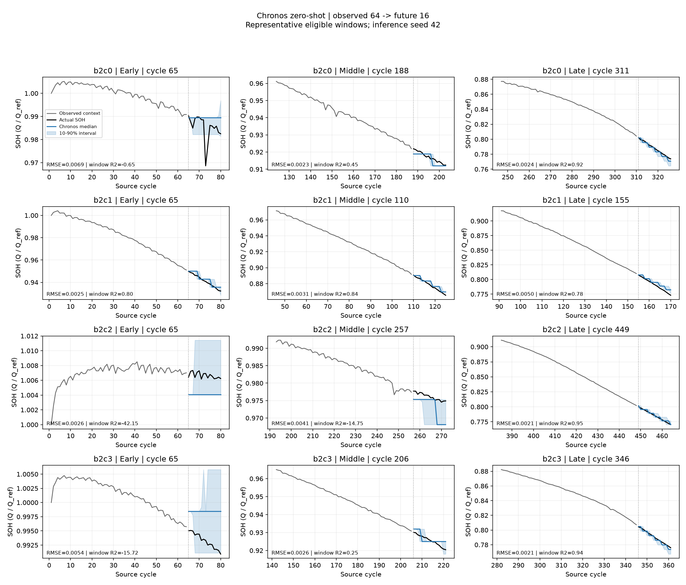

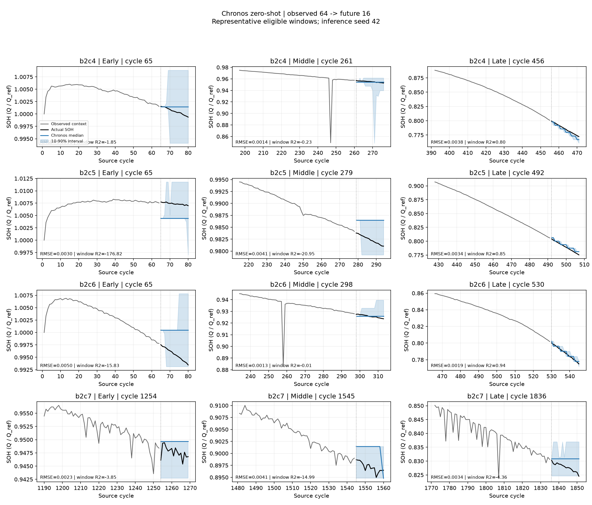

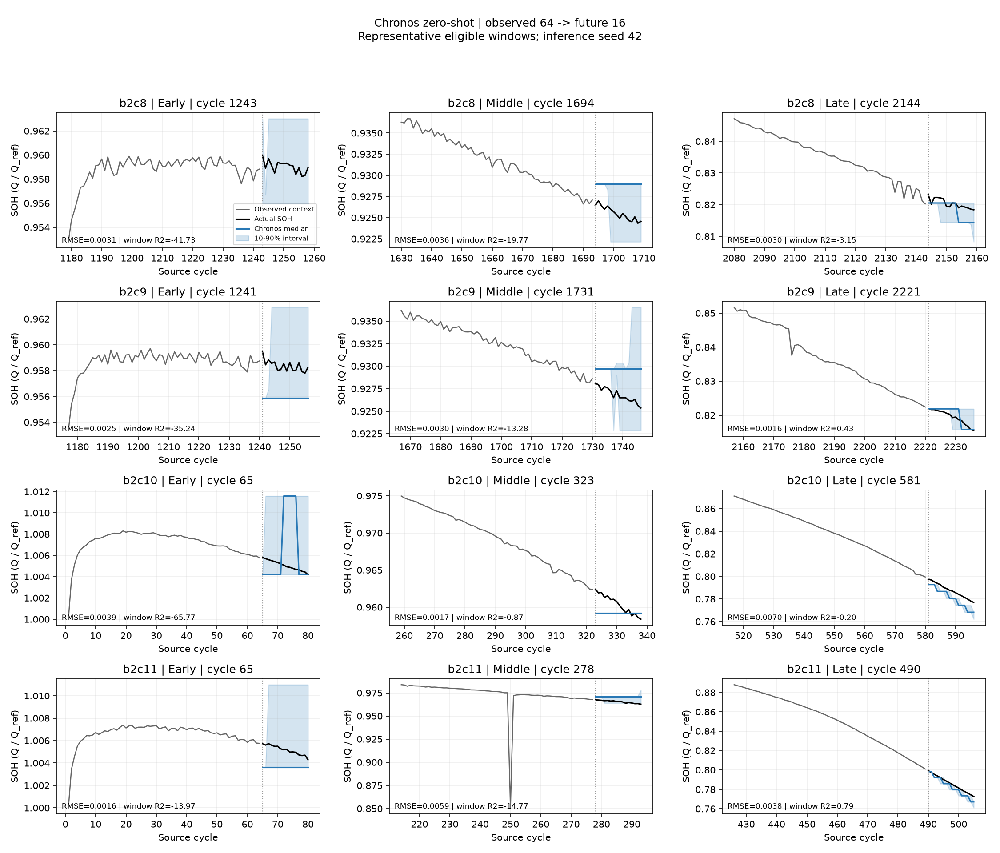

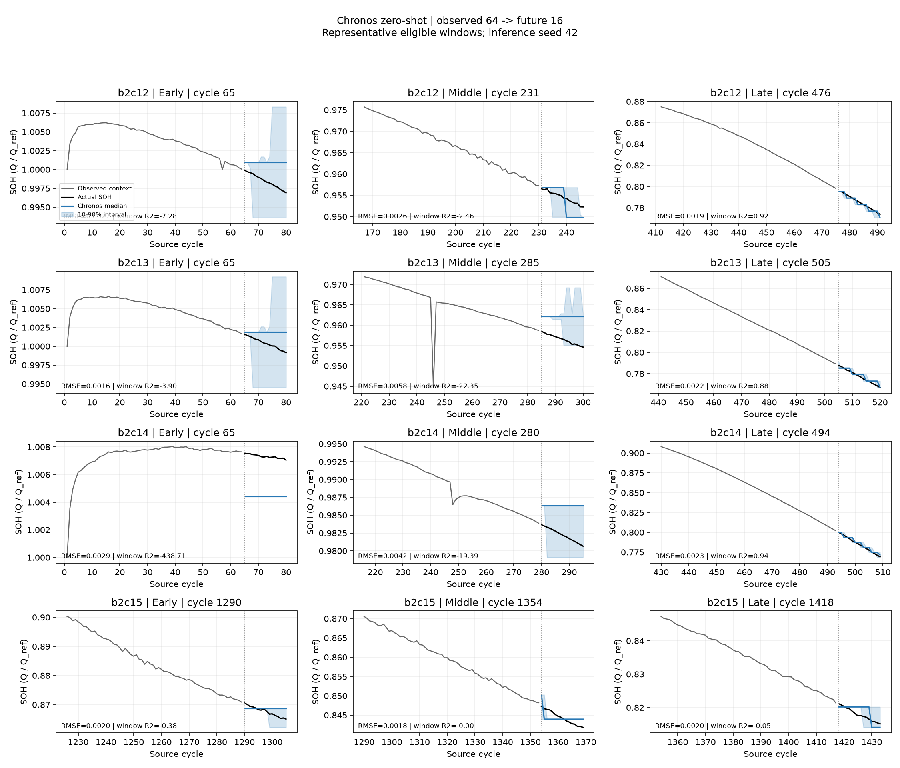

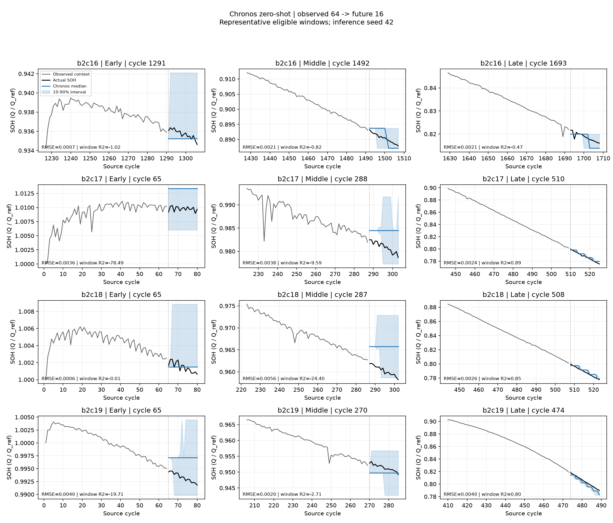

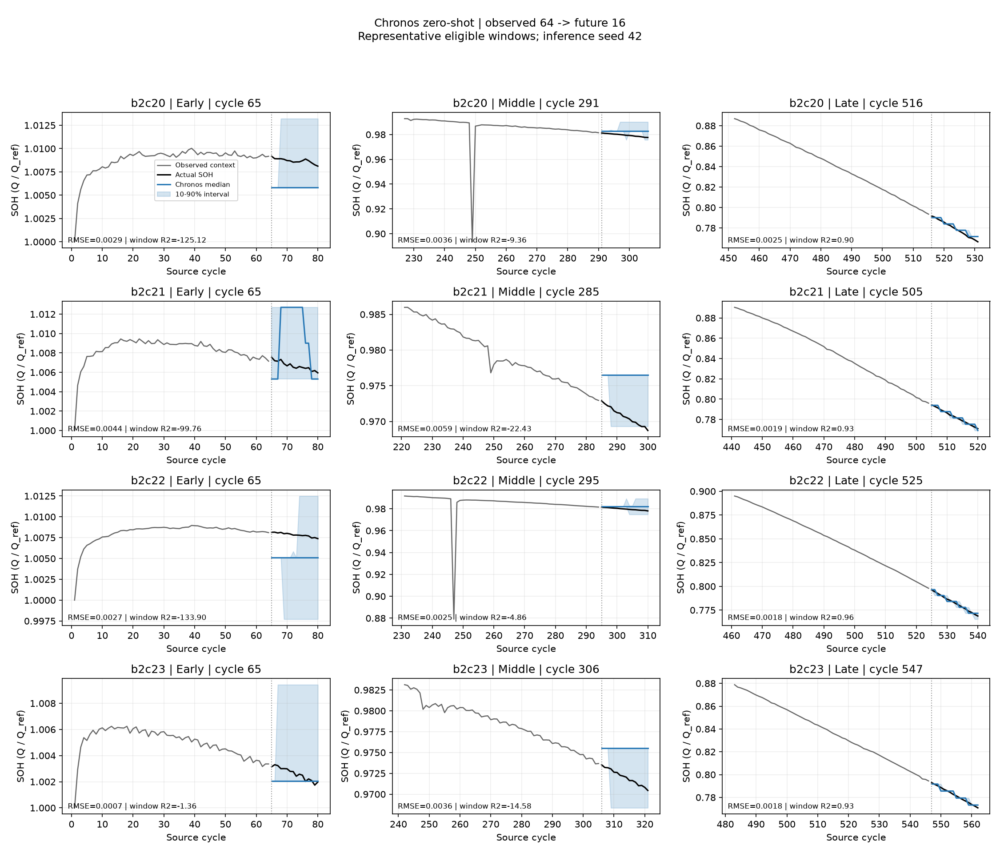

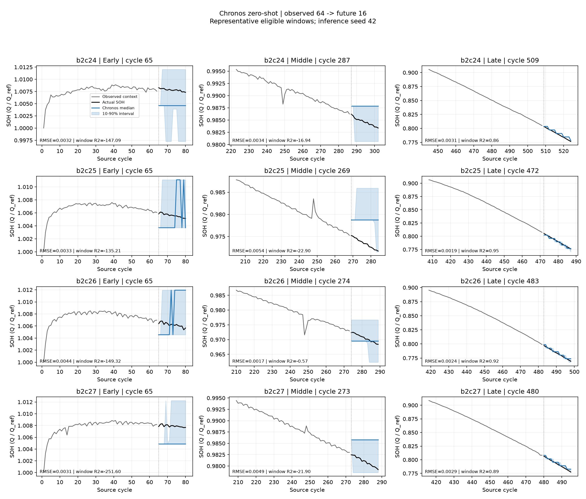

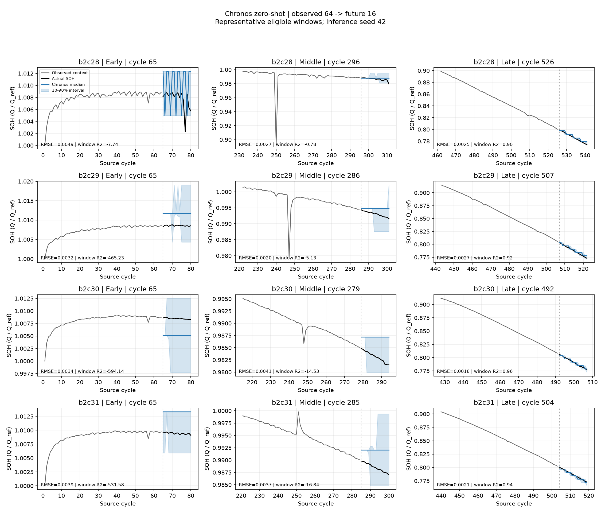

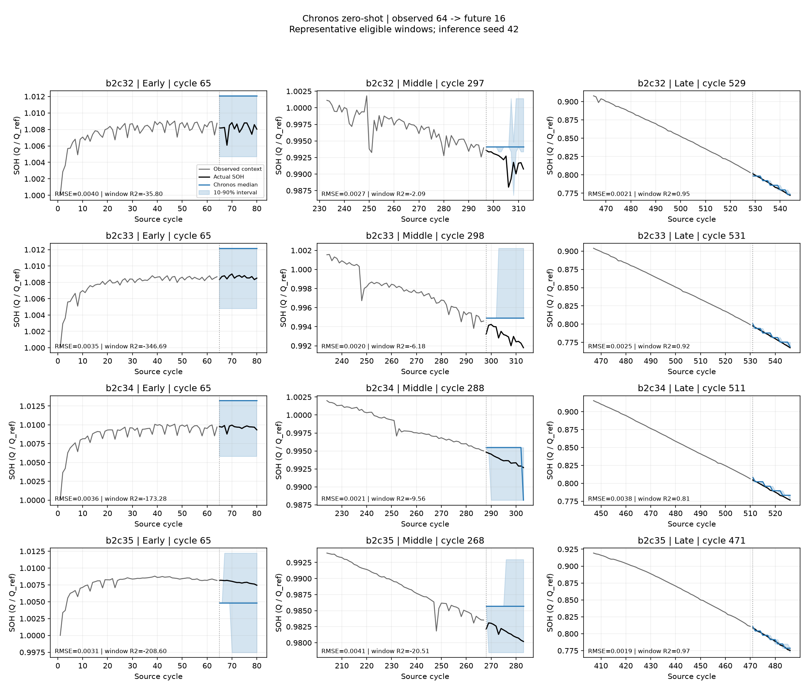

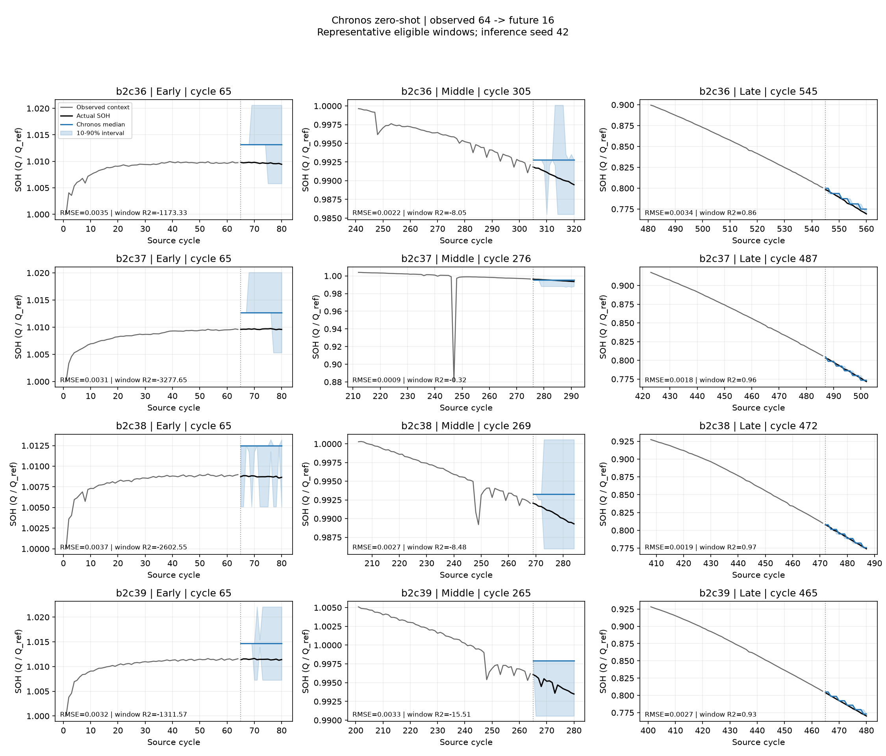

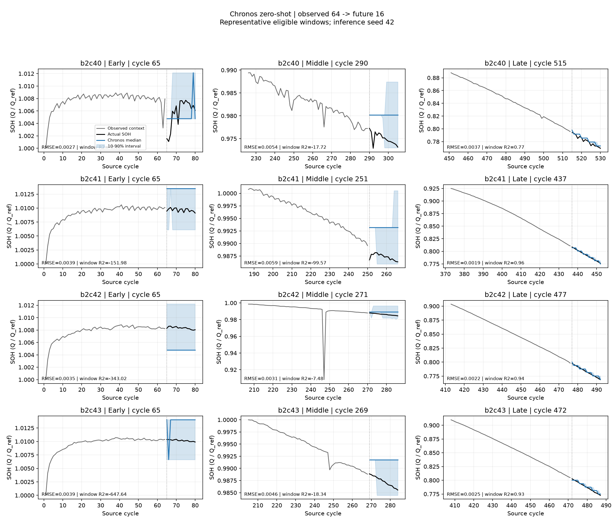

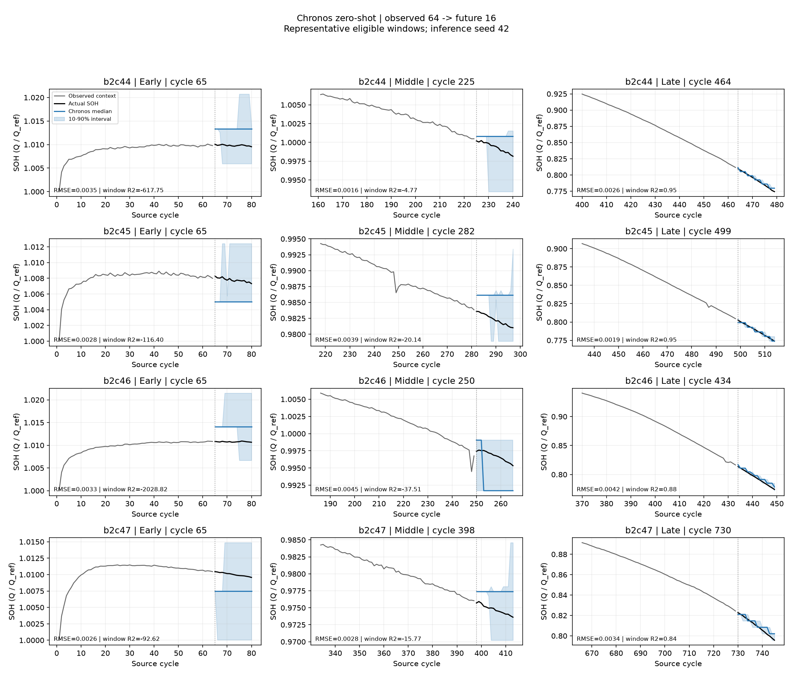
